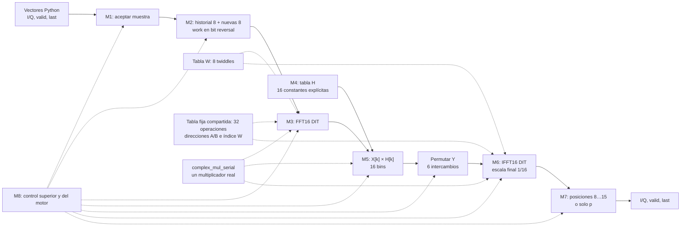
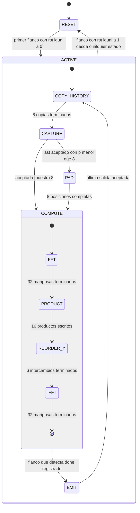

# C01 — Arquitectura RTL del filtro en frecuencia serial

**Estado:** diseño documentado para revisión de C01 y preparación de C02; usa la interfaz propuesta en E03, mantiene la comparación de A03 pendiente y los formatos fijos pendientes de A04. **Consolidación documental:** 12/10/2026. Este documento reúne las decisiones, justificaciones, puertos, bloques, estados y presupuesto de ciclos de la arquitectura serial.

Fuentes: [consigna vigente](consigna-actualizada.md), [contrato técnico](contrato-tecnico.md), contratos de [frecuencia](contratos/frecuencia.md), [señales y formatos](contratos/senales-y-formatos.md), [interfaz RTL](contratos/interfaz-rtl.md) y [verificación y PPA](contratos/verificacion-y-ppa.md), [backlog](backlog.md) y tabla de taps de [config/project.json](../config/project.json). Las decisiones compartidas conservan el estado indicado en esos contratos; documentar esta arquitectura no equivale a aprobarlas ni a cerrar las issues.

## 1. Qué se implementa

El núcleo recibe **muestras complejas ya sobremuestreadas** y calcula `y[n] = Σ(k=0…7) h[k]·x[n−k]`. Procesa una ventana de 16 muestras con ocho anteriores y ocho nuevas: FFT16 → 16 productos por H[k] → IFFT16 → salidas 8…15. Por cada muestra aceptada entrega exactamente una salida con el mismo índice lógico; no emite cola. Un último bloque con p<8 muestras nuevas se rellena con ceros para calcular y entrega solo p resultados.

La primera versión se divide en **tres módulos RTL sintetizables**. La separación sigue las fronteras reales de datos y control:

| Archivo previsto | Módulo | Responsabilidad principal |
|---|---|---|
| `rtl/frequency/fir_frequency_serial.sv` | `fir_frequency_serial` | Interfaz externa, historial de ocho muestras, armado de ventana, longitud de bloque/trama y emisión con pausas. |
| `rtl/frequency/frequency_block_engine.sv` | `frequency_block_engine` | Banco `work` de 16 muestras, FFT, productos por H, permutación, IFFT, constantes H/W, tabla fija de 32 operaciones FFT/IFFT y control local de cálculo. |
| `rtl/frequency/complex_mul_serial.sv` | `complex_mul_serial` | Un producto complejo usando un solo multiplicador real en cuatro pasos; instancia única dentro del motor de bloque. |

M1…M8 son **funciones**, no ocho archivos. M1/M7 y el control de tramas pertenecen al módulo superior; M3…M6 al motor de bloque. La misma mariposa física ejecuta FFT e IFFT en momentos distintos, y ambos modos comparten con el producto espectral la instancia `complex_mul_serial`. H y los twiddles son constantes dentro del motor; no requieren ROM externas. C03/C04 podrán cambiar el paralelismo sin alterar el contrato funcional.

El testbench previsto `tb/frequency/tb_fir_frequency_serial.sv` no forma parte del RTL sintetizable y usará vectores Python inyectados directamente en la entrada. Al crear RTL y testbench, registrar **los tres archivos** como fuentes de la variante en `config/rtl_targets.json`. El generador QPSK, el upsampler y una etapa de salida común no son dependencias RTL de C01/C02 tras el [cierre de R01](https://github.com/EnzoFernandezz11/rrc-fir-rtl/issues/31).

### 1.1 Correspondencia con el FIR temporal

Ambas ramas implementan el FIR complejo causal de ocho taps RRCOS, roll-off 0,5, con `x[n]=0` antes del inicio de la trama. Para el bloque b, la ventana es `w_b[r]=x[8b−8+r]`, r=0…15. La FFT usa exponente negativo sin escala; la IFFT usa exponente positivo y escala total `1/16`. El producto por H produce una convolución circular de 16 posiciones. En las posiciones conservadas r=8…15, todos los taps k=0…7 cumplen `r−k≥1`: no hay envolvimiento circular y el resultado coincide con `y[n]=Σ(k=0…7) h[k]·x[n−k]`, donde `n=8b+r−8`.

La posición 7 también es válida, pero pertenece al tramo anterior y se descarta para mantener un avance de ocho y superposición exacta del 50 %. Aunque basten siete muestras anteriores para un FIR de ocho taps, se conservan ocho por esa elección de bloques.

Los núcleos deben recibir la misma **secuencia de muestras aceptadas**, usar el mismo orden y ganancia de taps, iniciar con historial cero y producir el mismo número de salidas. Con upsampling 2× y sin cola: S símbolos → 2S entradas → 2S salidas. Las pausas y latencias pueden diferir; se compara el índice n, no el ciclo de reloj.

La verificación numérica distingue tres comparaciones:

1. Cada modelo fijo contra la referencia flotante común para medir SQNR.
2. Cada RTL contra las palabras de su modelo fijo, que debe reproducir su aritmética.
3. Las salidas temporal y de frecuencia entre sí con el criterio de A04/D07.

La consigna exige correspondencia, pero no fija tolerancia ni identidad bit a bit entre dominios. A03 cubre la comparación flotante; A04 debe acordar el criterio fijo antes de cerrar la aritmética y demostrar SQNR ≥ 40 dB, incluyendo el error de H, twiddles y operaciones.

### 1.2 Frontera del núcleo y reutilización

M0 queda fuera del RTL de C01: `qpsk()` y `upsample()` de [model/qpsk_rrc.py](../model/qpsk_rrc.py) preparan los vectores con el mapeo común y la secuencia `a[m], 0`. El núcleo recibe muestras, no símbolos. Un cero del upsampling es una muestra válida; una burbuja `valid=0` no inserta ceros ni avanza contadores.

Los testbenches temporal y de frecuencia usan drivers independientes para entregar la misma secuencia aunque los núcleos tengan distintos `ready`. El modelo Python y el banco común A06 reutilizan taps, vectores, índices y métricas; cada núcleo contiene sus propios operadores, memorias y conversiones. Se simulan y sintetizan por separado. Los generadores de vectores, drivers y comparador quedan fuera del núcleo medido para PPA.

## 2. Contratos de los módulos RTL

### 2.1 `fir_frequency_serial`: núcleo e interfaz externa

Los nombres de puertos siguen la propuesta E03 para las cuatro variantes; el nombre del módulo lo define C02. I/Q son componentes **signed** en complemento a dos y viajan juntas. `W_IN=2`, `F_IN=0` es la base de entrada de E02/E03; `W_OUT/F_OUT` y los formatos internos los fijará A04. `F_*` indica bits fraccionarios y no agrega un puerto.

| Parámetro de formato | Valor de trabajo | Estado |
|---|---|---|
| `W_IN`, `F_IN` | 2, 0 | Entrada exacta para −1, 0, +1 según E02/E03. |
| `W_OUT`, `F_OUT` | Por fijar | Resultado externo común de ambos filtros; A04. |
| Anchos de `work`, H, W y productos | Por fijar | Deben soportar FFT sin escala e IFFT escalada al final; A04. |

| Puerto | Dirección | Ancho | Significado |
|---|---|---|---|
| `clk` | Entrada | 1 | Reloj; transferencias en flanco ascendente. |
| `rst` | Entrada | 1 | Reset síncrono activo alto: cancela trabajo y salidas pendientes, limpia contadores e historial en el flanco. |
| `in_i`, `in_q` | Entrada | `W_IN` cada uno | Muestra compleja en formato `W_IN/F_IN`; incluye ceros válidos del sobremuestreo. |
| `in_valid` | Entrada | 1 | La fuente presenta `{in_i, in_q, in_last}`. |
| `in_ready` | Salida | 1 | El núcleo puede aceptar una muestra nueva. |
| `in_last` | Entrada | 1 | Marca la última muestra de una trama; solo cuenta al aceptarse. |
| `out_i`, `out_q` | Salida | `W_OUT` cada uno | Resultado causal ya escalado y convertido a `W_OUT/F_OUT`. |
| `out_valid` | Salida | 1 | Hay un resultado presentado. |
| `out_ready` | Entrada | 1 | El receptor acepta un resultado. |
| `out_last` | Salida | 1 | Marca solo el último resultado de la trama. |

Una entrada se acepta únicamente en el flanco con `rst=0 && in_valid && in_ready`; una salida se entrega únicamente con `rst=0 && out_valid && out_ready`. Si una transferencia está detenida, su productor mantiene `valid`, I/Q y `last` estables. `in_ready=0` durante copia de historial, cálculo y emisión; no hay FIFO ni captura del bloque siguiente mientras se procesa el actual. `in_ready` no depende combinacionalmente de `in_valid` y `out_valid` no depende combinacionalmente de `out_ready`. Con `rst=1`, `in_ready=out_valid=0`; en ese flanco se cancelan el cálculo y las salidas pendientes y se limpia el historial. Al liberar reset comienza `COPY_HISTORY`: se copian ocho posiciones con `in_ready=0` y luego se habilita la entrada en `CAPTURE`. La primera muestra aceptada es `x[0]` de una trama nueva. Una trama vacía consiste en ninguna transferencia y ninguna salida, sin comando especial.

El módulo superior conserva `history[0…7]` en orden temporal. Copia esas ocho muestras al motor y después le entrega hasta ocho muestras nuevas; cada entrada aceptada actualiza su posición de `history`. Si `last` llega antes de completar ocho, entrega ceros al motor hasta cerrar la ventana. Una vez que el motor avisa `done`, lee sus resultados 8…15 y presenta solo las salidas correspondientes a muestras reales. Conserva `out_i/q/last` durante pausas y limpia `history` al terminar una trama. No calcula FFT, H ni productos espectrales.

### 2.2 `frequency_block_engine`: procesamiento de una ventana

Este módulo **posee el único banco `work[0…15]`**. Su interfaz con `fir_frequency_serial` es interna y síncrona; no usa `valid/ready` porque el módulo superior ya controla cuándo puede cargarlo y cuándo empieza el cálculo.

| Puerto | Dirección | Ancho | Contrato |
|---|---|---|---|
| `clk`, `rst` | Entrada | 1 cada uno | Mismo reloj y reset síncrono del núcleo; reset aborta un cálculo en curso y baja `done`. |
| `load_en` | Entrada | 1 | Escribe una muestra en el flanco mientras el motor está libre. |
| `load_index` | Entrada | 4 | Índice **temporal** 0…15; el motor escribe internamente `work[bitrev4(load_index)]`. |
| `load_i`, `load_q` | Entrada | `W_IN` cada uno | Muestra del historial, entrada aceptada o cero de relleno. |
| `start` | Entrada | 1 | Pulso de un ciclo después de cargar los 16 índices; inicia FFT → producto → permutación → IFFT. |
| `done` | Salida | 1 | Pulso registrado de un ciclo: sube después del flanco que escribe el último resultado IFFT. El superior lo detecta en el siguiente flanco y entra en `EMIT`. |
| `result_index` | Entrada | 3 | Selecciona r=0…7, equivalente a `work[8+r]` en orden natural. |
| `result_i`, `result_q` | Salida | `W_OUT` cada uno | Resultado combinacional escalado por `1/16` y convertido al formato externo; estable mientras no cambien `result_index` ni `work`. |

`load_en` y `start` no se activan durante el cálculo; después de `done`, el banco se conserva intacto hasta terminar la emisión. El motor recorre 32 mariposas DIT en FFT, 16 bins en orden natural para `Y[k]=X[k]H[k]`, seis intercambios bit reversal y 32 mariposas DIT en IFFT. Usa una sola instancia `complex_mul_serial` tanto para twiddles como para H. Dos lecturas combinacionales y hasta dos escrituras registradas de `work` permiten escribir los dos resultados de una mariposa o intercambiar una pareja en un ciclo.

Si el último resultado IFFT se escribe en el flanco t, `done=1` durante el ciclo siguiente. En t+1, el superior detecta `done` y entra en `EMIT`, mientras el motor baja `done`. La primera salida puede aceptarse en t+2 si `out_ready=1`. El banco permanece intacto desde t hasta terminar la emisión; reset cancela el pulso y las salidas pendientes.

H y W **no son puertos**: son tablas constantes dentro de `frequency_block_engine`. Los 16 valores explícitos `H[0…15]` se generarán a partir de los taps cuantizados comunes de A04: `H_q = Q_H(DFT16([h_q, 0…0]))`. El motor lee directamente `H[k]`. W contiene ocho twiddles explícitos y cambia el signo imaginario en modo IFFT. Los anchos, la negación de W, el redondeo y la saturación los fija A04 antes de codificar esas constantes.

Primero se cuantizan los ocho taps comunes de E02, cuya fuente es `config/project.json`, y después se genera H desde esos `h_q`. Así ambas ramas parten del mismo filtro cuantizado; los coeficientes ilustrativos de pruebas no reemplazan la tabla común. Guardar las 16 constantes explícitas evita reconstruir H por conjugación durante la lectura.

### 2.3 `complex_mul_serial`: multiplicador compartido

El motor lo invoca para `W·B` en cada mariposa y para `X·H` en cada bin. **No tiene interfaz externa al filtro** ni sabe si opera en FFT, producto espectral o IFFT: recibe ya seleccionado el coeficiente complejo.

| Puerto | Dirección | Ancho | Contrato |
|---|---|---|---|
| `clk`, `rst` | Entrada | 1 cada uno | Reset síncrono aborta el producto y baja `done`. |
| `start` | Entrada | 1 | Pulso cuando está libre; captura ambos operandos. El motor inicia el siguiente producto después de capturar el resultado señalado por `done`. |
| `a_i`, `a_q` | Entrada | `W_A` cada uno | Primer operando complejo signed, en formato `W_A/F_A`. |
| `b_i`, `b_q` | Entrada | `W_B` cada uno | Segundo operando complejo signed, en formato `W_B/F_B`. El motor alinea H y W a esta interfaz. |
| `p_i`, `p_q` | Salida | `W_P` cada uno | Producto complejo registrado con `F_A+F_B` bits fraccionarios, antes del recorte del motor; `W_P ≥ W_A+W_B+1` cubre la suma/resta de dos productos reales. Se mantiene hasta completar otro producto o reset. |
| `done` | Salida | 1 | Pulso registrado de un ciclo, activado junto con `p_i/q` al completar la combinación. El motor captura el producto en el siguiente flanco. |

La unidad usa **un multiplicador real** durante cuatro ciclos para `a_i·b_i`, `a_q·b_q`, `a_i·b_q` y `a_q·b_i`; después registra `p_i = a_i·b_i − a_q·b_q` y `p_q = a_i·b_q + a_q·b_i` junto con `done=1`. Guarda los cuatro productos reales antes de combinarlos. En el siguiente flanco, el motor detecta `done` y captura el producto, mientras el multiplicador baja `done`. El motor aplica el recorte numérico que defina A04, según use el resultado como twiddle o como producto espectral. Ambos módulos anuncian la finalización con un pulso registrado y datos ya estables.

Numerando desde el flanco que acepta `start`: 1 captura operandos; 2…5 registra los cuatro productos reales; 6 registra `p_i/q` y activa `done`; 7 el motor captura el resultado y el multiplicador baja `done`. Para un bin, el motor escribe `Y[k]` en el flanco 7; para una mariposa, registra T en el 7 y escribe `A±T` en el 8. El presupuesto pasa a siete ciclos por bin y ocho por mariposa. `p_i/q` permanece estable hasta completar otro producto; reset invalida el resultado y cancela cualquier operación o pulso pendiente.

### 2.4 Tabla fija de operaciones FFT16/IFFT16

El motor contiene una tabla combinacional de 32 entradas, implementada como un `case` completo dentro de `frequency_block_engine`. Cada entrada entrega `{addr_a, addr_b, w_index}` con anchos de 4, 4 y 3 bits: **352 bits de información constante**, cuyo costo físico depende de la síntesis. Un contador `butterfly_index` de 5 bits selecciona la operación. La tabla es compartida por FFT e IFFT y se reutiliza en cada bloque.

La entrada seleccionada indica leer `A=work[addr_a]`, `B=work[addr_b]` y `W[w_index]`; la mariposa escribe `A+W·B` en `addr_a` y `A−W·B` en `addr_b`. Los valores de A/B y los resultados se calculan con los datos del bloque actual. Las direcciones y los índices de W siguen siempre esta secuencia:

| `butterfly_index` | `addr_a` | `addr_b` | `w_index` |
|---:|---:|---:|---:|
| 0 | 0 | 1 | 0 |
| 1 | 2 | 3 | 0 |
| 2 | 4 | 5 | 0 |
| 3 | 6 | 7 | 0 |
| 4 | 8 | 9 | 0 |
| 5 | 10 | 11 | 0 |
| 6 | 12 | 13 | 0 |
| 7 | 14 | 15 | 0 |
| 8 | 0 | 2 | 0 |
| 9 | 1 | 3 | 4 |
| 10 | 4 | 6 | 0 |
| 11 | 5 | 7 | 4 |
| 12 | 8 | 10 | 0 |
| 13 | 9 | 11 | 4 |
| 14 | 12 | 14 | 0 |
| 15 | 13 | 15 | 4 |
| 16 | 0 | 4 | 0 |
| 17 | 1 | 5 | 2 |
| 18 | 2 | 6 | 4 |
| 19 | 3 | 7 | 6 |
| 20 | 8 | 12 | 0 |
| 21 | 9 | 13 | 2 |
| 22 | 10 | 14 | 4 |
| 23 | 11 | 15 | 6 |
| 24 | 0 | 8 | 0 |
| 25 | 1 | 9 | 1 |
| 26 | 2 | 10 | 2 |
| 27 | 3 | 11 | 3 |
| 28 | 4 | 12 | 4 |
| 29 | 5 | 13 | 5 |
| 30 | 6 | 14 | 6 |
| 31 | 7 | 15 | 7 |

Las filas 0…7, 8…15, 16…23 y 24…31 corresponden a las cuatro etapas DIT. Para regenerar la tabla en Python, recorrer `m=(2,4,8,16)`, luego `base=0,m,…,16−m` y luego `j=0…m/2−1`; cada fila es `(base+j, base+j+m/2, j·16/m)`, con divisiones enteras. Estos cálculos se hacen al generar las constantes. W representa `exp(−j·2πk/16)` para k=0…7; en IFFT se usa su conjugado, con la misma tabla de direcciones. La carga inicial en bit reversal, los seis intercambios antes de IFFT y la escala final `1/16` conservan el orden y la ganancia definidos en §4.

Reset pone `butterfly_index=0`; cada FFT e IFFT comienza también en 0. El contador se mantiene durante la lectura, el producto y la captura de T. Avanza únicamente en el flanco que escribe ambos resultados de la mariposa, el octavo del presupuesto de §2.3. Al terminar la fila 31 permanece en 31 y la FSM pasa a producto espectral o termina la IFFT, según la fase. Fuera de FFT/IFFT la tabla no habilita operaciones. El contador se reinicia antes de la primera mariposa de la siguiente transformada.

La lectura combinacional permite conservar los ocho ciclos por mariposa. La elección simplifica el control para FFT16; cambiar el tamaño o el algoritmo requiere regenerar y verificar la tabla. El efecto sobre área, timing y potencia queda sujeto a síntesis y medición.

## 3. Diagrama de flujo de alto nivel



FFT e IFFT aparecen como dos **fases** del flujo, pero usan el mismo banco `work`, la misma mariposa, la misma tabla W y la misma tabla de operaciones; las flechas del multiplicador indican **un recurso físico compartido**, no tres instancias. El diagrama omite el testbench y los modelos porque quedan fuera del núcleo medido para PPA.

## 4. Ubicación de las funciones M1–M8

Los nombres M1–M8 describen el flujo; esta tabla indica **qué módulo RTL posee cada estado y registro**.

| Función | Módulo RTL responsable | Dato o control que produce |
|---|---|---|
| M1 — recepción | `fir_frequency_serial` | Aceptación `in_valid && in_ready`, muestra y `in_last` registrados para la trama. |
| M2 — historial y ventana | `fir_frequency_serial` + `frequency_block_engine` | El superior conserva `history[0…7]` y cuenta p; el motor carga `work[bitrev4(load_index)]`. |
| M3/M6 — FFT e IFFT | `frequency_block_engine` | Recorre las 32 entradas de la tabla fija con `butterfly_index`, lee A/B/W, forma `A±T` y escribe `work`; usa `complex_mul_serial` para T. |
| M4 — H | `frequency_block_engine` | Entrega directamente `H[k]` desde las 16 constantes explícitas. |
| M5 — producto espectral | `frequency_block_engine` | Lee `X[k]`, solicita `X[k]·H[k]` y escribe `Y[k]` en el mismo índice. |
| Permutación de M6 | `frequency_block_engine` | Intercambia las seis parejas bit reversal antes de IFFT. |
| M7 — emisión | `fir_frequency_serial` | Selecciona r=0…p−1, sostiene `out_valid`, I/Q y `out_last` durante pausas. |
| M8 — control | Superior + motor | El superior secuencia copia/captura/cálculo/emisión; el motor secuencia FFT/producto/permutación/IFFT. |

`bitrev4` invierte los cuatro bits de una dirección, no los bits de I/Q. El superior envía `history[r]` con `load_index=r`, r=0…7, antes de sobrescribir ese historial; después envía cada muestra nueva j con `load_index=8+j` y la guarda en `history[j]`. El motor efectúa el bit reversal al escribir su banco. `work` tiene dos lecturas combinacionales y hasta dos escrituras registradas por ciclo; sus accesos quedan excluidos por fase. Durante la emisión el superior solo cambia `result_index` al aceptarse una salida, de modo que el banco permanece intacto y el resultado presentado se mantiene estable.

La mariposa DIT forma `T=W·B` y escribe `A+T` y `A−T` usando los operandos originales. No se presuponen atajos para twiddles triviales. La FFT deja X en orden natural; M5 sobrescribe cada `X[k]` solo después de leerlo. Los seis intercambios preparan Y en bit reversal para la IFFT, que deja la salida temporal en orden natural. El motor aplica la división total por 16 al leer resultados para M7, con ancho interno suficiente según A04.

## 5. Secuencia de control y casos de trama



`RESET` representa el efecto del reset síncrono en el flanco, no un registro adicional de la FSM. El módulo superior controla `COPY_HISTORY`, `CAPTURE`, `PAD`, `COMPUTE` y `EMIT`; dentro de `COMPUTE`, `frequency_block_engine` controla FFT, producto, permutación e IFFT y devuelve `done`. En `CAPTURE`, p cuenta muestras **ya aceptadas**: permanece en ese estado ante burbujas, pausas o transferencias que aún no completan ocho muestras ni llevan `last`. En `EMIT` permanece hasta que se acepta el último resultado del bloque; el `last` de trama solo determina si se limpia `history` en esa transición. Los contadores de las 32 mariposas, los 16 productos y los seis intercambios son locales al motor.

Tras reset, `history` vale cero y comienza la copia de ocho posiciones con `in_ready=0`. Si la primera copia ocurre en el flanco 1, la octava ocurre en el 8 y la primera entrada puede aceptarse en el 9, ya en `CAPTURE`. En `CAPTURE`, solo `in_valid && in_ready` incrementa el conteo; una burbuja o una pausa no inserta ceros. Si se aceptan ocho muestras sin `last`, se procesa un bloque completo y se conserva el historial nuevo para el siguiente. Si `last` se acepta antes de ocho, `PAD` escribe los `8−p` ceros faltantes sin contarlos como entradas. Si `last` llega en la octava, se procesa un bloque completo y no se crea otro bloque vacío.

En `EMIT`, se leen `work[8]…work[15]` en orden natural o solo `work[8]…work[8+p−1]` para un parcial. El índice avanza solo con `out_valid && out_ready`; una pausa conserva I/Q y `out_last`. `out_last` aparece en la última salida del bloque **solo si** ese bloque cerró la trama. Después de aceptar esa salida, se limpia el historial para la próxima trama; de lo contrario, queda el historial de las ocho muestras nuevas. El núcleo no acepta muestras de la trama siguiente hasta terminar esta emisión y su preparación de ventana.

Ejemplo: si la tercera muestra aceptada lleva `in_last=1`, el núcleo añade cinco ceros internos para calcular la IFFT y entrega exactamente `y[0]`, `y[1]`, `y[2]`; `out_last=1` solo acompaña a `y[2]`. Los ceros de relleno no se presentan como entradas ni generan salidas.

## 6. Recursos, tiempos y verificación prevista

La base usa **un multiplicador real**, una mariposa, 16 registros complejos de trabajo en el motor, ocho de historial en el superior, 16 constantes complejas H, ocho twiddles complejos W y una tabla combinacional de 32×11 bits para las operaciones FFT/IFFT, además de contadores y registros aritméticos. Ninguna fase se solapa con otra y el banco queda protegido durante la emisión. No se presuponen atajos para twiddles triviales.

| Operación | Ciclos ideales | Desglose |
|---|---:|---|
| Copiar historial a `work` en bit reversal | 8 | Una posición por ciclo. |
| Capturar ocho posiciones nuevas | 8 | Una entrada aceptada o un cero de relleno por ciclo. |
| FFT16 | 256 | 32 mariposas × 8 ciclos, según §2.3. |
| Productos espectrales | 112 | 16 bins × 7 ciclos, según §2.3. |
| Permutar Y para la IFFT | 6 | Seis parejas intercambiadas en un ciclo cada una. |
| IFFT16 | 256 | 32 mariposas × 8 ciclos. |
| Enlace motor → emisión | 1 | Detección del `done` registrado, según §2.2. |
| Emitir bloque completo | 8 | Una salida aceptada por ciclo. |

Las fases sin el enlace suman un **subtotal de 654 ciclos**; el enlace agrega un ciclo: **655 ciclos ideales por bloque completo**, desde la primera copia de historial hasta la aceptación de la octava salida. Un parcial de p=1…7 ocupa **647+p ciclos**, pues el relleno completa las ocho posiciones de captura y se emiten p salidas.

Este presupuesto supone entrada disponible, salida siempre lista y ninguna espera adicional en las otras transiciones; incluye la captura de los primeros operandos FFT en el flanco que acepta `start`. Si la implementación agrega ciclos de arranque o de enlace, C02 actualizará las cifras con la simulación. Los 655 ciclos son una estimación de microarquitectura, no una exigencia de optimización ni una medida de timing.

Con la definición de [E03](contratos/interfaz-rtl.md#latencia-y-throughput), el presupuesto ideal de latencia `L` es **639 ciclos** desde la aceptación de una muestra hasta el primer flanco con su resultado válido, incluso para el peor índice del bloque: `x[0]` se acepta en el ciclo 9 y `y[0]` tiene su primer flanco válido en el 648; `x[7]` se acepta en el 16 y `y[7]` en el 655. La última escritura IFFT ocurre en el 646, el superior detecta `done` y entra en `EMIT` en el 647, y la primera salida se acepta en el 648. El intervalo entre aceptaciones es 1 ciclo dentro del bloque y 648 ciclos entre bloques completos; por eso el promedio es **655/8 = 81,875 ciclos por muestra**, con throughput ideal `8·f_clk/655`. A 10 MHz equivale a unas 122 137 muestras/s, sujeto a simulación y timing. Burbujas, backpressure o ciclos adicionales de implementación aumentan la latencia y los intervalos y reducen el throughput.

| Prueba de C02 | Qué debe demostrar |
|---|---|
| `fir_frequency_serial` | Conteo una salida por entrada; dos bloques consecutivos; parcial de 1…7, bloque de 8 y tramas independientes; pausas, `last` y reset sin pérdida ni duplicación. Después de reset, ocho copias con `in_ready=0` antes de aceptar `x[0]`; detectar `done` en t+1 y habilitar la primera aceptación de salida en t+2, según §2.2. |
| `frequency_block_engine` | Carga bit reversal, orden de bins FFT, lectura directa de los 16 valores H, 16 productos, seis intercambios y selección IFFT 8…15. `done` sube después de la última escritura IFFT, dura un ciclo y se limpia con reset; el banco se conserva durante la emisión. |
| Tabla de operaciones FFT/IFFT | Verificar las 32 entradas contra una DFT independiente con ventanas complejas; reutilización en FFT/IFFT y bloques sucesivos. `butterfly_index` comienza en 0, se mantiene hasta la escritura, avanza una vez por mariposa y termina en 31 sin repetir la fila 0. Reset aborta y reinicia el recorrido. |
| `complex_mul_serial` | Cuatro productos reales correctos con signos; `p_i/q` y `done` registrados en el flanco 6 desde `start`, captura por el motor en el 7 y pulso de un ciclo. Resultado estable hasta completar otro producto; operaciones consecutivas y cancelación por reset antes o durante `done`. |
| Integración con el modelo | Impulso y QPSK en fronteras de bloque; coincidencia por palabra con el modelo fijo cuando A04 cierre la aritmética. |

C02 medirá `L`, intervalos de aceptación y throughput en simulación. Para PPA se usará la propuesta E03: Vivado out-of-context sobre Artix-7 `xc7a35tcpg236-1`, con [reloj de 10 MHz](../constraints/clk_10mhz.xdc) para esta variante lenta, `report_utilization`, `report_timing_summary` y `report_power` con SAIF del vector QPSK de A05. Registrar utilización implementada, WNS/Fmax, potencia dinámica/estática y energía por muestra. La CI con Yosys comprueba sintetizabilidad; no produce cifras PPA comparables con este flujo. C03/C04 diseñarán y medirán la optimización frente a esta base serial.

## 7. Dependencias y decisiones pendientes

El [backlog](backlog.md) distingue dependencias para empezar y para cerrar: C01 requiere E01 para empezar y E03/A03 para cerrar; C02 requiere C01 para empezar y A05 para cerrar. Este documento reúne el diseño para revisión, sin dar por cerradas esas dependencias.

| Tarea o decisión | Qué falta o debe conservarse | Consecuencia |
|---|---|---|
| E03 / D03, D05 y D06 | La interfaz y el método PPA integrados por [PR #38](https://github.com/EnzoFernandezz11/rrc-fir-rtl/pull/38) siguen marcados «propuesto» en el contrato y la configuración hasta la revisión conjunta. | Usar `rst` síncrono activo alto, `valid/ready`, `last` y el flujo PPA descritos; el cierre de la issue no equivale por sí solo a aprobar las decisiones compartidas. |
| A03 | Comparar los modelos flotantes temporal y de frecuencia con la tabla común de E02, incluidos bloques completos, parciales y fronteras. | Aporta la evidencia requerida para cerrar C01. |
| A04 / D07 | Fijar anchos y bits fraccionarios de `work`, H, W, productos y salida; cuantización de `h_q`, H y W; recortes, redondeo, saturación y correspondencia entre dominios. Demostrar SQNR ≥ 40 dB sin overflow oculto. | Completar formatos y constantes antes de cerrar la aritmética RTL. La escala IFFT `1/16` al final exige ancho interno suficiente. |
| A05 | Exportar entradas y salidas del modelo fijo con formato reproducible. | Permite el vector matching requerido para cerrar C02. |
| C02 | Implementar y simular el motor, protocolo y bordes; medir latencia y throughput y verificar timing/PPA. | Los 655 ciclos y el reloj de 10 MHz siguen siendo presupuesto y objetivo hasta su medición. |

## 8. Evidencia disponible y límites

El [modelo de frecuencia](../model/frequency.py) representa FFT16/IFFT16 mediante DFT directa en flotante. La [prueba de overlap-save](../tests/test_frequency_overlap_contract.py) lo contrasta con una convolución causal independiente con error absoluto por muestra menor que `1e−10` y longitud exacta de salida. Cubre QPSK con upsampling 2×, tramas vacías/completas/parciales, taps asimétricos y complejos e impulsos en fronteras. Usa la tabla RRC común de A01/E02 y coeficientes de ejemplo para detectar errores de orden.

La evidencia histórica de E01 del 7/10/2026 fue `make smoke` PASS con nueve pruebas Python, incluidas cinco de overlap-save. A03 debe completar la comparación con el [modelo temporal A02](../model/fir_time.py). Los comandos para reproducir la verificación local son:

```sh
python3 -m unittest tests.test_frequency_overlap_contract -v
make smoke
```

Estas pruebas respaldan el algoritmo por bloques; no verifican las 32 operaciones del motor folded DIT, el protocolo RTL por ciclos, los 655 ciclos presupuestados, SQNR ni PPA. El modelo procesa una trama por llamada, de modo que reset e historial entre tramas RTL se comprobarán en C02. Al consolidar este documento, el árbol local no contiene fuentes/testbenches RTL ni modelo fijo y `config/rtl_targets.json` tiene cero variantes: un PASS de `smoke` en ese estado no es vector matching de hardware.
