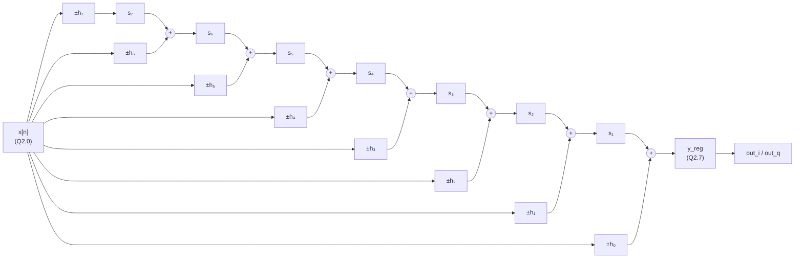

# B03 — Arquitectura RTL del filtro temporal optimizado

- **Issue:** [B03 (#16)](https://github.com/EnzoFernandezz11/rrc-fir-rtl/issues/16)
- **Responsable:** @moreyrajulian
- **Revisa:** @andres332271
- **Contratos:** [interfaz RTL](contratos/interfaz-rtl.md) (E03), [señales y formatos](contratos/senales-y-formatos.md) (E02, A04), [verificación y PPA](contratos/verificacion-y-ppa.md) (D05, D06)
- **Decisión:** D08 en el [contrato técnico](contrato-tecnico.md#2-registro-de-decisiones-de-etapa-0)

Este documento elige la implementación paralela del FIR temporal que B04 lleva a RTL y predice su compromiso PPA frente a la base serial de [B01](arquitectura-rtl-tiempo-serial.md)/B02. No contiene RTL ni cifras medidas: las cifras de Vivado salen de A07.

## 1. Qué se pide y qué se mejora

La consigna pide, después de la versión serial, «una implementación paralela utilizando alguna de las alternativas disponibles (pipeline, sistólica, folded u otra equivalente), con el objetivo de analizar las mejoras obtenidas en términos de desempeño». El eje PPA elegido es, por lo tanto, el **desempeño**: throughput `f_clk / II`, a costa de área.

La variante optimizada es la **rápida**: debe cerrar timing a **100 MHz** ([`constraints/clk_100mhz.xdc`](../constraints/clk_100mhz.xdc), período 10 ns, WNS ≥ 0), mientras que la serial es lenta y se mide a 10 MHz ([§1 del contrato técnico](contrato-tecnico.md#mínimos-adicionales-confirmados-por-enzo-el-7102026)). El throughput sube por las dos vías a la vez: menos ciclos por muestra (`II`) y más ciclos por segundo (`f_clk`).

Sigue igual todo lo que fija el contrato: la función `y[n] = Σ(k=0..7) h[k]·x[n−k]` para cualquier entrada en {−1, 0, +1}, la interfaz y sus 7 reglas, los formatos de A04 y la coincidencia palabra por palabra con `fir_time_fxp` (columnas `yt` de [vectors/](../vectors/README.md)).

## 2. Alternativas consideradas

| Alternativa | `II` | `L` | Camino crítico | Registros (I+Q) | Sumadores (I+Q) | Resultado |
|---|---:|---:|---|---:|---:|---|
| Serial de B01/B02 (referencia) | 10 | 9 | Selección + 1 suma de 9 bits | 56 | 2 | Base de comparación. |
| Folded por 4 con simetría | 6 | 5 | Presuma + selección + 1 suma | ≈ 60 | 4 | Descartada: mejora `II` solo 1,7× y mantiene FSM y contador. |
| Paralela directa, sin pipeline | 1 | 1 | Selección + árbol de 3 sumas | ≈ 51 | 14 | Descartada: el árbol es el camino más largo y crece con los taps. |
| Directa con simetría y árbol pipelineado | 1 | 3 | Presuma + selección o 1 suma | ≈ 120 | 14 (8 de 3 bits) | Alternativa válida: la simetría reduce las selecciones de 8 a 4 por componente, pero suma `L` y control de pipeline con backpressure. |
| **Sistólica en forma transpuesta** | **1** | **1** | **Selección + 1 suma de 9 bits** | **≈ 146** | **14** | **Elegida.** |
| Sistólica pura (entrada con dos registros por celda) | 1 | ≈ 8 | Selección + 1 suma | ≈ 210 | 14 | Descartada: con 8 taps y entrada de 2 bits la difusión de `x` no limita, y agrega registros y latencia. |

Los registros y sumadores son estimaciones de diseño con anchos uniformes de 9 bits para sumas parciales; las cifras reales salen de Vivado.

**Descartadas por el contrato, no por desempeño:**

- **Aprovechar los ceros del 2×.** Con el upsampler, una de cada dos muestras es cero, pero la regla 4 de la [interfaz](contratos/interfaz-rtl.md#reglas-por-ciclo) exige `y[n] = Σ h[k]·x[n−k]` para cualquier entrada, y [`vectors/extremos_tiempo.txt`](../vectors/extremos_tiempo.txt) usa muestras ±1 consecutivas para llevar la salida a ±234. Un diseño que asuma ceros alternados no pasaría el vector matching de B04.
- **Historial circular en lugar de mux 8:1** (sugerencia de la review de #44). Ahorra área en la serial, pero no paraleliza: no responde a la consigna.

## 3. Arquitectura sistólica en forma transpuesta

Una arquitectura **sistólica** es un arreglo de **celdas de procesamiento** (PE) idénticas y simples, conectadas solo con sus vecinas, por las que los datos avanzan un paso por ciclo de reloj. En la **forma transpuesta** del FIR, en lugar de guardar las últimas 8 muestras y sumar 8 productos cada vez, se guardan **sumas parciales**: cada muestra nueva se multiplica a la vez por los 8 coeficientes, y cada producto se suma a la suma parcial que llega de la celda vecina.

Con `s₈ = 0`, al aceptar `x[n]`:

```
y[n]     = h[0]·x[n] + s₁
s_k     ← h[k]·x[n] + s_{k+1}     k = 1…6
s₇      ← h[7]·x[n]
```

Desarrollando la recursión, `s₁` contiene `h[1]·x[n−1] + h[2]·x[n−2] + … + h[7]·x[n−7]`: es exactamente lo que le falta a `h[0]·x[n]` para dar `y[n]`. Cada suma parcial `s_k` es la contribución de las muestras pasadas a una salida futura.



El diagrama muestra una componente; I y Q son dos arreglos idénticos que comparten la habilitación y el control.

| Bloque | Función |
|---|---|
| Selección `±h_k` | Con `x = +1` pasa `h_q[k]`, con `x = −1` pasa `−h_q[k]`, con `x = 0` pasa 0. Igual que en B01: sin multiplicador. |
| Celda `k` (`k = 1…6`) | Un sumador y un registro: `s_k ← ±h_k + s_{k+1}`. |
| Celda 7 | Solo registro: `s₇ ← ±h₇`. |
| Celda de salida | `y_reg ← ±h₀ + s₁`. Es el registro de salida: `out_i = y_reg_I`, `out_q = y_reg_Q`. |
| Control | Dos registros de 1 bit: `out_valid` y `out_last`. No hay FSM ni contador de taps. |

### Anchos

Todo es entero y exacto, como en B01: no hay redondeo ni saturación. Cada suma parcial está acotada por la suma de los `|h_q|` que contiene, que es como máximo Σ|h_q| = 234 < 256, así que **9 bits con signo alcanzan para todas** (Q2.7, el mismo formato de A04).

| Registro | Cota | Bits necesarios |
|---|---:|---:|
| `s₁` | 233 | 9 |
| `s₂` | 219 | 9 |
| `s₃` | 205 | 9 |
| `s₄` | 117 | 8 |
| `s₅` | 29 | 6 |
| `s₆` | 15 | 5 |
| `s₇` | 1 | 2 |
| `y_reg` | 234 | 9 |

La propuesta es usar `W_ACC = 9` en todas (más simple y parametrizable). Ajustar cada ancho a su cota ahorraría 30 FF; queda como mejora opcional de B04 si el área lo justifica.

### Ejemplo: el impulso viaja por las sumas parciales

Componente I de [`vectors/impulso.txt`](../vectors/impulso.txt): `x = 1, 0, 0, …`. Valores después de cada aceptación:

| Muestra aceptada | `y` (sale en el ciclo siguiente) | `s₁` | `s₂` | `s₃` | `s₄` | `s₅` | `s₆` | `s₇` |
|---|---:|---:|---:|---:|---:|---:|---:|---:|
| `x[0] = 1` | 1 | −14 | 14 | 88 | 88 | 14 | −14 | 1 |
| `x[1] = 0` | −14 | 14 | 88 | 88 | 14 | −14 | 1 | 0 |
| `x[2] = 0` | 14 | 88 | 88 | 14 | −14 | 1 | 0 | 0 |
| `x[3] = 0` | 88 | 88 | 14 | −14 | 1 | 0 | 0 | 0 |

Con `x[0] = 1` cada celda carga su coeficiente, y con cada cero siguiente la cadena se corre un lugar hacia la salida: `y` recorre `1, −14, 14, 88, 88, 14, −14, 1`, los `h_q` de A04, que es la columna `yt_i` del vector.

## 4. Interfaz y control

`II = 1` obliga a manejar el backpressure en todo el arreglo: si el receptor no toma `y[n]`, ninguna suma parcial puede avanzar. Toda la ruta de datos avanza con una sola habilitación, la aceptación de entrada.

| Señal | Definición |
|---|---|
| `acepta` | `in_valid && in_ready` |
| `in_ready` | `!rst && (!out_valid_r || out_ready)`: hay lugar si el registro de salida está vacío o se vacía en este mismo flanco. |
| `out_valid` | `out_valid_r && !rst`, registrado. |
| `out_valid_r` | Con `acepta` pasa a 1; si no, con `out_ready` pasa a 0; si no, se mantiene. |
| `s_k`, `y_reg`, `out_last` | Se actualizan solo con `acepta`. |

| Regla de [E03](contratos/interfaz-rtl.md#reglas-por-ciclo) | Cómo la cumple |
|---|---|
| 1. Transferencia | Todo registro de datos avanza solo con `in_valid && in_ready`; la salida se entrega con `out_valid && out_ready`. |
| 2. Sostener | Con `out_valid = 1` y `out_ready = 0`, `in_ready = 0`: no hay `acepta` y `y_reg` no cambia. |
| 3. Sin dependencia circular | `in_ready` no depende de `in_valid`, y `out_valid` sale de un registro, sin depender de `out_ready`. `in_ready` sí depende combinacionalmente de `out_ready`, lo que la regla 3 no prohíbe. |
| 4. Conteo | Cada aceptación carga exactamente un `y_reg`, que se entrega una vez. Sin cola. |
| 5. Trama | Al aceptar una muestra con `in_last`, `y_reg` recibe su resultado y **todas las `s_k` pasan a 0 en el mismo flanco**: la muestra siguiente es `x[0]` de una trama nueva con historial cero, sin bajar `in_ready`. |
| 6. Reset | `s_k`, `y_reg`, `out_valid_r` y `out_last` a cero; `in_ready = out_valid = 0` mientras `rst = 1`. |
| 7. Burbujas | Sin `in_valid` no hay `acepta` y las `s_k` no cambian; el registro de salida se vacía si el receptor lo toma. |

**Riesgo para B04:** el camino `out_ready → in_ready → acepta → habilitación` llega a los ~146 FF. Es legal, pero si Vivado no cierra timing a 100 MHz por esa habilitación, la alternativa es un registro de salida de dos posiciones (*skid buffer*), que deja `in_ready` registrado a cambio de ~19 FF y un ciclo más de `L` en el peor caso. Si B04 lo incorpora, hay que volver a verificar `L`, backpressure, `last`, reset y timing, porque cambia el comportamiento por ciclo descrito en esta sección.

### Secuencia por ciclo

Trama de cuatro muestras, con backpressure, burbuja y una trama nueva a continuación (`L = 1`, `II = 1`). `↑` marca una transferencia.

| Ciclo | `rst` | `in_valid` | `in_ready` | Entrada | `out_valid` | `out_ready` | Salida | Qué pasa |
|---:|:-:|:-:|:-:|---|:-:|:-:|---|---|
| 0 | 1 | 0 | 0 | — | 0 | 1 | — | Reset. |
| 1 | 0 | 1 | 1 | `x[0]` ↑ | 0 | 1 | — | Acepta `x[0]`. |
| 2 | 0 | 1 | 1 | `x[1]` ↑ | 1 | 1 | `y[0]` ↑ | Entrega `y[0]` y acepta `x[1]` en el mismo flanco. |
| 3 | 0 | 1 | 0 | `x[2]` | 1 | 0 | `y[1]` | El receptor no toma `y[1]`: `in_ready = 0` y el productor sostiene `x[2]`. |
| 4 | 0 | 1 | 1 | `x[2]` ↑ | 1 | 1 | `y[1]` ↑ | Se liberan los dos lados. |
| 5 | 0 | 0 | 1 | — | 1 | 1 | `y[2]` ↑ | Burbuja de entrada: las `s_k` no cambian. |
| 6 | 0 | 1 | 1 | `x[3]`, `last` ↑ | 0 | 1 | — | Acepta la última muestra; las `s_k` pasan a 0. |
| 7 | 0 | 1 | 1 | `x[0]` ↑ | 1 | 1 | `y[3]`, `last` ↑ | Entrega el fin de trama y acepta la primera muestra de la trama siguiente. |

## 5. Predicción PPA frente a la serial

| Métrica | B02 serial | B04 sistólica (predicción) | Cambio esperado |
|---|---|---|---|
| Reloj objetivo | 10 MHz | 100 MHz | ×10 |
| `II` | 10 ciclos (medido) | 1 ciclo | ÷10 |
| `L` | 9 ciclos (medido) | 1 ciclo | ÷9 |
| Throughput a igual reloj | `f_clk / 10` | `f_clk / 1` | **×10**, por arquitectura (`II`) |
| Throughput con el reloj objetivo de cada variante | 1 Msample/s (10 MHz) | 100 Msample/s (100 MHz) | ×100: ×10 por `II` y ×10 por el reloj asignado |
| Registros | 56 FF estimados (63 en Yosys) | ≈ 146 FF | ≈ ×2,6 |
| Sumadores | 2 de 9 bits | 14 de 9 bits | ×7 |
| Mux de muestras | 2 × 8:1 | Ninguno (no hay historial de muestras) | — |
| Control | FSM de 3 estados + contador de 3 bits | 2 FF | Más simple |
| DSP48 / BRAM | 0 / 0 | 0 / 0 | Igual |
| Camino crítico | Selección + suma de 9 bits, con 100 ns de período | Selección + suma de 9 bits + habilitación, con 10 ns | Debe entrar en 10 ns |
| Potencia dinámica | Baja | Mayor: más registros conmutando y reloj ×10 | Aumenta |
| Energía por muestra | `P / 1 Msample/s` | `P / 100 Msample/s` | Sin predicción firme; A07 la mide con SAIF |

**Compromiso:** la arquitectura gana ×10 en throughput a igual reloj y ÷9 en latencia, a cambio de unas 2,6 veces más registros y 7 veces más sumadores, todos pequeños (9 bits) y sin DSP. El ×100 con los relojes objetivo incluye otro ×10 que no viene del diseño sino de medir la serial a 10 MHz y la sistólica a 100 MHz. El camino crítico de la serial también es corto (selección + suma de 9 bits), así que es posible que la serial cierre a 100 MHz; por eso la comparación de arquitecturas se hace con el throughput máximo `Fmax / II` de cada una (sección 6). La serial ocupa casi todos sus ciclos en recorrer el historial; la sistólica hace el mismo trabajo aritmético en un ciclo, repartido en 8 celdas. Por eso es razonable esperar una energía por muestra similar o menor, pero esa hipótesis solo la confirma la medición de A07.

**Evidencia de la propuesta:** [`model/fir_time_systolic.py`](../model/fir_time_systolic.py) simula ciclo a ciclo estas ecuaciones y el handshake de la sección 4, con productor y receptor que pausan. `python3 -m model.fir_time_systolic` da coincidencia exacta con `yt` y `last` en los cinco vectores smoke y en `qpsk_s1` (2474 muestras), ideal y con pausas, `L = 1` e `II = 1` en todas las muestras del modo ideal y ninguna suma parcial fuera de 9 bits. Verifica la propuesta, no el RTL de B04 ni su timing.

## 6. Qué verifica B04

- Mismo testbench de B02 adaptado al nuevo módulo, con `L = 1` e `II = 1` esperados: los 5 vectores smoke ideal y con pausas, salida estable (regla 2), reset en medio de trama (regla 6) y la regresión `qpsk_s1` con `+regresion`. El reset en medio de trama se prueba con el arreglo lleno, para que cualquier `s_k` que no se limpie aparezca en `impulso.txt`.
- Registro en [`config/rtl_targets.json`](../config/rtl_targets.json) con `architecture: "optimized"` y script Yosys.
- Síntesis Vivado a 100 MHz con WNS ≥ 0 y cifras comparables con B02 en las condiciones de [D05/D06](contratos/verificacion-y-ppa.md#ppa), cuando A07 haga la corrida temporal.
- Comparación con B02 en las mismas condiciones (`CONTRIBUTING.md`): además del cumplimiento del reloj objetivo de cada variante, el throughput máximo `Fmax / II`, con `Fmax = 1 / (T − WNS)` del contrato de verificación, y la energía por muestra, que el contrato define para comparar variantes con relojes distintos. La relación entre los throughputs máximos es la mejora atribuible a la arquitectura.

- En la rama en frecuencia el throughput se calcula como `8 × f_clk / II_bloque` ([interfaz](contratos/interfaz-rtl.md#latencia-y-throughput)): el `II` por bloque de C02/C04 no se compara directamente con el `II` por muestra de B02/B04, sino el throughput resultante.

**Seriales a 100 MHz, acordado en la revisión de #49:** el Fmax de una corrida a 10 MHz puede ser pesimista, porque con un reloj holgado Vivado no optimiza velocidad. A07 corre también B02 y C02 con período de 10 ns, con implementación y timing, como dato adicional: no reemplaza la medición oficial a 10 MHz, responde si la serial también llegaría a 100 MHz y separa la ganancia de la arquitectura de la del reloj asignado. Las condiciones de cada corrida quedan identificadas.

## 7. Dependencias y fuera de alcance

| Tema | Estado | Consecuencia |
|---|---|---|
| B02 | Integrada en [#45](https://github.com/EnzoFernandezz11/rrc-fir-rtl/pull/45) | Base de comparación y testbench a reutilizar. |
| A04 (D04) | Integrada, decisión «propuesto» | Si cambian los bits fraccionarios, cambian `W_COEF`/`W_ACC` y la tabla `h_q`, no la arquitectura. |
| A06 | En curso | B04 cierra después de A06 (backlog). |
| A07 | En curso; `run.tcl` parametrizado desde #47; falta la corrida temporal | Las cifras PPA de B02 y B04 dependen de esa corrida. |

Quedan fuera de B03 el RTL y el testbench (B04), las cifras PPA medidas (A07) y la optimización en frecuencia (C03). El nombre de módulo propuesto es `fir_time_systolic`; B04 lo confirma.
