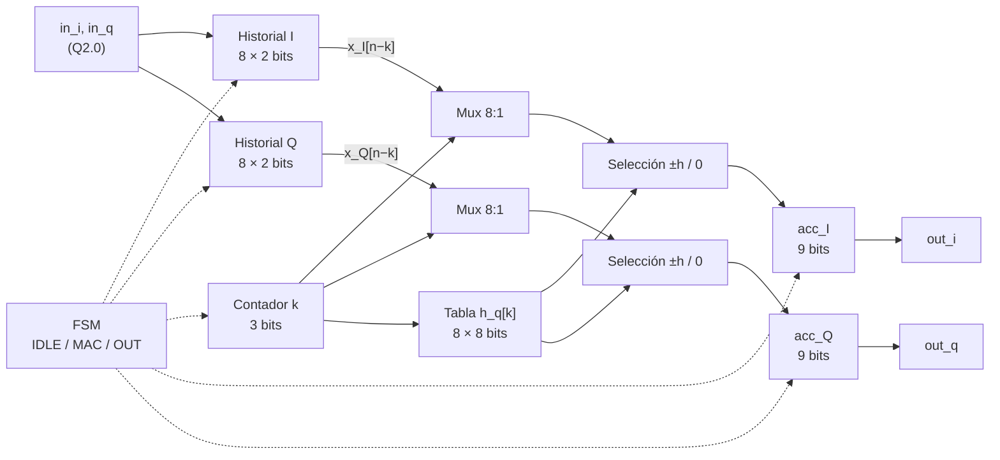
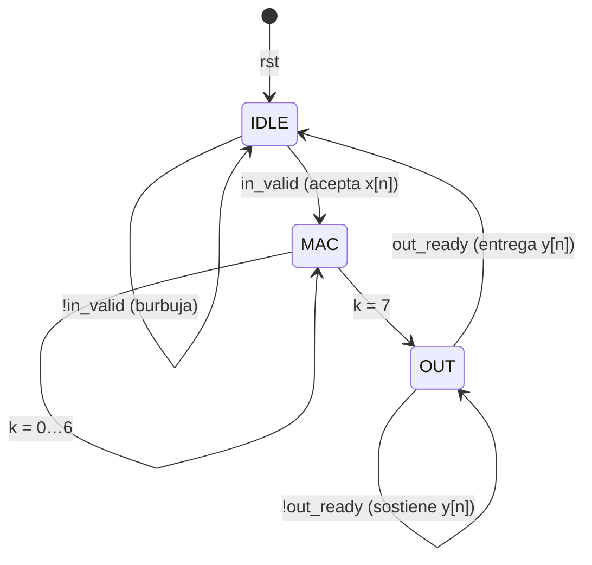

# B01 — Arquitectura RTL del filtro temporal serial

- **Issue:** [B01 (#11)](https://github.com/EnzoFernandezz11/rrc-fir-rtl/issues/11)
- **Responsable:** @moreyrajulian
- **Revisa:** @andres332271
- **Contratos:** [interfaz RTL](contratos/interfaz-rtl.md) (E03), [señales y formatos](contratos/senales-y-formatos.md) (E02, A04)

Este documento fija la arquitectura que B02 lleva a RTL: diagrama de bloques, máquina de estados, recursos y cronograma de ciclos. Es la base funcional contra la que B03/B04 miden la optimización, por eso prioriza la simplicidad sobre el desempeño.

## 1. Qué se implementa

El núcleo calcula `y[n] = Σ(k=0..7) h[k]·x[n−k]` con los ocho coeficientes de E02 y la interfaz de E03. **Serial** significa que recorre los ocho taps de a uno, un tap por ciclo, con una sola unidad de acumulación por componente.

Dos propiedades de la consigna simplifican el datapath:

1. **Coeficientes reales sobre datos complejos.** I y Q no se mezclan: `y_I = Σ h·x_I` e `y_Q = Σ h·x_Q`. El núcleo es dos FIR reales idénticos que comparten control, contador de tap y tabla de coeficientes. Se procesan en paralelo, con un acumulador cada uno.
2. **Entrada en {−1, 0, +1}.** El producto `h[k]·x` es `+h[k]`, `−h[k]` o `0`: una selección y una negación, sin multiplicador. El producto es exacto y el acumulador no necesita redondeo (A04).

El módulo propuesto es `fir_time_serial`; B02 confirma el nombre. No incluye generador QPSK ni interpolador: el testbench inyecta los vectores de A05 directamente en la interfaz.

## 2. Diagrama de bloques

| Bloque | Función |
|---|---|
| Historial I/Q | Registro de desplazamiento: posición `k` guarda `x[n−k]`. Al aceptar una muestra, entra en la posición 0 y el resto corre un lugar; la posición 7 se descarta. |
| Mux 8:1 | Elige `x[n−k]` según el contador. |
| Contador `k` | Recorre los taps 0…7 durante `MAC`. |
| Tabla `h_q[k]` | Coeficientes cuantizados, constantes de síntesis (lógica combinacional, sin memoria). |
| Selección ±h / 0 | Con `x = +1` pasa `h_q[k]`, con `x = −1` pasa `−h_q[k]`, con `x = 0` pasa 0. |
| `acc_I`, `acc_Q` | Acumuladores. Al terminar los ocho taps contienen `y[n]` y funcionan además como registros de salida: `out_i = acc_I`, `out_q = acc_Q`. |
| FSM | Control del handshake, del contador y de la trama (sección 4). |

## 3. Formatos

Los anchos son los de A04, integrado en [#41](https://github.com/EnzoFernandezz11/rrc-fir-rtl/pull/41) con la decisión D04 en estado «propuesto» ([formatos de punto fijo](contratos/senales-y-formatos.md#formatos-de-punto-fijo-a04)). B02 los declara como parámetros (`W_COEF`, `W_ACC`) para absorber un cambio de A04 sin rediseñar.

| Nodo | Formato | Bits | Rango | Corte |
|---|---|---:|---|---|
| Entrada I/Q | Q2.0 | 2 | {−1, 0, +1} | Exacta (E02) |
| Coeficientes `h_q[k] = round(h[k]·128)` | Q1.7 | 8 | `[1, −14, 14, 88, 88, 14, −14, 1]` | Offline |
| Término `±h_q[k]` | Q1.7 | 8 | \|término\| ≤ 88 | Exacto |
| Acumulador y salida | Q2.7 | 9 | \|y\| ≤ Σ\|h_q\| = 234 (1,83) | Exacto, sin redondeo ni saturación |

Cada suma parcial está acotada por la misma suma Σ|h_q| = 234 < 256, de modo que el acumulador de 9 bits no desborda en ningún paso. La entrada `−2` (código `10`) no pertenece al contrato y no se considera en el diseño.

## 4. Máquina de estados

`rst = 1` lleva a `IDLE` desde cualquier estado.

| Estado | `in_ready` | `out_valid` | Acción en el flanco |
|---|:-:|:-:|---|
| `IDLE` | 1 | 0 | Con `in_valid`: desplaza el historial con `x[n]`, pone `acc = 0`, `k = 0`, guarda `in_last` y pasa a `MAC`. Sin `in_valid`: nada cambia. |
| `MAC` | 0 | 0 | `acc += ±h_q[k]` para I y Q; `k += 1`. Con `k = 7` pasa a `OUT`. |
| `OUT` | 0 | 1 | Con `out_ready`: entrega `y[n]` con `out_last` igual al `last` guardado y vuelve a `IDLE`. Si era el último de la trama, pone el historial en cero en ese mismo flanco. |
| Reset | 0 | 0 | Historial, acumuladores, `k` y `last` guardado a cero; estado `IDLE`. |

`in_ready` y `out_valid` salen del estado registrado y se fuerzan a 0 con `rst = 1`. No dependen de `in_valid` ni de `out_ready`. Son 3 estados: 2 bits de estado.

## 5. Cronograma de ciclos

Con entrada siempre disponible y `out_ready = 1`, cada muestra recorre 10 ciclos:

| Ciclo relativo | Estado | Qué pasa |
|---:|---|---|
| 0 | `IDLE` | Se acepta `x[n]` en el flanco. |
| 1…8 | `MAC` | Un tap por ciclo, `k = 0…7`, en I y Q a la vez. |
| 9 | `OUT` | `out_valid = 1` con `y[n]`; se entrega en el flanco. |
| 10 | `IDLE` | Se acepta `x[n+1]`. |

| Medida | Valor | Cálculo |
|---|---|---|
| Latencia `L` | 9 ciclos | Del flanco que acepta `x[n]` (ciclo 0) al primer flanco con `out_valid = 1` (ciclo 9). |
| Intervalo `II` | 10 ciclos | 1 de aceptación + 8 de MAC + 1 de entrega. |
| Throughput | `f_clk / 10` | A 10 MHz, 1 Msample/s. |

Son cifras ideales: burbujas y `out_ready = 0` alargan el intervalo sin cambiar valores. La variante es lenta y se mide con el reloj de 10 MHz de [D05](contratos/verificacion-y-ppa.md#ppa). B02 mide `L` e `II` en simulación. La secuencia con reset, backpressure, burbuja y `last` está en la [interfaz RTL](contratos/interfaz-rtl.md#secuencia-de-b01-temporal-serial).

## 6. Recursos

| Recurso | Cantidad | Bits |
|---|---|---:|
| Historial I/Q | 2 × 8 registros de 2 bits | 32 FF |
| Acumuladores (y salida) | 2 × 9 bits | 18 FF |
| Contador `k` | 1 × 3 bits | 3 FF |
| Estado de la FSM | 3 estados | 2 FF |
| `last` guardado | 1 bit | 1 FF |
| **Total de registros** | | **56 FF** |
| Sumador/restador | 2 × 9 bits | Lógica |
| Mux 8:1 de 2 bits | 2 | Lógica |
| Tabla de coeficientes | 8 × 8 bits, indexada por `k` | Lógica |
| Multiplicadores, DSP48, BRAM | 0 | — |

Es una estimación de diseño, no una medida: las cifras de LUT/FF salen de Vivado en B02/A07 con el flujo de D05.

## 7. Cumplimiento de la interfaz

| Regla de [E03](contratos/interfaz-rtl.md#reglas-por-ciclo) | Cómo la cumple el diseño |
|---|---|
| 1. Transferencia | La entrada se acepta solo en `IDLE` con `in_valid`; la salida se entrega solo en `OUT` con `out_ready`. |
| 2. Sostener | En `OUT` el acumulador no cambia hasta la entrega. |
| 3. Sin dependencia circular | `in_ready` y `out_valid` dependen solo del estado y de `rst`. |
| 4. Conteo | Cada aceptación pasa una sola vez por `MAC` y `OUT`: un resultado por muestra, sin cola. |
| 5. Trama | `in_ready = 0` desde que se acepta `in_last` hasta entregar su resultado; ese flanco limpia el historial. |
| 6. Reset | Fuerza `in_ready = out_valid = 0`, limpia todo y acepta en el primer flanco con `rst = 0`. |
| 7. Burbujas | En `IDLE` sin `in_valid` no cambia ningún registro. |

## 8. Ejemplos numéricos

Valores en enteros Q·.7 (dividir por 128).

**Impulso.** Con `x_I = 1, 0, 0, …` el historial lleva el 1 a la posición `k = n`, así que `y_I[n] = h_q[n]`: `1, −14, 14, 88, 88, 14, −14, 1` y luego ceros.

**QPSK** (semilla 1, cuatro símbolos de E02, 2×): `x = +1−j, 0, −1−j, 0, +1+j, 0, −1−j, 0`. Para `n = 4` el historial es `[+1+j, 0, −1−j, 0, +1−j, 0, 0, 0]` y la acumulación tap por tap da:

| k | `x[4−k]` | `h_q[k]` | `acc_I` | `acc_Q` |
|---:|---|---:|---:|---:|
| 0 | +1+j | 1 | 1 | 1 |
| 1 | 0 | −14 | 1 | 1 |
| 2 | −1−j | 14 | −13 | −13 |
| 3 | 0 | 88 | −13 | −13 |
| 4 | +1−j | 88 | 75 | −101 |
| 5…7 | 0 | — | 75 | −101 |

`y[4] = (75 − 101j)/128`. El modelo flotante [A02](../model/fir_time.py) da `(75,44 − 101,04j)/128`: la diferencia es la cuantización de los coeficientes. La trama completa en punto fijo es `(1,−1), (−14,14), (13,−15), (102,−74), (75,−101), (−88,−116), (−89,−61), (89,87)`, con `out_last` solo en el último resultado.

## 9. Dependencias y fuera de alcance

| Tema | Estado | Consecuencia |
|---|---|---|
| E03 (D03, D05, D06) | Integrada, decisiones «propuesto» | El diseño usa la interfaz y el flujo PPA tal como están. |
| A04 (D04) | Integrada en [#41](https://github.com/EnzoFernandezz11/rrc-fir-rtl/pull/41), decisión «propuesto» | Si cambian los bits fraccionarios, cambian `W_COEF`/`W_ACC` y la tabla `h_q`, no la arquitectura. |
| A05 | En revisión | Necesario para cerrar B02 con vector matching. |

Quedan fuera de B01 el RTL y el testbench (B02), las cifras PPA (B02/A07) y la elección de la optimización (B03). Esta base no aprovecha la simetría `h[k] = h[7−k]` ni los ceros del 2×, ni solapa la entrega de `y[n]` con la aceptación de `x[n+1]`: son candidatas para B03.
