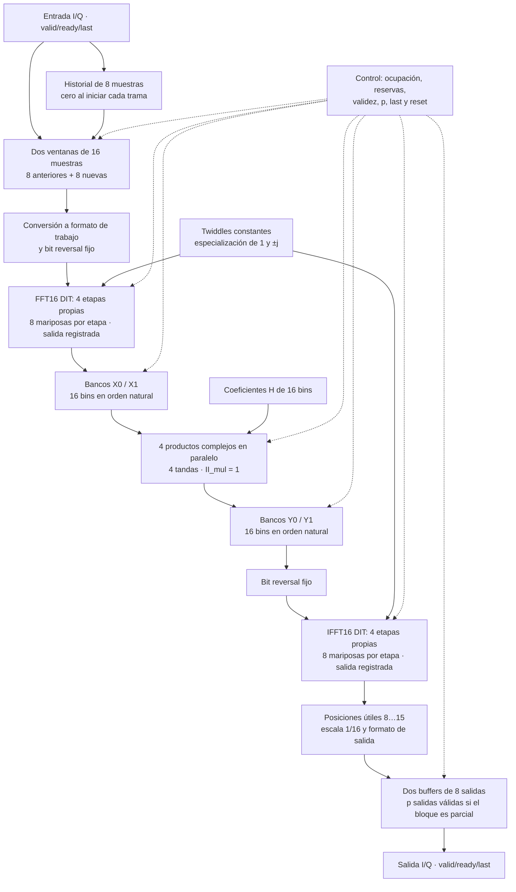

# C03 — Estrategia de optimización en frecuencia

**Issue:** [C03 — Elegir optimización en frecuencia](https://github.com/EnzoFernandezz11/rrc-fir-rtl/issues/18).

**Alcance:** definición de la estrategia y su justificación. El RTL y las mediciones corresponden a C04.

**Eje PPA:** desempeño. Se busca aumentar el throughput sostenido mediante
paralelismo y pipeline, aceptando más operadores, registros e interconexión.
La candidata es una **variante rápida con objetivo de 100 MHz (10 ns)** y
**un bloque de ocho muestras nuevas cada ocho ciclos** en régimen sin pausas.
Ambas cifras son metas para C04, pendientes de implementación y medición.

## Decisión propuesta

Se elige una arquitectura **FFT16/IFFT16 paralela por etapas y pipelineada**,
con núcleos separados y multiplicación espectral parcialmente compartida.
El método sigue siendo overlap-save con 50 % de superposición: ocho muestras
de historial, ocho nuevas y ocho salidas útiles por bloque completo.

| Nivel de diseño | Elección | Motivo y costo principal |
|---|---|---|
| FFT16 e IFFT16 | Dos núcleos separados; cuatro etapas propias de ocho mariposas cada uno | Evitar la reutilización entre etapas y entre transformadas; aumenta el hardware dedicado. |
| Aritmética | Cuatro multiplicadores reales Booth radix-4 → Wallace → CLA por producto complejo general | Calcular los cuatro productos simultáneamente; aumenta lógica y conexiones. |
| Twiddles triviales | Especializar las posiciones con `1` y `±j` | Resolver 22 de las 32 rotaciones de cada núcleo por conexiones y signos, conservando sus sumas/restas. |
| Productos espectrales | Cuatro unidades complejas para 16 bins, en cuatro tandas consecutivas | Compartir recursos con margen dentro del objetivo de ocho ciclos por bloque. |
| Pipeline | Registro a la salida de cada etapa radix-2; `II_mul = 1` en la etapa espectral | Separar etapas dependientes y permitir bloques solapados; exige cerrar cada camino a 10 ns. |
| Almacenamiento y control | Dos ventanas, dos bancos X, dos Y y dos buffers de salida; reserva antes de iniciar | Desacoplar productores y consumidores y conservar datos ante pausas; aumenta memoria y control. |
| Orden de datos | X e Y en orden natural; bit reversal fijo a la entrada de cada DIT | Eliminar los intercambios seriales previos a IFFT mediante conexiones vectoriales. |

### Diagrama de bloques de la candidata



La cuarta etapa de cada núcleo escribe directamente en su destino reservado:
X para FFT y, tras seleccionar y escalar, el buffer de salida para IFFT.
Los twiddles de IFFT son los conjugados de los de FFT. El historial avanza
solo con muestras aceptadas; las reservas y los metadatos acompañan cada bloque.

### Relación con la consigna y alcance de C03

La [consigna vigente](../consigna-actualizada.md) pide una implementación paralela
y evaluar especialmente FFT, multiplicación espectral e IFFT. La propuesta
explota los ocho pares independientes de cada etapa radix-2, despliega las cuatro
etapas y separa ambos núcleos. **La etapa espectral usa paralelismo parcial**:
cuatro productos simultáneos, frente al máximo estructural de 16. Se justifica
por la alimentación de una muestra por ciclo y el objetivo de ocho ciclos entre
bloques; aumentar a ocho o 16 unidades queda sujeto al calendario y las medidas.
Esta elección debe revisarse explícitamente al evaluar el requisito de mayor
paralelización posible; no se presenta como máximo paralelismo en los tres bloques.

C03 documenta la opción, la memoria y el compromiso PPA, como pide la
[issue #18](https://github.com/EnzoFernandezz11/rrc-fir-rtl/issues/18).
C04 implementará y verificará la candidata antes de analizar retiming o cortes
adicionales. La propuesta corresponde a D08 de la rama de frecuencia;
la revisión del equipo y su registro en el contrato siguen pendientes.

**Guía de lectura:** la sección 1 presenta la base; las secciones 2–4 justifican
la arquitectura y su calendario; la sección 5 compara la candidata completa;
la sección 6 define su validación. El apéndice A conserva las estimaciones
parciales de alternativas y el B identifica el material de apoyo.

## 1. Problema de la implementación actual

El filtro serial de C02 funciona y cuenta con comparación exacta contra el
modelo fijo y los vectores oficiales A05. Su principal limitación de calendario
es la cantidad de trabajo ejecutado en serie. La
[base PPA documentada](../../reports/ppa/frequency.md) utiliza 575 ciclos para
procesar un bloque de ocho muestras nuevas:

| Trabajo por bloque | Ciclos | Fracción |
|---|---:|---:|
| FFT16: 32 mariposas × 7 ciclos | 224 | 39,0 % |
| 16 productos espectrales × 6 ciclos | 96 | 16,7 % |
| Reordenamiento previo a IFFT | 6 | 1,0 % |
| IFFT16: 32 mariposas × 7 ciclos | 224 | 39,0 % |
| Preparación y control externos al motor | 25 | 4,3 % |
| **Total** | **575** | **100 %** |

FFT e IFFT ocupan juntas el **77,9 % de los ciclos**. El desglose se deriva del
calendario del controlador, no de contadores independientes por fase.

El [multiplicador complejo actual](../../rtl/frequency/complex_mul_serial.sv)
reutiliza un único operador real para calcular los cuatro productos de una
multiplicación compleja. El producto real es combinacional (`a * b`); la
serialización consiste en ejecutar esos cuatro productos uno después del otro.
El control, la captura y las escrituras agregan ciclos al cálculo.

Esta limitación debe distinguirse del **camino crítico físico**, que determina
el reloj alcanzable. El resumen histórico de Vivado informa una Fmax aproximada
de 57,72 MHz, obtenida de una implementación a 10 MHz, pero falta el reporte
detallado para localizar el tramo limitante. El costo en ciclos justifica
optimizar la aritmética; no demuestra que el multiplicador sea el camino crítico.

## 2. Criterio de diseño: RTL orientado a ASIC

El objetivo formativo es diseñar módulos RTL orientados a ASIC. Artix-7 y Vivado
son la plataforma disponible para medir la implementación, por lo que sus
recursos específicos no determinan la arquitectura aritmética elegida.

Se describirán explícitamente la recodificación Booth, los compresores Wallace
y la anticipación de acarreos del CLA. Esto permite estudiar cómo generación de
productos parciales, reducción y suma final afectan la profundidad lógica, los
operadores y las conexiones.

Los reportes de Vivado caracterizarán el **mapeo FPGA**. Sus LUT, DSP, retardos
y potencia no equivalen a área, timing o potencia de un ASIC. Una evaluación
física ASIC necesitaría una biblioteca de celdas y un flujo específicos. La base
histórica se conservará con su procedencia para interpretar la comparación.

### Categoría rápida y reloj objetivo

Se elige como objetivo inicial **100 MHz**, correspondiente a un período de
**10 ns** y al mínimo de la categoría rápida del
[contrato técnico](../contrato-tecnico.md). Se fija una meta de diseño y medición,
no una Fmax ya alcanzada.

Los caminos entre registros deberán cumplir ese período, considerando lógica,
interconexión, retardos de los registros y márgenes temporales. Esto no exige
resolver una transformada completa en un ciclo ni determina por sí solo el
intervalo de aceptación de muestras o bloques. El objetivo sostenido se define
a continuación y deberá respaldarse con la organización temporal.

La medición disponible de C04 utilizará el reloj de
[`clk_100mhz.xdc`](../../constraints/clk_100mhz.xdc), que ya define un período de
10 ns. Primero se verificará y medirá la candidata; si no cumple, se identificarán
los caminos limitantes para estudiar retiming o nuevos cortes de pipeline y
repetir la evaluación. No se declara cumplimiento de la categoría antes de
contar con esa evidencia.

El resumen histórico de C02 procede de una implementación a 10 MHz. Las
comparaciones separarán reducción de ciclos y cambio de reloj, indicando las
condiciones de ambas corridas. El cumplimiento físico en Vivado caracterizará
el mapeo FPGA, sin atribuir esos retardos a un ASIC sin biblioteca y flujo propios.

### Intervalo objetivo de ocho ciclos entre bloques

Se fija **`II_bloque = 8 ciclos` como objetivo sostenido**, con bloques completos
consecutivos de una misma trama, fuente siempre disponible, salida siempre
lista y después del arranque. Cada bloque incorpora ocho muestras nuevas y la
interfaz acepta como máximo una por ciclo. Por ello, el objetivo de intervalo
no mayor de ocho coincide con el mínimo de ocho ciclos impuesto por esa
alimentación.

Con el reloj objetivo de 100 MHz, la capacidad buscada es:

```text
Tasa de bloques = 100 000 000 / 8 = 12 500 000 bloques/s
Throughput = 8 × 100 000 000 / 8 = 100 000 000 muestras/s
```

Son metas de diseño, no resultados obtenidos. **No se exige terminar un bloque
en ocho ciclos**: su latencia puede ser mayor si la arquitectura admite bloques
solapados y sostiene el intervalo. Debe verificarse la tasa de entrada y salida
en régimen; llenar buffers durante un transitorio no demuestra throughput
sostenido.

El calendario debe permitir a FFT, productos e IFFT sostener esa tasa junto con
las transferencias. La captura de las ocho muestras nuevas, la preparación del
historial y la emisión de las ocho salidas no pueden agregar esperas periódicas
que aumenten el intervalo objetivo. Su solapamiento y almacenamiento se
establecen en la organización de entrada/salida y en el calendario inicial.

Las burbujas de fuente, el backpressure, reset y los cierres o parciales de trama
pueden introducir espera y se comprobarán por separado. En esos casos se exige
conservar datos, orden y conteo, sin atribuir su menor tasa al escenario ideal
sin pausas. La latencia, el tiempo de arranque y el drenaje se informarán además
del intervalo sostenido.

## 3. Arquitectura del multiplicador real y motivo de cada elección

Cada multiplicador recibe un dato de trabajo de **12 bits con signo** y un
coeficiente o twiddle de **10 bits con signo**, y entrega un producto exacto de
**22 bits**:

```text
Dato de 12 bits × coeficiente de 10 bits
                    ↓
         Generación Booth radix-4
                    ↓
          Reducción mediante Wallace
                    ↓
        CLA jerárquico explícito
                    ↓
       Producto de 22 bits con signo
```

Estos bloques describen la estructura lógica. No representan necesariamente
etapas de reloj ni fijan por sí solos una cantidad de ciclos.

### Booth radix-4 para generar menos productos parciales

La generación directa utiliza diez filas principales, asociadas a los diez bits
del coeficiente y con el tratamiento correspondiente del signo. Booth radix-4
recodifica ese operando en cinco grupos que seleccionan `0`, `+A`, `-A`,
`+2A` o `-2A`.

Se elige Booth para reducir el trabajo que recibe el árbol de compresión. El
costo es agregar recodificación, selección y correcciones de signo. Los cinco
grupos principales no implican necesariamente una matriz de solo cinco filas
sin correcciones, ni garantizan duplicar la velocidad o reducir a la mitad el
área.

La implementación debe representar correctamente los múltiplos intermedios.
En particular, `-2A` para el mínimo negativo de A exige suficiente ancho antes
de formar el producto final. La reducción debe preservar el producto exacto,
incluidos los extremos de complemento a dos.

### Wallace para reducir los productos parciales

El árbol Wallace utiliza compresores 3:2 o CSA para transformar tres filas en
dos conservando su suma. Los acarreos se trasladan a la posición siguiente sin
propagarse a lo largo de toda la palabra en cada nivel. La reducción continúa
hasta obtener dos filas para el sumador final.

Se elige Wallace por la facilidad de seguir y verificar una reducción por
grupos. Dadda también era una alternativa válida: organiza la compresión por
alturas objetivo y suele evitar compresores que Wallace utilizaría. Se acepta
ese posible costo adicional de Wallace a cambio de una estructura directa de
construir y revisar. No se afirma que Wallace tenga mejor área o timing medidos.

Los compresores concretos dependerán de la matriz Booth completa, incluidos
desplazamientos, extensión de signo y correcciones.

### CLA jerárquico para la suma final

Las dos filas finales se combinarán con un **Carry Lookahead Adder diseñado a
mano**. Se elige anticipar los acarreos mediante señales de generación y
propagación, evitando resolver toda la palabra mediante una cadena ripple bit
a bit.

Para los 22 bits se utilizarán cinco grupos de cuatro y uno de dos:

| Grupo | Bits | Ancho |
|---|---|---:|
| 0 | `[3:0]` | 4 |
| 1 | `[7:4]` | 4 |
| 2 | `[11:8]` | 4 |
| 3 | `[15:12]` | 4 |
| 4 | `[19:16]` | 4 |
| 5 | `[21:20]` | 2 |

Cada grupo calcula generación `G` y propagación `P`; una red superior anticipa
los acarreos de entrada a los grupos. No se conectarán los bloques esperando
secuencialmente el acarreo de salida del anterior, porque eso dejaría un ripple
entre grupos.

La jerarquía mantiene expresiones locales manejables y facilita verificar cada
grupo y su integración. Una anticipación global de 22 bits exigiría expresiones
amplias que se descomponen en puertas de fan-in limitado. El compromiso es
agregar lógica y conexiones de grupo. El tamaño de cuatro bits es un punto de
partida fundamentado en el material de la cursada, no un óptimo físico demostrado.

## 4. Paralelismo aritmético y procesamiento FFT/IFFT

El producto complejo necesita cuatro productos reales independientes:

```text
M0 = a_i × b_i       M1 = a_q × b_q
M2 = a_i × b_q       M3 = a_q × b_i

p_i = M0 - M1
p_q = M2 + M3
```

La candidata los calcula simultáneamente con cuatro unidades Booth → Wallace →
CLA. Frente a dos operadores, elimina la necesidad de repartir esos cuatro
productos en dos turnos de cálculo. A cambio, utiliza más lógica aritmética y
conexiones.

Los productos de 22 bits se extenderán con signo antes de combinarse en
resultados complejos de **23 bits**. Se mantendrán los puntos de redondeo y
recorte posteriores del motor, de forma que los cambios arquitectónicos no
introduzcan una nueva cuantización.

Cuatro multiplicadores en paralelo no cuadruplican el retardo de una
multiplicación. El camino relevante incluye una de las ramas de multiplicación
y su combinación posterior, además de selección y ruteo. La alternativa de dos
operadores se conservará como referencia de compromiso si cuatro no aporta una
mejora temporal suficiente.

La unidad aritmética es aplicable tanto a las mariposas de FFT/IFFT como a los
productos espectrales. Los **cuatro operadores por producto complejo** y las
**ocho mariposas simultáneas por etapa** son dos niveles distintos de paralelismo.
Su combinación, el despliegue de las cuatro etapas y los núcleos separados
responden al objetivo de la [consigna](../consigna-actualizada.md) de paralelizar
el procesamiento. El paralelismo espectral inicial será de cuatro productos
complejos simultáneos, con doble buffer entre núcleos. Su ocupación, transferencias
y manejo de pausas deberán coordinarse con la temporización de los operadores
para habilitar el solapamiento entre bloques.

### Bypass de twiddles triviales

No todas las mariposas necesitan un producto complejo general. Para un dato
`a_i + j·a_q`, los twiddles `1` y `±j` permiten obtener el producto mediante
conexiones, intercambio de componentes y cambio de signo:

| Twiddle | Parte real del producto | Parte imaginaria | Aplicación |
|---|---|---|---|
| `1` | `a_i` | `a_q` | FFT e IFFT. |
| `-j` | `a_q` | `-a_i` | FFT. |
| `+j` | `-a_q` | `a_i` | IFFT, por conjugación del twiddle. |

Se elige el bypass para evitar trabajo aritmético innecesario. La tabla actual
de FFT16 contiene 15 mariposas con `W = 1` y siete con `W = -j`; la IFFT usa
los factores conjugados. Por tanto, se simplifica el producto por twiddle en
**22 de las 32 mariposas de cada transformada**, o 44 entre FFT e IFFT por bloque.
Las mariposas y sus sumas/restas posteriores siguen siendo necesarias.

Frente a usar siempre los cuatro multiplicadores, el bypass agrega selección,
identificación del caso y tratamiento de signos en datos y control. El caso se
puede reconocer mediante el índice de twiddle que ya utiliza el motor. La
finalización del camino simplificado debe coordinarse con el controlador para
aprovechar el atajo sin repetir ni perder operaciones.

Se conservarán los anchos y los puntos de cuantización existentes. La negación
se realizará con suficiente ancho antes del recorte, manteniendo la detección
de overflow y el comportamiento de redondeo de la referencia. El bypass debe
producir exactamente el mismo valor que el producto por las constantes
cuantizadas de `1` y `±j`, no una aproximación numérica distinta.

En una unidad general, agregar un bypass no elimina automáticamente el área del
multiplicador. Con las etapas desplegadas elegidas, las posiciones cuyo twiddle
es siempre trivial se especializarán directamente, sin un multiplicador general
innecesario. En posiciones que conserven un operador general, seleccionar otra
salida no garantiza menor conmutación interna: cualquier ahorro de actividad
requerirá controlar las entradas no utilizadas y verificarse con estímulos
representativos. La mejora de ciclos depende del calendario y no se deduce
directamente del porcentaje de twiddles triviales.

### Ocho mariposas simultáneas por etapa

FFT16 radix-2 tiene cuatro etapas de ocho mariposas cada una. Las mariposas de
una etapa utilizan pares disjuntos de los 16 datos complejos, por lo que pueden
ejecutarse simultáneamente. La etapa siguiente necesita los resultados de la
anterior; esa dependencia se conserva al paralelizar.

Se eligen ocho mariposas simultáneas como objetivo porque permiten procesar una
etapa completa por tanda, alcanzando el máximo paralelismo dentro de una etapa
de esta FFT radix-2. La misma organización se aplica a IFFT16 con los twiddles
conjugados y el escalado numérico ya definido.

| Mariposas simultáneas comparadas | Tandas por etapa | Tandas por FFT16 | Datos complejos leídos / escritos por tanda |
|---:|---:|---:|---:|
| 1 | 8 | 32 | 2 / 2 |
| 2 | 4 | 16 | 4 / 4 |
| 4 | 2 | 8 | 8 / 8 |
| **8, elegidas** | **1** | **4** | **16 / 16** |

Una tanda no equivale necesariamente a un ciclo. Su latencia dependerá de los
caminos aritméticos y del control. Las ocho mariposas trabajan en paralelo, no
como ocho operaciones encadenadas en un mismo camino combinacional. El costo
esperado es más hardware concurrente, conexiones y distribución de datos que
con una o cuatro mariposas; la viabilidad temporal y de recursos se verificará
en C04. Cuatro mariposas quedan como alternativa de comparación si ocho no
resulta conveniente según las medidas.

El bypass modifica el trabajo de cada etapa de la tabla actual:

| Etapa | Mariposas con twiddle trivial | Mariposas con producto general |
|---:|---:|---:|
| 1 | 8 | 0 |
| 2 | 8 | 0 |
| 3 | 4 | 4 |
| 4 | 2 | 6 |

En etapas mixtas, los caminos de bypass deben conservar sus resultados hasta
que los productos generales de la tanda estén disponibles. La siguiente etapa
no puede consumir resultados incompletos. Por eso, simplificar una mariposa
no garantiza acortar toda la tanda si otra rama sigue siendo más lenta.

Ocho mariposas no implica automáticamente 32 multiplicadores reales físicos:
la especialización por twiddle influye en ese conteo. El despliegue de etapas y
los núcleos FFT/IFFT separados y las cuatro unidades espectrales se definen a
continuación; los registros de etapa se establecen en la temporización inicial.

### Cuatro etapas desplegadas y especializadas

Se elige dar hardware propio a las cuatro etapas, con ocho posiciones de
mariposa por etapa, en lugar de reutilizar un único conjunto de ocho unidades.
El bloque atraviesa las etapas en el orden de sus dependencias:

```text
Entrada → etapa 1: 8 mariposas → etapa 2: 8 mariposas
        → etapa 3: 8 mariposas → etapa 4: 8 mariposas → salida
```

La arquitectura tiene **32 posiciones de mariposa por estructura transformadora**.
Se prioriza el paralelismo estructural y la posibilidad de conexiones fijas
entre etapas. Reutilizar ocho unidades habría reducido hardware aritmético,
pero exigiría seleccionar operandos y twiddles según la etapa y realimentar sus
resultados al banco de trabajo. El despliegue acepta más hardware dedicado y
conexiones para evitar esa reutilización temporal.

Las posiciones se especializarán según sus twiddles: las etapas 1 y 2 solo
necesitan caminos triviales, la etapa 3 tiene cuatro productos generales y la
etapa 4 tiene seis. Se mantienen las sumas/restas de las 32 mariposas. Así, para
una estructura desplegada, hay **22 posiciones con producto trivial y diez con
producto general**, no 32 productos complejos generales. Con cuatro operadores
reales por producto general, el punto de partida estructural es de 40
multiplicadores reales en esas diez posiciones, antes de otras simplificaciones
por constantes o transformaciones de síntesis; no es un recurso físico medido.

La misma organización se aplicará a los dos núcleos separados, FFT16 e IFFT16,
como se explica en la sección siguiente. El almacenamiento entre etapas se
describe en la temporización inicial; la etapa espectral tendrá cuatro unidades
de producto complejo reutilizadas entre bins.

Desplegar las etapas no elimina sus dependencias ni las convierte automáticamente
en cuatro ciclos o en un resultado por ciclo. Permite que etapas distintas
trabajen sobre bloques distintos si la alimentación, el almacenamiento y el
control lo habilitan. Se elige un pipeline inicial con registro a la salida de
cada etapa, descrito más adelante. Su capacidad y cumplimiento del período se
comprobarán en C04; el despliegue por sí solo no los demuestra.

### Núcleos FFT16 e IFFT16 separados

Se eligen dos estructuras transformadoras independientes. Cada núcleo tendrá
cuatro etapas desplegadas de ocho mariposas, con especialización de los
twiddles triviales. La FFT utiliza los twiddles directos; la IFFT, sus conjugados
y el escalado final `1/16`, conservando la convención y cuantización existentes.

```text
Núcleo FFT16 → productos espectrales X[k] × H[k] → núcleo IFFT16
```

La alternativa de una estructura configurable compartida habría requerido que
cada bloque utilizara dos veces su capacidad de transformación, seleccionando
modo y planificando los usos de FFT e IFFT. Se prioriza separar esa capacidad
para evitar competencia por el mismo recurso y facilitar que la FFT procese un
bloque nuevo mientras la IFFT trabaja sobre uno anterior.

| Recurso estructural comparado | Estructura compartida | Dos núcleos elegidos |
|---|---:|---:|
| Posiciones de mariposa | 32 | 64, 32 por núcleo |
| Posiciones con producto complejo general tras el bypass | 10 compartidas | 20, 10 por núcleo |
| Operadores reales, cuatro por producto general | 40 compartidos | 80, 40 por núcleo |

Son conteos estructurales previos a otras simplificaciones y al mapeo, no
resultados de síntesis ni área total del filtro. Tampoco incluyen la unidad
espectral. Se acepta más hardware dedicado a cambio de capacidad de cálculo
independiente; su costo temporal, de recursos y de actividad deberá medirse.

Para un mismo bloque sigue siendo obligatorio completar FFT, productos e IFFT
en ese orden. La concurrencia se produce entre bloques distintos y requiere
almacenamiento y control de transferencia que mantengan datos, validez, orden
y límites de trama alineados. Separar núcleos no garantiza por sí solo operar
sin pausas ni obtener un bloque por ciclo. Se eligen inicialmente cuatro
productos espectrales simultáneos y doble buffer en ambas fronteras, como se
define a continuación.

### Productos espectrales con cuatro unidades compartidas

La etapa intermedia calcula `Y[k] = X[k] × H[k]` para los 16 bins de cada bloque.
Se eligen inicialmente **cuatro unidades de producto complejo en paralelo**,
reutilizadas para procesar esos bins en **cuatro tandas de hasta cuatro productos**.
Cada unidad utiliza los cuatro multiplicadores reales de la arquitectura
Booth → Wallace → CLA, por lo que el punto de partida es de **16 operadores
reales para la etapa espectral**, antes de simplificaciones por constantes o
transformaciones de síntesis. No son 16 unidades complejas ni 64 operadores
reales dedicados a esta etapa.

Se adopta este compromiso para limitar la replicación de hardware sin volver a
procesar todos los bins con una única unidad. Las alternativas de ocho o 16
unidades complejas reducirían las tandas a dos o una, pero multiplicarían la
capacidad aritmética dedicada; esa capacidad adicional debe justificarse por la
tasa que realmente necesita el sistema. La interfaz acepta como máximo una
muestra por ciclo, por lo que reunir ocho muestras nuevas requiere al menos
ocho ciclos sin pausas. Esto es un límite de alimentación, no una garantía de
intervalo de ocho ciclos para el filtro completo.

Se elige **`II_mul = 1` como intervalo de aceptación inicial**: las cuatro
unidades procesan tandas consecutivas, con multiplicación, combinación compleja
y redondeo combinacionales entre X y la escritura registrada en Y. No se agrega
inicialmente un registro entre los cuatro productos reales y su combinación.

| Tanda | Bins procesados simultáneamente |
|---:|---|
| 0 | 0, 1, 2, 3 |
| 1 | 4, 5, 6, 7 |
| 2 | 8, 9, 10, 11 |
| 3 | 12, 13, 14, 15 |

Así se presupuestan cuatro ciclos de cálculo por bloque, además de sus
transferencias y control. Frente a `II_mul = 2`, que ocuparía los ocho ciclos
disponibles de capacidad aritmética, esta elección deja margen para el objetivo
de un bloque cada ocho ciclos. No acredita que el camino combinacional cumpla
10 ns: deberá implementarse y medirse.

Si posteriormente se divide el producto en más etapas, su latencia puede crecer
manteniendo `II_mul = 1`, siempre que el pipeline acepte tandas consecutivas y
conserve índices, banco de destino y validez. El calendario deberá actualizarse;
no se confundirá latencia de producto con intervalo entre aceptaciones.

El control deberá presentar hasta cuatro pares `X[k], H[k]`, conservar el índice
de cada operación y ubicar cada resultado en `Y[k]`. Los productos mantendrán
los anchos y el redondeo del modelo fijo; la IFFT no consumirá un vector parcial
como si estuviera completo. Los vectores se conservarán en los bancos ping-pong
y se transferirán según su estado y la disponibilidad del consumidor.

**Criterio de revisión:** comenzar con cuatro unidades y aumentar su cantidad
solo si el calendario y la medición muestran que la etapa espectral limita el
intervalo objetivo entre bloques. También se revisarán su intervalo de aceptación
y las esperas de alimentación para distinguir falta de operadores de un cuello
de botella en datos o control. Cambiar la cantidad requerirá recalcular recursos,
accesos, timing y throughput; no se presupone que más unidades mejoren por sí
solas el desempeño global.

### Doble buffer ping-pong entre núcleos

Se eligen **dos bancos X entre FFT y productos espectrales**, y **dos bancos Y
entre productos e IFFT**. Cada banco almacena un bloque completo de 16 valores
complejos en formato de trabajo de 12 bits por componente:

```text
FFT16 → [X0 / X1] → cuatro unidades espectrales → [Y0 / Y1] → IFFT16
```

Un banco por frontera habría requerido menos almacenamiento, pero bloquearía al
productor mientras el único banco siguiera ocupado. El doble buffer permite
que un banco sea consumido mientras el otro recibe otro bloque. Se elige para
aprovechar mejor los núcleos separados y absorber una espera limitada entre
etapas, aceptando almacenamiento y control de ocupación adicionales.

| Organización comparada | Datos en X | Datos en Y | Total de datos |
|---|---:|---:|---:|
| Un banco por frontera | 384 bits | 384 bits | 768 bits |
| **Dos bancos por frontera, elegidos** | **768 bits** | **768 bits** | **1536 bits** |

Son capacidades nominales: `16 × 2 × 12 = 384` bits por banco. No incluyen
metadatos, estados de control, historial, almacenamiento de entrada/salida ni
registros internos de las transformadas. La organización física deberá permitir
las transferencias vectoriales y por tandas requeridas; el conteo de bits no
supone una memoria de pocos puertos capaz de resolver todos los accesos.

La corrección del ping-pong se basa en las siguientes reglas funcionales:

- Un productor solo escribe en un banco libre que tenga asignado. No sobrescribe
  datos que todavía necesite el consumidor ni alterna bancos ciegamente.
- Los bancos X conservan los datos hasta que las lecturas espectrales hayan
  sido aceptadas y ninguna operación dependa de volver a leerlos. La lógica
  aritmética conserva los operandos e índices que necesite durante su cálculo.
- Se reserva un banco Y para reunir los resultados de un bloque. Se marca
  completo cuando sus 16 resultados están guardados, no al lanzar la cuarta
  tanda. Los resultados en vuelo mantienen su índice y banco de destino.
- La IFFT recibe un vector Y completo. El banco se libera cuando el núcleo ha
  aceptado y conservado los 16 valores necesarios para continuar su cálculo.
- Se conserva el orden de los bloques. Datos y metadatos viajan juntos: cantidad
  de salidas reales del bloque parcial, fin de trama y estado de validez.
- Si no hay banco libre de destino, no se inicia un nuevo cálculo. El bloque
  espera en su banco de origen. Cada operación iniciada ya tiene reservado el
  almacenamiento necesario para terminar sin pausas internas.
- El reset invalida los bloques pendientes y su control asociado, de modo que
  no reaparezcan resultados de operaciones abortadas tras reiniciar.

Las transferencias requieren acuerdo de validez y disponibilidad entre productor
y consumidor. Las pausas se propagan según la capacidad libre y las operaciones
en vuelo; dos bancos no absorben indefinidamente un destino detenido. Las reservas
y los registros iniciales se concretan a continuación. Los cortes adicionales
dentro de Booth, Wallace, CLA o una mariposa se evaluarán después de implementar
y medir, como se establece en el plan de C04.

### Temporización inicial y reservas de destino

Se registra la salida de cada etapa radix-2 de FFT e IFFT. Las tres fronteras
internas conservan vectores completos de trabajo; la cuarta etapa utiliza el
banco de destino como registro de salida:

```text
Ventana → E1 → REG → E2 → REG → E3 → REG → E4 → X reservado
Y       → E1 → REG → E2 → REG → E3 → REG → E4
          → selección de las posiciones 8…15 y escala → salida reservada
```

Las ocho mariposas de una etapa comparten el avance de datos y metadatos. Las
ramas triviales y generales se capturan en la misma frontera: el bypass no
adelanta una parte del vector respecto de las demás. Los registros no agregan
redondeos; se conservan los puntos numéricos de la referencia, incluido el
recorte de trabajo antes de la escala final de salida.

Inicialmente, la aritmética de cada etapa es combinacional entre esas fronteras.
En la última etapa IFFT, el presupuesto temporal incluye también la selección
y conversión al formato externo antes de escribir el buffer de salida. Esta
organización evita encadenar cuatro etapas completas en un ciclo y proporciona
una primera candidata para medir. No garantiza que una etapa mixta con producto,
combinación y suma de mariposa cumpla 10 ns.

Se elige **reservar antes de iniciar**, frente a detener individualmente las
etapas del pipeline. Una reserva ocupa un banco aunque todavía no contenga
resultados válidos; solo se publica como completo cuando se guarda todo el
bloque correspondiente:

| Cálculo que comienza | Origen completo requerido | Destino reservado |
|---|---|---|
| FFT | Ventana de entrada | Banco X libre |
| Cuatro tandas espectrales | Banco X | Banco Y libre |
| IFFT | Banco Y | Banco de salida libre |

Cada reserva pertenece a un único bloque y acompaña sus datos por el pipeline.
Una vez lanzado, el cálculo continúa aunque aparezca backpressure externo;
su destino permanece reservado. Si falta espacio, se demora el inicio del
siguiente cálculo y su origen conserva el bloque. Esto evita un control de pausa
independiente en cada etapa, a cambio de reservar almacenamiento por anticipado.

El origen se libera cuando ninguna operación necesita volver a leerlo: la
ventana o Y, después de capturar la primera etapa que consume todo el vector;
X, después de capturar los operandos de la última tanda espectral. La reserva
del destino dura hasta que el consumidor libere ese banco. Se conserva el orden
FIFO de los bloques, aun cuando otro banco esté libre o termine antes.

Las señales de validez, cantidad útil `p`, fin de trama e identificador del
destino avanzan con los datos. Reset cancela también las reservas y la validez
en vuelo. No se publican salidas de operaciones canceladas.

### Preparación de ventanas y emisión de resultados

Se eligen **dos buffers de ventanas de entrada**. Cada ventana contiene las ocho
muestras de historial y las ocho nuevas en orden natural. Mientras una ventana
espera o alimenta la FFT, el otro buffer puede reunir el bloque siguiente, si
está libre. El historial corresponde al avance de las muestras aceptadas, no al
orden en que terminen los cálculos.

El historial se copia en paralelo o de forma solapada con la captura; no se
inserta una fase serial de ocho ciclos entre bloques completos. La rotación
de bancos debe permitir aceptar muestras consecutivas sin una burbuja periódica
en el límite de bloque. Una ventana ocupada no se modifica hasta que la FFT
haya consumido su entrada. La conversión de los datos de entrada al formato
de trabajo se mantiene exacta.

Se eligen **dos buffers de salida**, cada uno con espacio para ocho resultados
complejos en formato externo. La última etapa IFFT guarda las posiciones útiles
`8…15`, con el escalado y redondeo existentes, en el destino reservado. No hace
falta conservar allí los primeros ocho valores descartados de la IFFT.

Un banco puede emitirse a razón de una muestra por ciclo mientras el otro
recibe otro bloque. El paso de un banco completo al siguiente no introduce un
ciclo vacío en régimen con `out_ready = 1`. Si la salida se detiene, se sostienen
`out_valid`, I/Q y `out_last`; el índice solo avanza con una transferencia.
El banco se libera después de aceptar su último resultado útil.

Los bloques parciales conservan `p` entre uno y ocho: se completa la ventana
según la referencia, pero solo se emiten `p` resultados. `last` marca únicamente
el último resultado de la trama. No se genera un bloque extra cuando `last`
coincide con la octava muestra. El historial comienza en cero para cada trama;
las burbujas no cuentan como muestras y reset cancela el trabajo pendiente.

Cuando se agota el espacio, las ocupaciones y reservas frenan los nuevos
inicios hasta propagar la espera a `in_ready`. Se mantiene el contrato externo
`valid/ready/last`, sin dependencias combinacionales circulares. Los buffers
permiten solapamiento y absorben pausas finitas; no eliminan el backpressure.

### Calendario inicial de referencia

El siguiente presupuesto cuenta flancos relativos a una ventana completa
disponible en `t = 0`, con destinos disponibles y salida siempre lista. Cada
fila indica cuándo se capturan o transfieren resultados; no es un resultado de
simulación ni una latencia externa garantizada:

| Flanco relativo | Acción para el bloque A |
|---|---|
| 0 | Inicio de FFT con X reservado y ventana estable |
| 1…4 | Captura de las salidas de las cuatro etapas FFT; X completo en 4 |
| 5 | Transferencia de control a la etapa espectral y reserva de Y |
| 6…9 | Escritura de las cuatro tandas en Y; Y completo en 9 |
| 10 | Inicio de IFFT con buffer de salida reservado |
| 11…14 | Captura de las cuatro etapas IFFT; resultados útiles guardados en 14 |
| 15…22 | Transferencia de las ocho muestras de salida |

Las esperas de control de los flancos 5 y 10 están incluidas; no se presupone
que un consumidor use en el mismo flanco un banco que recién se completa.
El bloque B desplaza este calendario ocho ciclos: FFT en 9…12, escrituras
espectrales en 14…17, IFFT en 19…22 y emisión en 23…30. Así, las emisiones
de A y B son consecutivas y cada etapa sostiene la separación de ocho ciclos.

El presupuesto separa la preparación inicial de la ventana, el procesamiento
del bloque y la emisión. Desde la ventana disponible, la primera salida se
transfiere en 15 y la última en 22 en este modelo. La latencia por muestra
depende además de su posición dentro de la ventana y se medirá con la definición
del contrato. Los handshakes, las reservas y los cambios de banco del RTL deberán
comprobar que este calendario se sostiene sin añadir esperas periódicas.

### Orden natural y permutaciones fijas de entrada

Se mantiene DIT radix-2 para FFT e IFFT, junto con sus operaciones y puntos de
cuantización. Los vectores externos a cada núcleo y los buffers intermedios
utilizarán orden natural:

```text
Ventana w[0…15] → FFT DIT → X[0…15]
X[k] × H[k] → Y[k]
Y[0…15] → IFFT DIT → v[0…15]
```

Cada producto espectral combina el bin `X[k]` con su coeficiente `H[k]` y se
guarda en `Y[k]`, independientemente de cuándo finalice la operación. Los
buffers ping-pong conservan ese mismo convenio en ambos bancos. La salida IFFT
permanece en orden temporal natural; se entregan las posiciones `8…15`, o las
primeras `p` de ese tramo para un bloque parcial, según el contrato existente.

La red DIT recibe sus posiciones internas en bit reversal. Para evitar mover
sucesivamente datos almacenados, se elige una conexión fija entre el vector
natural y la primera etapa de cada núcleo:

```text
entrada_interna[j] = entrada_natural[bitrev4(j)]

Índices naturales conectados a las posiciones internas 0…15:
0, 8, 4, 12, 2, 10, 6, 14, 1, 9, 5, 13, 3, 11, 7, 15
```

La inversión corresponde a los cuatro bits del índice; los valores completos
I/Q mantienen su representación. El cableado de entrada FFT permuta la ventana
temporal y el de entrada IFFT permuta los bins Y. Se aplica exactamente una vez
por núcleo. En particular, la captura de la candidata entrega la ventana en
orden natural: no se debe conservar la escritura ya invertida de la base serial
y agregar además otra inversión en la entrada FFT.

Frente a los seis intercambios previos a la IFFT del motor serial, esta
organización evita la secuencia de lecturas, escrituras y control dedicada al
reordenamiento. Se elige porque el vector completo ya está disponible y las
etapas desplegadas permiten definir sus conexiones de antemano. La permutación
no introduce una nueva cuantización ni requiere ciclos de intercambio; sí tiene
retardo físico de interconexión, que deberá incluirse en el análisis de timing.

La eliminación de esa fase no fija por sí sola el ahorro del filtro completo:
el calendario inicial incluye sus transferencias y fronteras, y deberá
contrastarse con el RTL y sus pausas. El orden de bins y la aplicación única
del bit reversal se comprobarán contra la referencia fija en C04.

### Memoria y alimentación de operandos

La referencia actual dispone de un banco de trabajo de 16 muestras complejas
de 12 bits por componente: **384 bits nominales**. El historial de ocho muestras
complejas de entrada ocupa **32 bits nominales**. H y los twiddles son constantes
precalculadas; sus formatos y valores no cambian por esta optimización.

Los cuatro productos comparten los mismos operandos complejos. Distribuir sus
componentes entre cuatro multiplicadores no exige leer cuatro muestras ni
cuatro coeficientes distintos. Para una mariposa siguen siendo necesarios los
dos valores complejos y las escrituras de sus dos resultados.

Con ocho mariposas se necesita disponer de los **16 datos complejos** de cada
etapa y transferir sus **16 resultados**, sin conflictos entre pares. Las etapas
desplegadas permiten conexiones fijas entre sus salidas y las entradas de la
etapa siguiente, respetando el orden de la FFT. Las fronteras vectoriales se
organizan como bancos de registros con conexiones paralelas; no se presupone
una memoria central de pocos puertos capaz de alimentar todas las posiciones.

Un conjunto completo de 16 resultados complejos de 12 bits por componente ocupa
384 bits nominales por frontera almacenada. Las tres fronteras internas elegidas
requieren 1152 bits por núcleo, o **2304 bits entre FFT e IFFT**. La cuarta etapa
escribe directamente en X o en el buffer de salida reservado, sin duplicar ese
registro en este presupuesto.

Los cuatro bancos ping-pong elegidos aportan 1536 bits de datos entre núcleos.
Su control de ocupación y las reservas de destino deben coordinarse con la
latencia y los resultados en vuelo de cada núcleo. Ese almacenamiento no forma parte
de los 384 bits de referencia ni de los registros de las fronteras internas.

La unidad espectral necesita acceder a hasta cuatro valores complejos de X y
cuatro coeficientes H por tanda, y ubicar hasta cuatro resultados en Y. Estos
accesos y la conservación del vector hasta su aceptación por la IFFT deben
formar parte de la organización de almacenamiento y no suponerse resueltos por
la sola existencia de los cuatro multiplicadores complejos. X e Y se organizarán
como bancos de registros que permitan seleccionar cuatro bins y escribir cuatro
resultados por tanda, además de la transferencia vectorial con las transformadas.

El presupuesto nominal de datos de la organización inicial es:

| Almacenamiento | Capacidad de datos |
|---|---:|
| Dos ventanas de entrada, cada una de 16 complejos con 2 bits por componente | 128 bits |
| Historial independiente de ocho complejos de entrada | 32 bits |
| Tres fronteras internas de 16 complejos de trabajo por núcleo, dos núcleos | 2304 bits |
| Dos bancos X y dos bancos Y de 16 complejos de trabajo | 1536 bits |
| Dos bancos de salida de ocho complejos con 9 bits por componente | 288 bits |
| **Total nominal de datos** | **4288 bits** |

Se conservan las ventanas en formato de entrada hasta alimentar la FFT; por eso
no se cuentan como vectores de 384 bits. El historial independiente permite
preparar las ventanas sin depender de la finalización de bloques anteriores.
El total excluye índices, ocupación, reservas y metadatos de pipeline, además de
cualquier registro aritmético que se agregue posteriormente. No representa área
de silicio ni una cantidad garantizada de flip-flops tras síntesis.

Los 384 bits representan el banco de trabajo de referencia, no el almacenamiento
total garantizado de la arquitectura paralela. Los registros de pipeline tendrán
un costo propio: por ejemplo, guardar cuatro productos completos requiere
88 bits de datos por unidad de producto complejo, más el control asociado.
Ese corte se evaluará después de medir; no está seleccionado ahora.

## 5. Mejora esperada y compromiso PPA

La comparación principal enfrenta la base serial con **la candidata completa**.
Se usa `II_bloque` para el intervalo entre bloques completos de una misma trama,
con entrada siempre disponible y salida siempre lista, después del arranque.

| Métrica | C02 serial | Candidata C03, pendiente de verificar en C04 |
|---|---|---|
| Reloj de evaluación | 10 MHz en la corrida histórica | Objetivo de 100 MHz (10 ns) |
| `II_bloque` | 575 ciclos, verificados en el benchmark | Objetivo de 8 ciclos |
| Throughput al mismo reloj `f` | `8 × f / 575` muestras/s | `8 × f / 8 = f` muestras/s; factor teórico **71,875×** |
| Throughput con los relojes indicados | ≈ 139 130 muestras/s a 10 MHz | Objetivo de 100 000 000 muestras/s a 100 MHz; factor combinado **718,75×** |
| Latencia | `L = 559` ciclos según el benchmark y la definición contractual | Pendiente de medir con la misma definición; el calendario interno entrega la primera salida 15 ciclos después de disponer de la ventana |
| Operadores reales de multiplicación | Un operador compartido en RTL | 96 posiciones: 40 en FFT + 16 espectrales + 40 en IFFT, antes de simplificaciones y síntesis |
| Almacenamiento de datos | Banco de trabajo de 384 bits más historial de 32 bits; conteo parcial | Presupuesto de 4288 bits de datos; excluye control y otros registros indicados en la sección 4 |
| Recursos FPGA | Resumen histórico: 1875 LUT como lógica, 569 FF y 3 DSP | Pendientes de síntesis e implementación; las posiciones aritméticas no equivalen a DSP físicos |
| Timing físico | Fmax aproximada de 57,72 MHz derivada de la corrida a 10 MHz; falta el camino detallado | Comprobar setup/hold a 100 MHz e identificar caminos limitantes |
| Potencia y energía por muestra | Conservar procedencia y limitaciones de la base histórica | Pendientes de actividad representativa y medición comparable |

Los factores de throughput son **relaciones teóricas entre el calendario base y
la meta**, no mejoras obtenidas. El factor combinado incluye **10× por el cambio
de reloj** además de `575/8 = 71,875×` por el intervalo entre bloques. No expresa
una reducción equivalente de la latencia ni garantiza que la candidata cumpla
100 MHz. Las tasas cuentan muestras complejas de la interfaz del filtro; para
una cadena con upsampling 2×, 100 Mmuestras/s corresponden a 50 Msímbolos/s QPSK.

```text
Throughput = 8 × f_clk / II_bloque

Factor de mejora de throughput =
    (575 / II_bloque_nuevo) × (f_clk_nuevo / f_clk_base)
```

La comparación física debe conservar dispositivo, flujo, formatos y estímulos,
y declarar el reloj de cada corrida. Una corrida adicional de la base a 100 MHz
permitiría comparar su respuesta a la misma restricción, sin sustituir el registro
histórico. La Fmax estimada de una implementación a 10 MHz no demuestra cómo
cerraría ese diseño al implementarlo con una restricción más exigente.

Se espera aumentar la lógica y el almacenamiento respecto de un operador
compartido. La magnitud final depende de especialización por constantes, síntesis
y ruteo; no se deduce multiplicando los recursos de C02 por 96. La energía por
muestra podría mejorar al aumentar la tasa, pero la replicación y la actividad
impiden garantizarlo antes de medir.

Los escenarios de **415 y 335 ciclos** comparan únicamente cambios de operadores
sobre un calendario serial y se conservan en el apéndice A. No son el presupuesto
de esta arquitectura ni se suman sus ahorros a los del pipeline elegido.

## 6. Plan posterior: RTL, medición y análisis de retiming

La decisión de C03 es la estrategia anterior. Su implementación y evaluación
se realizarán en **C04**, siguiendo este orden:

1. **Implementar el RTL de la candidata.** Describir CLA, Booth, Wallace y el
   producto complejo de cuatro operadores, junto con el bypass para `1` y `±j`.
   Desplegar las cuatro etapas en cada uno de los núcleos FFT16 e IFFT16 separados,
   con ocho mariposas por etapa, conexiones según la FFT y especialización de
   los twiddles triviales. Incorporar cuatro unidades espectrales compartidas
   entre los 16 bins y su control de tandas, índices y finalización.
   Incorporar los dos bancos X y los dos bancos Y, los dos buffers de ventanas
   y los dos de salida, con metadatos, ocupación y reservas previas al inicio.
   Registrar las tres fronteras internas de cada núcleo y escribir la última
   etapa directamente en el destino reservado. Implementar las cuatro tandas
   espectrales consecutivas con `II_mul = 1`, sin pausas internas una vez
   iniciado el cálculo de un bloque.
   Mantener los buffers en orden natural e implementar las permutaciones fijas
   de entrada a FFT/IFFT, sin duplicar la inversión de índices ni conservar la
   secuencia serial de intercambios anterior a la IFFT.
   Integrar ambos caminos con el control del motor conservando formatos,
   redondeos, interfaz, solapamiento y límites de trama.
   La primera versión utilizará las fronteras de etapa elegidas como referencia
   antes de aplicar retiming. Los cortes adicionales dentro de la aritmética
   se estudiarán después de medir.
2. **Verificar el comportamiento.** Comprobar los bloques aritméticos con signos,
   extremos y correcciones de Booth, además de la equivalencia exacta del bypass
   con el producto general y su finalización en FFT e IFFT. Repetir la comparación
   exacta con el modelo fijo y A05, además de pausas, backpressure, reset y tramas
   parciales. Comprobar los pares de cada etapa, la conservación de resultados
   de bypass y el avance de etapa cuando estén disponibles los 16 resultados
   complejos de las ocho mariposas. Verificar el calendario real y mantener el
   requisito de SQNR ≥ 40 dB.
   Ejercitar ambos bancos en cada frontera, sus intercambios, bancos llenos,
   resultados en vuelo y reset durante procesamiento o espera, sin pérdidas,
   duplicados, mezcla de bloques ni cambios de datos retenidos por una pausa.
   Comprobar la correspondencia `X[k], H[k], Y[k]`, el bit reversal de cada
   entrada y el orden temporal natural de la salida IFFT.
   Verificar la reserva exclusiva de destinos, el avance sin pausas de las
   operaciones iniciadas y la liberación de orígenes después de su último uso.
   Comprobar que captura, historial y cambio de banco de salida sostengan el
   calendario sin burbujas periódicas con bloques completos y sin pausas.
3. **Medir la implementación.** Registrar ciclos por bloque, latencia, throughput,
   recursos y timing, identificando el camino crítico y el reparto entre lógica
   y ruteo. Verificar 100 MHz con período de 10 ns y el intervalo sostenido
   objetivo de ocho ciclos entre bloques completos sin pausas. Distinguir ese
   intervalo de la latencia y del llenado transitorio de los buffers. Declarar
   explícitamente la diferencia frente al reloj de 10 MHz de la base histórica.
   Usar condiciones comparables para el resto de la configuración. Potencia y
   energía requieren actividad representativa y procedencia;
   las cifras vectorless históricas no sustituyen esa medición.
4. **Analizar retiming con los reportes.** Estudiar si redistribuir los registros
   existentes permite equilibrar los caminos limitantes. El análisis debe
   considerar reset, enables, datos y control, y preservar el comportamiento
   observable requerido. No se decide su aplicación ni ubicación antes de medir.
5. **Evaluar nuevos cortes si hacen falta y volver a medir.** Si mover registros
   no alcanza, estudiar agregar etapas y adaptar el calendario y la alineación
   de señales. Eso es una modificación de pipeline, distinta del retiming.
   Repetir la verificación y la comparación temporal después de cada cambio.

El retiming se decidirá con los caminos medidos. Si se agregan registros,
se actualizarán latencia, reservas y alineación del control, y se verificará
que el intervalo de ocho ciclos siga siendo sostenible.

Las evidencias y comparaciones de C04 se incorporarán al
[registro PPA común](../../reports/ppa/frequency.md), conservando la base y
distinguiendo las predicciones de los resultados obtenidos.

### Puntos para la revisión de C03

- Evaluar el compromiso de cuatro unidades espectrales frente a ocho o 16,
  considerando la consigna y el objetivo de una muestra por ciclo.
- Revisar el calendario, los accesos vectoriales y las reservas con los buffers
  elegidos, especialmente ante backpressure y límites de trama.
- Revisar el costo estructural de 96 multiplicadores reales y 4288 bits de datos,
  y el plan para comprobar 100 MHz sin cambiar la cuantización de referencia.
- Registrar la propuesta de frecuencia en D08 al preparar su integración,
  conservando el estado que tenga la decisión temporal y la revisión del equipo.

Esta nota aporta la decisión escrita para revisión de C03; la implementación,
la equivalencia y las mejoras físicas de C04 siguen pendientes.

## Apéndice A. Alternativas parciales de multiplicación

La estimación inicial conserva las 64 mariposas de FFT/IFFT, los 16 productos
espectrales y los otros 31 ciclos por bloque. Supone que el controlador se adapta
para aprovechar los operadores y mantiene los restantes enlaces de la base.
Esta comparación aísla el cambio de cantidad de multiplicadores con una mariposa
a la vez; **no incluye el bypass ni las ocho mariposas simultáneas elegidas**:

| Alternativa de calendario | Ciclos por mariposa | Ciclos por bin | Ciclos por bloque | Aumento de throughput al mismo reloj |
|---|---:|---:|---:|---:|
| Base serial de C02 | 7 | 6 | 575 | Referencia |
| Dos operadores, dos ciclos de cálculo | 5 | 4 | 415 | 38,6 % |
| Cuatro operadores, productos y combinación en un ciclo | 4 | 3 | 335 | 71,6 % |
| Cuatro operadores, productos y combinación en dos ciclos sin solapamiento | 5 | 4 | 415 | 38,6 % |

Son **escenarios parciales anteriores al paralelismo de ocho mariposas**, no
el presupuesto de la candidata completa ni resultados del RTL optimizado.
La cifra de 335 ciclos
depende de completar multiplicación y combinación en un ciclo de cálculo. Un
pipeline más profundo, un control con operaciones solapadas o la incorporación
del bypass, de las ocho mariposas y del despliegue exige recalcular el calendario.
Cada transformada conserva cuatro etapas dependientes, ahora con hardware propio.
El calendario inicial de la sección 4 presupone un ciclo por etapa y
cuatro tandas espectrales consecutivas, junto con transferencias y emisión.
Su intervalo sostenido se verificará en el RTL; no se obtiene sumando los
ahorros parciales de esta tabla.

El escenario de 335 ciclos representa un 41,7 % menos de tiempo por bloque y
un 71,6 % más de throughput al mismo reloj. Frente a la candidata de dos
operadores y 415 ciclos, la ganancia adicional sería del 23,9 % en throughput.

Agregar un registro no garantiza mejorar el throughput. En estos escenarios
bloqueantes, pasar de 335 a 415 ciclos exigiría un aumento de reloj mayor que
23,9 % para compensar. En la candidata con bloques solapados, la comparación
se realiza con el `II_bloque` resultante, no con esa latencia parcial.

## Apéndice B. Fundamentos y referencias

El material de la cursada se consultó en `/mnt/datos/marvell/RTL/PPTS`.
Las referencias siguientes identifican sus resúmenes locales; no forman parte
del repositorio ni reemplazan la consigna vigente.

| Material del curso | Aplicación en esta decisión |
|---|---|
| `Resumen_Modulo_4.md`, secciones 3–7 | CLA jerárquico, compresores CSA, Wallace/Dadda y Booth radix-4; fundamento de la estructura del multiplicador. |
| `Resumen_Modulo_6.md`, secciones 1–3 | Separación entre planificación en ciclos y timing físico; dependencias de datos y asignación de recursos. |
| `Resumen_Modulo_7_Arquitecturas_DSP.md`, secciones 5 y 8 | Pipeline, retiming, reutilización de recursos y FFT DIT; fundamento del despliegue y de la distinción entre latencia y tasa. |
| `Resumen_Modulo_9_Timing_STA_CDC.md`, sección 3 | Análisis de caminos, setup/hold y alineación de datos y control al modificar registros. |

Las decisiones concretas —ocho mariposas por etapa, cuatro unidades espectrales,
buffers y calendario— son propuestas de este trabajo. El material proporciona
los criterios para justificarlas, sin demostrar su PPA ni imponer esos valores.

La [PR #49 — B03: Elegir optimización temporal](https://github.com/EnzoFernandezz11/rrc-fir-rtl/pull/49)
se toma como referencia de presentación: eje PPA explícito, alternativas,
comparación base/propuesta y separación entre predicción y verificación.
Sus cifras y su validación pertenecen al FIR temporal; la candidata de frecuencia
requiere sus propias evidencias.
