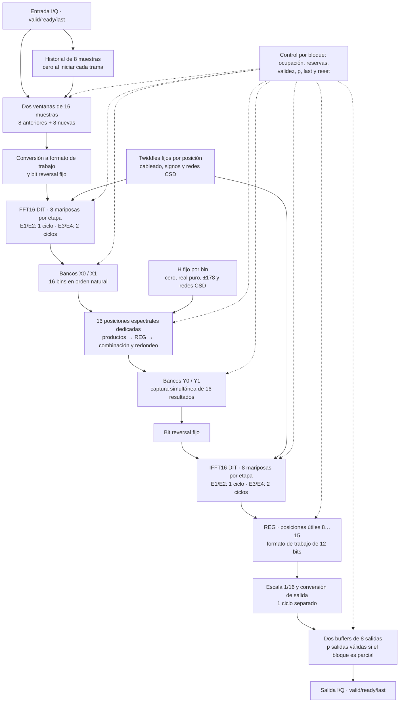

# C03 — Estrategia de optimización en frecuencia

**Issue:** [C03 — Elegir optimización en frecuencia](https://github.com/EnzoFernandezz11/rrc-fir-rtl/issues/18).

**Alcance:** elegir y justificar la arquitectura; C04 implementará el RTL.
**Eje PPA:** desempeño, aceptando más lógica y registros que la base serial.
Se propone una **variante rápida de 100 MHz (10 ns)** con **un bloque de ocho
muestras nuevas cada ocho ciclos**, en régimen sin pausas.

**Estado de la evidencia:** el calendario, los conteos estructurales y el
presupuesto de LUT de esta nota son cálculos de diseño, no resultados del RTL
optimizado. C04 deberá demostrar equivalencia, SQNR ≥ 40 dB, comportamiento
con pausas/reset, recursos, timing y potencia. La evidencia medida de C02 se
identifica por separado y conserva sus limitaciones de procedencia.

## Decisión propuesta

Se elige una arquitectura **FFT16/IFFT16 paralela por etapas y pipelineada**,
con núcleos separados y **16 posiciones espectrales dedicadas, una por bin**.
El método continúa siendo overlap-save: ocho muestras de historial, ocho nuevas
y ocho salidas útiles por bloque completo, con 50 % de superposición.

| Nivel de diseño | Elección | Motivo y costo principal |
|---|---|---|
| FFT16 e IFFT16 | Dos núcleos; cuatro etapas propias de ocho mariposas cada uno | Paralelismo por etapa, conexiones fijas y ausencia de competencia entre transformadas. |
| Aritmética | Productos por constantes mediante sumas/restas y desplazamientos, con representación CSD | Especializar cada posición para su twiddle o H; evitar un multiplicador variable innecesario. |
| Twiddles | Cableado/signos para `1` y `±j`; dos productos reales para componentes de igual magnitud | Simplificar las 32 posiciones de cada núcleo según sus constantes exactas. |
| Productos espectrales | 16 posiciones simultáneas con H fijo; especializar cero, real puro y componentes iguales | Eliminar tandas, contador de bins y selección de cuatro bins; aumenta el hardware dedicado. |
| Pipeline | E1/E2 en un ciclo cada una; E3/E4 en dos cada una; producto espectral en dos; conversión de salida en uno separado | Cortar los caminos aritméticos largos desde la primera implementación; aumenta latencia y registros. |
| Almacenamiento y control | Dos ventanas, dos bancos X, dos Y y dos buffers de salida; reserva antes del inicio | Solapar bloques y conservar los resultados ante pausas. |
| Orden | X/Y naturales; bit reversal fijo a la entrada de cada DIT | Sustituir los intercambios seriales por conexiones vectoriales. |

### Diagrama de bloques de la candidata



E4 de FFT escribe directamente en X. E4 de IFFT registra las ocho posiciones
útiles antes de convertirlas al formato externo y escribir el destino reservado.
Los twiddles de IFFT son los conjugados de los de FFT. Datos y metadatos avanzan
juntos, incluidas las ramas triviales que solo necesitan alineación temporal.

### Relación con la consigna y alternativas

La [consigna vigente](../consigna-actualizada.md) pide máxima paralelización de
la etapa basada en FFT y evaluar FFT, multiplicación espectral e IFFT. Se adopta
un criterio común: desplegar las posiciones independientes de los tres bloques
y especializarlas para constantes conocidas. Se acepta que su capacidad interna
supere la alimentación de una muestra por ciclo.

| Unidades espectrales | Tandas por bloque | Coeficiente por unidad | Compromiso |
|---:|---:|---|---|
| 4 | 4 | Cambia con la tanda | Puede alcanzar la tasa objetivo; requiere selección de bins y seguimiento de tandas. |
| 8 | 2 | Cambia con la tanda | Menos reutilización; conserva selección y control de tandas. |
| **16 posiciones dedicadas** | **1** | **H[k] fijo** | **Conexiones fijas, especialización por bin y máximo paralelismo espectral.** |

Las cuatro unidades de la propuesta inicial eran compatibles con el objetivo
de tasa. Se reemplazan por las 16 posiciones para aplicar el mismo criterio de
paralelización y especialización que en FFT/IFFT. El despliegue también evita
realimentar y seleccionar operandos entre etapas de las transformadas.

Con una entrada serial, pasar de cuatro a 16 posiciones **no multiplica por
cuatro el throughput del filtro** si ambas alternativas sostienen `II_bloque = 8`.
Tampoco se presume menor área total: se elimina selección y se simplifican
constantes, pero se replica lógica. La comparación física depende del mapeo.
La ocupación baja de una etapa dedicada es un costo aceptado; no se usa la tasa
externa como único criterio para dimensionar uno solo de los tres bloques.

La propuesta corresponde a D08 para frecuencia. Su registro en el contrato y
la revisión del equipo quedan pendientes antes de integrar C03. Esta nota no
modifica la decisión de la rama temporal.

## 1. Base serial y objetivo de desempeño

El filtro C02 tiene comparación exacta contra el modelo fijo y los vectores
A05. La [base PPA](../../reports/ppa/frequency.md) informa 575 ciclos por bloque:

| Trabajo por bloque | Ciclos | Fracción |
|---|---:|---:|
| FFT16: 32 mariposas × 7 ciclos | 224 | 39,0 % |
| 16 productos espectrales × 6 ciclos | 96 | 16,7 % |
| Reordenamiento previo a IFFT | 6 | 1,0 % |
| IFFT16: 32 mariposas × 7 ciclos | 224 | 39,0 % |
| Preparación y control externos al motor | 25 | 4,3 % |
| **Total** | **575** | **100 %** |

El desglose procede del controlador; FFT/IFFT reúnen el 77,9 % de los ciclos.
El [multiplicador serial](../../rtl/frequency/complex_mul_serial.sv) reutiliza
un único operador real `a * b` para los cuatro productos de cada operación
compleja. Captura, combinación, control y escrituras agregan ciclos.

La Fmax histórica de aproximadamente 57,72 MHz se dedujo de una implementación
con restricción de 10 MHz. Falta el reporte detallado del camino crítico;
ese valor no demuestra que el multiplicador sea el limitante ni predice el
reloj de la arquitectura paralela.

### Intervalo entre bloques, latencia y reloj

Se fija **`II_bloque = 8`** para bloques completos consecutivos de una misma
trama, fuente disponible y salida lista, después del arranque. Reunir ocho
muestras nuevas a una por ciclo exige al menos ocho ciclos. Por tanto:

```text
Tasa de bloques = f_clk / 8
Throughput = 8 × f_clk / II_bloque = f_clk, si II_bloque = 8
A 100 MHz: 12,5 millones de bloques/s y 100 millones de muestras complejas/s
```

No se exige terminar cada bloque en ocho ciclos. Se solapan captura,
procesamiento y emisión; la latencia de un bloque puede superar ese intervalo.
Llenar buffers durante un transitorio tampoco demuestra una tasa sostenida.

Los 100 MHz corresponden al mínimo de la categoría rápida del
[contrato técnico](../contrato-tecnico.md). C04 utilizará
[`clk_100mhz.xdc`](../../constraints/clk_100mhz.xdc) y comprobará setup/hold,
considerando lógica, ruteo y márgenes. Las burbujas, el backpressure y las tramas
parciales se verifican aparte: deben preservar datos, orden y conteo, aunque
reduzcan la tasa respecto del escenario continuo.

## 2. Criterio aritmético: especialización para constantes

El enfoque formativo sigue siendo RTL orientado a ASIC. Vivado y Artix-7 son
la plataforma de medición disponible; sus LUT, FF, DSP y retardos describen
el mapeo FPGA. Para evaluar físicamente un ASIC se requiere otra biblioteca
y otro flujo.

En una estructura desplegada, cada posición de FFT/IFFT tiene un twiddle fijo.
Las 16 posiciones espectrales también tienen H fijo. Que una tabla sea ROM no
basta para esta propiedad: en una unidad reutilizada, el índice cambia y el
coeficiente que recibe el multiplicador varía. Aquí las constantes se fijan
**por instancia**, sin un puerto de coeficiente que cambie entre operaciones.
Se mantienen exactamente los valores cuantizados de la
[ROM de C02](../../rtl/frequency/frequency_block_roms.sv).

### Elección: redes de sumas, restas y desplazamientos

Se representará cada constante mediante CSD (Canonical Signed Digit), con
dígitos `−1`, `0` y `+1`, para generar sus términos desplazados. Se combinarán
con una red equilibrada de sumas/restas, conservando precisión hasta el corte
numérico original. Por ejemplo:

```text
181 = 256 − 64 − 16 + 4 + 1
181 × a = (a << 8) − (a << 6) − (a << 4) + (a << 2) + a
```

Los desplazamientos fijos son conexiones; las sumas/restas tienen costo lógico
y retardo. La expresión ilustra la identidad: no obliga a encadenar cuatro
sumadores en serie. Antes de desplazar se extiende el signo al ancho elegido.
CSD reduce términos para muchas constantes, pero no garantiza por sí solo la
mejor red física ni el menor retardo para todas ellas. El presupuesto conserva
redes independientes por producto, sin atribuir ahorros a subexpresiones aún
no implementadas.

Las sumas/restas se expresarán como operaciones aritméticas de ancho explícito.
En FPGA se comprobará la inferencia de carry y el uso de DSP; no se impone un
CLA manual a todos los sumadores. AMD recomienda la inferencia de
[CARRY4](https://docs.amd.com/r/2025.1-English/ug953-vivado-7series-libraries/CARRY4)
y documenta el [mapeo de multiplicadores](https://docs.amd.com/r/en-US/ug901-vivado-synthesis/Multipliers-Implementation).
Una descripción estructural puede dificultar ese reconocimiento; el reporte
de síntesis determinará qué recursos se utilizaron.

### Alternativa considerada: Booth → Wallace → CLA

Booth radix-4 recodifica un operando variable para seleccionar productos
parciales; Wallace los comprime y CLA resuelve la suma final. Es una alternativa
para multiplicadores generales, como los de una organización compartida.
Con el coeficiente fijo, la recodificación se resuelve estáticamente y síntesis
puede eliminar selección y productos nulos. Por eso no se elige construir
esa estructura genérica en cada posición de la candidata.

Se conserva su estudio como alternativa aritmética, sin forzar hardware para
mostrar las tres técnicas. Las redes por constante y su pipeline son la decisión
que implementará C04. El conteo inicial de 96 operadores generales queda
sustituido por el conteo especializado de la sección 3.

## 3. Paralelismo y conservación del punto fijo

### Anchos y puntos de cuantización

Se conservan los formatos de C02: trabajo de 12 bits con signo, coeficientes
de 10 bits con ocho fraccionarios y salida de 9 bits. Para componentes de
coeficiente diferentes se mantiene la descomposición de cuatro productos:

```text
M0 = a_i × c_i       M1 = a_q × c_q
M2 = a_i × c_q       M3 = a_q × c_i
p_i = M0 − M1        p_q = M2 + M3
```

Cada producto `12 × 10` se conserva en 22 bits y se extiende a 23 antes de
combinarlo. Para componentes de igual magnitud se suman/restan los datos en
**13 bits**, después de extender ambos operandos, y se conservan los productos
`13 × 10` en **23 bits**. No se recortan las presumas a 12 bits.

El redondeo de producto mantiene la fórmula de C02: extender a 24 bits, sumar
128 y desplazar aritméticamente ocho posiciones; luego convertir a trabajo de
12 bits, verificando overflow. Las mariposas calculan sumas/restas en 13 bits
y conservan el corte a 12 de la referencia. En salida se toma primero el dato
de trabajo de IFFT y luego se aplica el escalado y redondeo existentes:
`IFFT_SHIFT = 4 + F_WORK − F_OUT = 2`, con guardia de 13 bits y salida de 9.
No se fusionan redondeos ni se agrega saturación.

### Twiddles triviales y de componentes iguales

Para `a = a_i + j·a_q`, las posiciones con `1` y `±j` se especializan estáticamente:

| Twiddle | Parte real | Parte imaginaria |
|---|---|---|
| `1` | `a_i` | `a_q` |
| `−j` | `a_q` | `−a_i` |
| `+j` | `−a_q` | `a_i` |

El valor entero que representa 1 es 256, por lo que estos atajos son exactos
respecto del producto cuantizado. Los cambios de signo se hacen con guardia
antes del corte; se conserva la detección de overflow de la referencia.
No hay selector dinámico de twiddle en cada posición dedicada.

W² y W⁶ tienen componentes de magnitud 181. Antes del redondeo y de dividir por
256, las identidades de FFT son:

```text
W² = ( 181 − j181) / 256:
    p_i = 181 × (a_i + a_q)
    p_q = 181 × (a_q − a_i)

W⁶ = (−181 − j181) / 256:
    p_i = 181 × (a_q − a_i)
    p_q = −181 × (a_i + a_q)
```

IFFT utiliza sus conjugados: para W², los resultados son
`181 × (a_i − a_q)` y `181 × (a_i + a_q)`; para W⁶,
`−181 × (a_i + a_q)` y `181 × (a_i − a_q)`. Cada posición necesita dos
productos reales por constante, en lugar de cuatro. Se forman primero las
sumas/restas indicadas en 13 bits y se aplica cualquier negativo exterior al
producto de 23 bits, evitando negar el mínimo de 13 bits en ese mismo ancho.
El signo se resuelve antes del redondeo: negarlo después puede cambiar el
resultado del redondeo mitad hacia arriba.

### Ocho mariposas por etapa y núcleos independientes

Las ocho mariposas de cada etapa trabajan sobre pares disjuntos. Se despliegan
las cuatro etapas, con conexiones fijas y registros entre ellas; las dependencias
entre etapas se mantienen. FFT e IFFT tienen hardware propio para procesar
bloques diferentes sin disputar un núcleo configurable compartido.

| Etapa por núcleo | Twiddles triviales | Componentes iguales, ±181 | Otras constantes | Productos reales por constante |
|---:|---:|---:|---:|---:|
| E1 | 8 | 0 | 0 | 0 |
| E2 | 8 | 0 | 0 | 0 |
| E3 | 4 | 4 | 0 | 8 |
| E4 | 2 | 2 | 4 | 20 |
| **Total** | **22** | **6** | **4** | **28** |

Cada núcleo mantiene 32 posiciones de mariposa. Los 28 productos son 12 por
181, ocho por 237 y ocho por 98, con los signos de cada posición; sus redes no
son multiplicadores generales. Entre ambos núcleos hay 64 mariposas y 56
productos reales por constante. El presupuesto conserva todas las posiciones;
una eliminación posterior de resultados no utilizados puede reducirlo.

### Dieciséis posiciones espectrales dedicadas

Cada posición calcula `Y[k] = X[k] × H[k]` y escribe siempre el mismo bin.
Las constantes de la ROM permiten estas especializaciones:

| Bins | H cuantizado, antes de dividir por 256 | Implementación | Productos reales |
|---|---|---|---:|
| 8 | `0 + j0` | Salida cero, con validez alineada | 0 |
| 0 | `356 + j0` | `356 × X_i`, `356 × X_q` | 2 |
| 4 | `178 + j178` | `178 × (X_i − X_q)`, `178 × (X_i + X_q)` | 2 |
| 12 | `178 − j178` | `178 × (X_i + X_q)`, `178 × (X_q − X_i)` | 2 |
| Los otros 12 | Componentes fijas no triviales | Cuatro productos por constante y dos combinaciones | 48 |
| **Total espectral** | | **16 posiciones, incluidas las simplificadas** | **54** |

Se eliminan las cuatro tandas, el contador de tanda, los índices de resultados
en vuelo y los multiplexores que seleccionaban cuatro de 16 bins. Permanecen
la selección de banco X, la reserva de banco Y y los metadatos de bloque.
Los 16 resultados se publican simultáneamente, incluido el cero de Y[8].

El presupuesto completo es **28 + 54 + 28 = 110 productos reales por constante**.
No es comparable como área con los 96 operadores generales de la propuesta
anterior, ni implica 110 DSP: cambian las operaciones y su implementación.

## 4. Pipeline, almacenamiento y calendario

### Cortes seleccionados desde C03

E1/E2 solo contienen twiddles triviales y se resuelven en un ciclo por etapa.
En E3/E4 se introduce un registro **dentro del producto complejo**, después de
los productos reales y antes de su combinación/redondeo y la mariposa:

```text
E1 → REG → E2 → REG
   → [E3: presumas y productos constantes → REG → combinación, redondeo y mariposa] → REG
   → [E4: presumas y productos constantes → REG → combinación, redondeo y mariposa] → destino

Espectral: productos constantes → REG → combinación y redondeo → Y
IFFT: E4 → REG de ocho resultados útiles → conversión de salida → buffer reservado
```

En los productos factorizados, el segundo tramo aplica los signos necesarios
y el redondeo; no necesita recombinar cuatro productos. Los registros de E3/E4
conservan además el operando directo de cada mariposa y los datos de las ramas
triviales. Todos los caminos de una etapa llegan juntos a su frontera de salida.

Cada FFT dura **seis ciclos** desde el lanzamiento hasta X completo. La etapa
espectral dura **dos ciclos** desde el lanzamiento hasta Y completo. IFFT dura
**seis ciclos**, más **uno** para la conversión externa. Cada tramo aritmético
es pipelineado y puede admitir datos nuevos por ciclo si sus destinos y control
lo permiten; el calendario del sistema lanza bloques cada ocho ciclos.

Estos cortes separan el producto real del resto de la mariposa y retiran la
conversión externa del último camino IFFT. No cortan internamente cada red CSD:
el tramo presuma/producto y el tramo combinación/redondeo/mariposa deben medirse
por separado. Si alguno no cumple 10 ns, C04 deberá redistribuir o agregar
registros y recalcular las reservas, sin alterar la cuantización.

La conservación de throughput depende del intervalo de aceptación y del espacio
reservado, no de una supuesta cantidad de ciclos libres. No basta con agregar
registros y desplazar fechas: un destino reservado durante más tiempo puede
obligar a introducir esperas o más bancos.

### Reservas y manejo de pausas

Se eligen dos bancos X y dos bancos Y, cada uno de 16 complejos de trabajo,
además de dos ventanas y dos buffers de salida. Son bancos de registros con
acceso vectorial; una RAM de pocos puertos no satisface estos accesos por sí sola.

| Operación | Origen completo | Destino que se reserva antes de iniciar | Liberación del origen |
|---|---|---|---|
| FFT | Ventana | Banco X libre | Captura de E1, que consume todo el vector |
| Espectral | Banco X | Banco Y libre | Captura de todos los productos reales |
| IFFT y conversión | Banco Y | Buffer de salida libre | Captura de E1 de IFFT |

Una reserva ocupa el destino aunque todavía no tenga datos válidos. Solo se
marca completo al escribir todos los resultados. Una operación iniciada avanza
sin pausas internas; si falta destino, se demora el inicio y se conserva el
origen. Se atienden los bloques en orden FIFO, sin alternar bancos ciegamente.

Cada registro de pipeline lleva la validez y los metadatos necesarios: destino,
cantidad útil `p` y fin de trama. Reset síncrono activo alto invalida los bloques
en vuelo, buffers y reservas, impidiendo publicar operaciones abortadas.
Dos bancos absorben esperas finitas; cuando se ocupan, el bloqueo se propaga
hasta `in_ready`.

### Preparación de ventanas y salida

Las ventanas conservan 16 complejos en formato de entrada de 2 bits por
componente. Una puede alimentar o esperar a FFT mientras la otra reúne las
ocho muestras nuevas. El historial independiente avanza solo con transferencias
aceptadas y se copia en paralelo o solapado con la captura. No se agrega una
fase serial de ocho ciclos para copiarlo ni una burbuja al cambiar de ventana.
La conversión al formato de trabajo se realiza al alimentar E1.

Los buffers de salida almacenan ocho complejos de 9 bits por componente. Uno
se emite a una muestra por ciclo mientras el otro recibe el bloque siguiente;
el cambio de banco completo no introduce un ciclo vacío. Ante una pausa se
mantienen `out_valid`, I/Q y `out_last`, y el índice avanza solo al transferir.
El banco se libera después de aceptar su último resultado útil.

Para un bloque parcial se completa la ventana según la referencia y se emiten
solo `p` muestras, entre una y ocho. `last` marca el final de la trama, sin
crear un bloque extra si coincide con la octava entrada. El historial se reinicia
por trama. Se conserva `valid/ready/last` sin dependencias combinacionales
circulares entre disponibilidades.

### Calendario nominal con los cortes incluidos

Se toma `t = 0` con la ventana A completa, destinos disponibles y salida siempre
lista. Las fechas indican flancos de captura; un banco recién completado no se
consume en ese mismo flanco.

| Flanco relativo | Acción para A |
|---|---|
| 0 | Lanzar FFT y reservar X |
| 1, 2 | Capturar E1 y E2; liberar ventana en 1 |
| 3, 4 | Capturar productos de E3 y luego su mariposa |
| 5, 6 | Capturar productos de E4 y luego X completo |
| 7 | Lanzar etapa espectral y reservar Y |
| 8 | Capturar productos espectrales; liberar X |
| 9 | Combinar/redondear y escribir Y completo |
| 10 | Lanzar IFFT y reservar buffer de salida |
| 11, 12 | Capturar E1 y E2 de IFFT; liberar Y en 11 |
| 13, 14 | Capturar productos de E3 y luego su mariposa |
| 15, 16 | Capturar productos de E4 y luego ocho resultados útiles de trabajo |
| 17 | Convertir y escribir el buffer de salida completo |
| 18…25 | Transferir ocho muestras; liberar salida en 25 |

B desplaza todas las fechas ocho ciclos, y C dieciséis. La disponibilidad de
bancos alternados queda explícita:

| Recurso | Reserva de A | Liberación de A | Reserva de B, otro banco | Reserva de C, banco de A |
|---|---:|---:|---:|---:|
| X | 0 | 8 | 8 | 16 |
| Y | 7 | 11 | 15 | 23 |
| Salida | 10 | 25 | 18 | 26 |

La coincidencia en 8 es entre bancos X distintos. El buffer de salida de A se
libera un flanco antes de reservarlo para C, sin necesitar liberación y nueva
reserva del mismo banco en el mismo flanco. Las emisiones de A, B y C son
**18…25, 26…33 y 34…41**: consecutivas, con intervalo de ocho ciclos.

Desde la ventana completa, la primera transferencia ocurre en 18 y la última
en 25. La latencia contractual por muestra incluye además su posición en la
ventana y se medirá con la definición de la interfaz. El margen de salida es
estrecho: agregar otro ciclo interno obliga a revisar esta tabla y el protocolo
de reutilización de bancos. Con backpressure, los lanzamientos se posponen según
las reservas; no se promete sostener este calendario durante una pausa.

### Orden natural y permutaciones

X e Y conservan orden natural. Cada entrada DIT recibe una permutación fija:

```text
entrada_interna[j] = entrada_natural[bitrev4(j)]
Orden de conexiones: 0, 8, 4, 12, 2, 10, 6, 14, 1, 9, 5, 13, 3, 11, 7, 15
```

Se aplica una vez a la ventana antes de FFT y una vez a Y antes de IFFT.
La captura de entrada ya no utiliza la escritura invertida de C02, para evitar
una inversión doble. Los seis intercambios seriales previos a IFFT desaparecen;
las conexiones tienen retardo físico de ruteo, pero no ciclos de intercambio.
La salida útil conserva las posiciones temporales `8…15`, o las primeras `p`
de ese tramo para bloques parciales.

### Presupuesto de registros de datos

El conteo usa los anchos anteriores, sin reducir registros por análisis de rango
ni por eliminación de bits constantes. En cada corte interno de E3/E4 se guarda
el operando directo A de ocho mariposas (`8 × 2 × 12 = 192` bits). En las ramas
triviales se retiene B en 12 bits por componente y se aplica el signo con guardia
al consumirlo. En las demás se guardan productos exactos:

| Registro aritmético | Cálculo | Bits |
|---|---|---:|
| Corte E3, por núcleo | `192 + 4 × 2 × 12 + 4 × 2 × 23` | 472 |
| Corte E4, por núcleo | `192 + 2 × 2 × 12 + 2 × 2 × 23 + 4 × 4 × 22` | 684 |
| Cortes E3/E4, ambos núcleos | `2 × (472 + 684)` | 2312 |
| Productos espectrales | `12 × 4 × 22 + 2 × 2 × 23 + 2 × 22`; H[8] sin datos almacenados | 1192 |
| Salida útil IFFT previa a conversión | `8 × 2 × 12` | 192 |

Los registros de productos factorizados ya contienen las presumas multiplicadas;
no se agrega otro registro para esas presumas. La validez de H[8] se alinea con
el resto del bloque aunque su dato sea un cero constante.

| Almacenamiento | Capacidad de datos |
|---|---:|
| Dos ventanas, cada una de 16 complejos de 2 bits por componente | 128 bits |
| Historial de ocho complejos de entrada | 32 bits |
| Salidas E1/E2/E3 de ambos núcleos: `2 × 3 × 16 × 2 × 12` | 2304 bits |
| Cortes aritméticos E3/E4 de ambos núcleos | 2312 bits |
| Registro de productos espectrales | 1192 bits |
| Dos bancos X y dos Y: `4 × 16 × 2 × 12` | 1536 bits |
| Salida útil IFFT antes de conversión | 192 bits |
| Dos buffers de salida: `2 × 8 × 2 × 9` | 288 bits |
| **Total nominal de datos** | **7984 bits** |

E4 de FFT utiliza X como registro final; no se duplica. E4 de IFFT conserva
solo sus ocho resultados útiles en el registro previo a conversión. H y W son
constantes por instancia, sin bancos de coeficientes variables.

El presupuesto sustituye los 4288 bits iniciales: suma 3696 bits para los cortes
aritméticos y la salida IFFT intermedia. Excluye validez, ocupación, reservas,
contadores de entrada/salida y metadatos. Es capacidad nominal de datos, no
área ni un conteo de FF garantizado después de síntesis.

## 5. Compromiso PPA y presupuesto de implementación

| Métrica | C02 serial | Candidata C03 |
|---|---|---|
| Reloj de evaluación | 10 MHz en la corrida histórica | Objetivo de 100 MHz |
| `II_bloque` | 575 ciclos en el benchmark | Objetivo de 8 ciclos |
| Throughput al mismo reloj `f` | `8 × f / 575` | `f`; factor teórico **71,875×** |
| Throughput con los relojes indicados | ≈ 139 130 muestras/s | 100 000 000 muestras/s; factor combinado **718,75×** |
| Latencia | `L = 559` ciclos según el benchmark y la definición contractual | Primera salida interna en 18 desde ventana completa; falta medir L contractual |
| Multiplicación en RTL | Un operador real compartido | 110 productos reales por constante: 28 FFT + 54 espectrales + 28 IFFT |
| Datos almacenados | Banco work de 384 bits e historial de 32; conteo parcial | 7984 bits nominales, sin control ni metadatos |
| Recursos FPGA | Resumen recibido: 1875 LUT como lógica, 569 FF y 3 DSP | Presupuesto analítico de LUT abajo; síntesis e implementación en C04 |
| Timing | Fmax aproximada 57,72 MHz; sin reporte detallado del camino | Verificar 10 ns en cada tramo del pipeline seleccionado |
| Potencia y energía | Referencia histórica vectorless, con limitaciones | Actividad representativa y condiciones comparables |

El factor combinado incluye 10× por reloj y `575/8` por intervalo. No expresa
la mejora de latencia. Las tasas cuentan muestras complejas del filtro; con
upsampling 2×, 100 Mmuestras/s corresponden a 50 Msímbolos/s QPSK.

```text
Throughput = 8 × f_clk / II_bloque
Factor = (575 / II_bloque_nuevo) × (f_clk_nuevo / f_clk_base)
```

La comparación física conservará dispositivo, flujo, formatos y estímulos,
declarando el reloj de cada corrida. Puede agregarse una corrida C02 a 100 MHz
para comparar restricciones, sin reemplazar la base histórica. El resumen
recibido de C02 carece de reportes originales y de identificación completa de
fuentes; se mantienen las limitaciones del registro PPA.

### Estimación analítica de LUT frente a xc7a35t

El xc7a35t dispone de **20 800 LUT y 41 600 FF**, según la tabla de recursos
[AMD UG474](https://docs.amd.com/r/en-US/ug474_7Series_CLB/7-Series-FPGA-CLB-Resources).
Se presupone aquí una implementación de las redes constantes en lógica, sin
atribuirles DSP ni un área proporcional al multiplicador de C02.

Para obtener una referencia reproducible se cuenta `t − 1` sumas/restas por
constante con `t` términos CSD no nulos. Se usan palabras completas de 22 bits,
o 23 para los productos precedidos por presuma, sin compartir subexpresiones
ni descontar bits que síntesis podría simplificar:

| Redes constantes | Productos | Sumas/restas CSD | Suma de anchos de esas operaciones |
|---|---:|---:|---:|
| FFT | 28 | 88 | 1984 bits |
| IFFT | 28 | 88 | 1984 bits |
| Espectral | 54 | 134 | 2960 bits |
| **Total** | **110** | **310** | **6928 bits** |

Para reproducir el conteo espectral se toman dos productos por 356, cuatro por
178 con ancho de 23 bits, y cuatro por cada magnitud de
`71, 355, 337, 139, 186, 278, 111, 74, 11, 27, 13, 3`, de 22 bits.
Los signos se tratan aparte o se absorben en las operaciones consumidoras.

Se agregan estas operaciones de ancho completo al modelo:

| Operaciones adicionales | Cálculo | Suma de anchos |
|---|---|---:|
| Presumas de posiciones con componentes iguales | `28 × 13` | 364 bits |
| Combinaciones de productos no factorizados | `40 × 23` | 920 bits |
| Sumas/restas de las 64 mariposas | `64 × 4 × 13` | 3328 bits |
| Bias de redondeo de productos no triviales | `70 × 24` | 1680 bits |
| Bias de conversión de salida | `16 × 13` | 208 bits |
| **Total adicional** | | **6500 bits** |

La suma es **13 428 bits de operaciones aritméticas**. Como hipótesis de
presupuesto, un mapeo de aproximadamente una LUT por bit de sumador con carry
más una reserva del 20 % para signos, selección de bancos, control y lógica
auxiliar da **unas 16 100 LUT, cerca del 77,5 % del dispositivo**. El 20 % es una
reserva de planificación, no una estimación sintetizada de esos bloques.

Este modelo no es una cota: ignora simplificaciones de constantes, empaquetado,
fanout, duplicación para timing y costos particulares de control. Si el mapeo
necesitara dos LUT por bit aritmético, la misma cuenta superaría 32 200 LUT y
no cabría. La aritmética por sí sola consume un presupuesto significativo;
C04 debe sintetizar pronto las redes constantes y una mariposa de E4, y luego
el conjunto, para reemplazar estas hipótesis por utilización real. Los 7984 bits
de datos representan alrededor del 19,2 % de los FF disponibles antes del
control, pero la distribución física y el ruteo siguen siendo relevantes.

La replicación y los registros aumentan recursos y actividad respecto del
serial. Reducir la energía por muestra es posible al aumentar la tasa, pero
requiere medir actividad y potencia. Tampoco se deduce el área comparando
110 productos constantes con 96 generales ni multiplicando recursos de C02.

## 6. Plan de implementación y verificación de C04

1. **Validar la aritmética especializada.** Implementar redes por constante con
   anchos explícitos; verificar cada producto contra la multiplicación entera,
   incluidos extremos, negativos, presumas de 13 bits y signos antes de redondear.
   Comprobar los atajos para `1`, `±j`, W²/W⁶ y H[0/4/8/12], tanto en FFT como
   en IFFT. Mantener guardias, redondeos y detección de overflow de C02.
2. **Implementar y sintetizar los cortes seleccionados.** Comenzar por las redes
   constantes y E4 para evaluar los dos tramos críticos, carry/DSP inferidos y
   recursos. Desplegar FFT/IFFT, las 16 posiciones espectrales y la conversión
   separada de salida. Incluir desde esta versión los registros de productos,
   operandos directos, bypass y metadatos presupuestados en la sección 4.
3. **Integrar buffers y control por bloque.** Implementar reservas exclusivas,
   orden FIFO, liberación de orígenes tras su captura y reset de toda validez
   pendiente. Conservar el orden natural de X/Y y una sola permutación fija
   a la entrada de cada DIT. No incorporar contador de tandas espectrales.
4. **Verificar el filtro completo.** Comparar exactamente con el modelo fijo y
   A05; comprobar SQNR ≥ 40 dB. Ejercitar pausas de fuente, backpressure en
   distintas fases, ambos bancos ocupados, resultados en vuelo, reset durante
   cálculo/espera/emisión y tramas parciales. Comprobar que no haya pérdidas,
   duplicados, mezcla de bloques ni cambios en una salida retenida. Verificar
   también alineación del bin cero, bypass y producto general tras cada corte.
5. **Comprobar el calendario y medir PPA.** Medir aceptación y emisión continuas
   sobre muchos bloques después del arranque: `II_bloque = 8`, sin burbujas en
   el cambio de ventana ni de salida. Medir L según el contrato y comprobar
   reservas ante pausas, sin usar solo el llenado transitorio como evidencia.
   Implementar con restricción de 10 ns, revisar setup/hold y caminos críticos,
   registrar LUT/FF/DSP/BRAM y comparar condiciones con C02. Potencia y energía
   requieren actividad representativa; las cifras vectorless no la sustituyen.
6. **Ajustar con evidencia.** Si no cierra timing, estudiar retiming o cortes
   adicionales, distinguiendo mover registros de agregar etapas. Recalcular
   latencia, capacidad de buffers y reservas; alargar IFFT puede agotar el margen
   de los dos destinos de salida. Si no cabe, revisar redes constantes y su
   mapeo; cualquier cambio de paralelismo debe volver a justificar la consigna.
   Repetir la verificación funcional y temporal después de modificar el diseño.

Los resultados se incorporarán al [registro PPA común](../../reports/ppa/frequency.md).
Antes de integrar C03 deben revisarse el calendario, los anchos, el presupuesto
de recursos y el compromiso de paralelismo, y registrarse D08 para frecuencia
conservando el estado de la decisión temporal y la revisión del equipo.

Como comprobación de esta nota se contrastaron constantes y conteos con la ROM,
las redes CSD con multiplicación entera sobre entradas de 13 bits y las
factorizaciones con extremos y casos aleatorios. El cálculo de reservas sobre
128 bloques confirmó que no se reutiliza un banco ocupado y que las emisiones
nominales son consecutivas. Son comprobaciones aritméticas del diseño escrito;
la simulación del nuevo RTL y sus pausas corresponde al plan anterior.

## Apéndice A. Alternativas parciales sobre el calendario serial

Se conservan como referencia las estimaciones que cambiaban solo la cantidad
de operadores, con una mariposa a la vez, 64 mariposas entre FFT/IFFT,
16 productos espectrales y otros 31 ciclos por bloque:

| Alternativa | Ciclos por mariposa | Ciclos por bin | Ciclos por bloque | Aumento de throughput al mismo reloj |
|---|---:|---:|---:|---:|
| C02 serial | 7 | 6 | 575 | Referencia |
| Dos operadores, dos ciclos de cálculo | 5 | 4 | 415 | 38,6 % |
| Cuatro operadores, productos y combinación en un ciclo | 4 | 3 | 335 | 71,6 % |
| Cuatro operadores, productos y combinación en dos ciclos sin solapamiento | 5 | 4 | 415 | 38,6 % |

Estas alternativas no incorporan la especialización, el despliegue completo
ni el pipeline seleccionado. Sus ahorros no se suman a los de la candidata.
Pasar de 335 a 415 ciclos en un diseño bloqueante exige más de 23,9 % de mejora
de reloj para compensar. En la candidata con bloques solapados, la comparación
se hace con el intervalo entre bloques, no con esa latencia parcial.

## Apéndice B. Fundamentos y referencias

Las decisiones concretas de esta nota se apoyan en fuentes del repositorio y
documentación pública, sin depender de rutas locales del material de cursada:

| Fuente | Uso en la decisión |
|---|---|
| [Consigna vigente](../consigna-actualizada.md) y [contrato técnico](../contrato-tecnico.md) | Paralelización, categoría rápida y estado de D08. |
| [Contrato de frecuencia](../contratos/frecuencia.md) | FFT16, overlap-save y selección de salidas. |
| [Señales y formatos](../contratos/senales-y-formatos.md) | Coeficientes, anchos, redondeos y SQNR. |
| [Interfaz RTL](../contratos/interfaz-rtl.md) | Handshake, reset y definición de latencia/throughput. |
| [ROM](../../rtl/frequency/frequency_block_roms.sv) y [motor C02](../../rtl/frequency/frequency_block_engine.sv) | Constantes exactas, pares de mariposa, orden y puntos de cuantización. |
| [Modelo fijo](../../model/fixed_point.py) | Referencia numérica para equivalencia y límites. |
| [Verificación y PPA](../contratos/verificacion-y-ppa.md) y [base medida](../../reports/ppa/frequency.md) | Método de comparación y procedencia de C02. |
| [AMD UG474: recursos](https://docs.amd.com/r/en-US/ug474_7Series_CLB/7-Series-FPGA-CLB-Resources) | Capacidad de LUT/FF del xc7a35t. |
| [AMD UG953: CARRY4](https://docs.amd.com/r/2025.1-English/ug953-vivado-7series-libraries/CARRY4) | Carry dedicado e inferencia aritmética en FPGA. |

CSD y las factorizaciones se explicitan en la sección 2 y la sección 3 para
poder comprobar las identidades sin material externo. El calendario y los
presupuestos son decisiones de este trabajo. La
[PR #49](https://github.com/EnzoFernandezz11/rrc-fir-rtl/pull/49) sirve de referencia
de presentación de la comparación PPA; sus mediciones pertenecen al FIR temporal.
