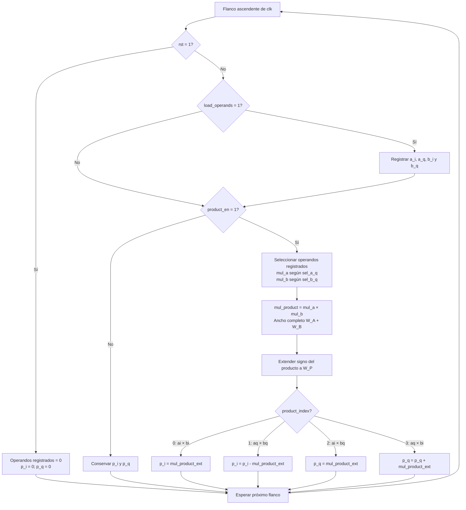

# Flujo de `complex_mul_serial`

Fuente: [`complex_mul_serial.sv`](../../rtl/frequency/complex_mul_serial.sv). El datapath captura operandos y reutiliza un único multiplicador real. Los cuatro productos se acumulan directamente en `p_i/p_q`, sin registros de productos separados ni ciclo de combinación.

El control separa la captura de los cuatro ciclos de producto. Los multiplexores, la multiplicación y la extensión de signo son combinacionales; solo se registran los operandos y las actualizaciones de `p_i/p_q` indicadas en el diagrama. `load_operands` y `product_en` son habilitaciones independientes en el datapath, aunque el control no las activa juntas.

`W_P` debe ser al menos `W_A + W_B + 1` para cubrir la suma/resta completa. El motor instancia la unidad con anchos 12 × 10 → 23 bits; el redondeo A04 se hace en el motor, después de `done`. Durante el cálculo las salidas pueden mostrar valores parciales; son finales con `done` y se mantienen hasta la siguiente acumulación o reset.

[Índice de diagramas](README.md) · [Control del multiplicador](complex_mul_serial_control.md)
