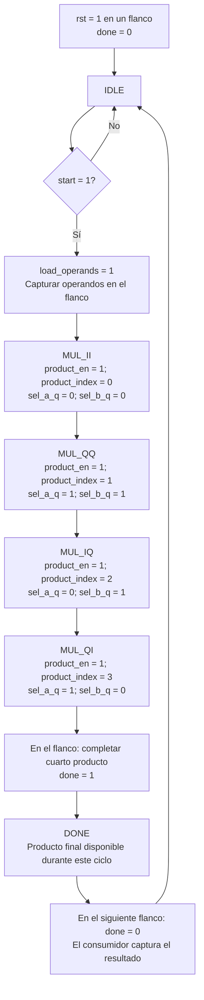

# Flujo de `complex_mul_serial_control`

Fuente: [`complex_mul_serial_control.sv`](../../rtl/frequency/complex_mul_serial_control.sv). La FSM captura ambos operandos complejos, habilita cuatro productos reales y genera un pulso registrado de finalización.

Reset tiene prioridad desde cualquier estado y vuelve a `IDLE` con `done=0`; el datapath limpia operandos y resultados en ese mismo flanco. `start` se acepta únicamente en `IDLE`. Los estados de producto avanzan un estado por flanco y `DONE` vuelve a `IDLE` sin aceptar un nuevo `start` en ese flanco. Un estado inválido también vuelve a `IDLE`.

Contando el flanco que acepta `start` como 1: captura en 1, productos en 2…5, resultado completo y `done=1` después del flanco 5; el motor lo captura en el 6. `done` se pone por defecto en cero en cada flanco y solo sube en la transición `MUL_QI → DONE`. No existe el estado `COMBINE`.

[Índice de diagramas](README.md) · [Datapath del multiplicador](complex_mul_serial.md)
