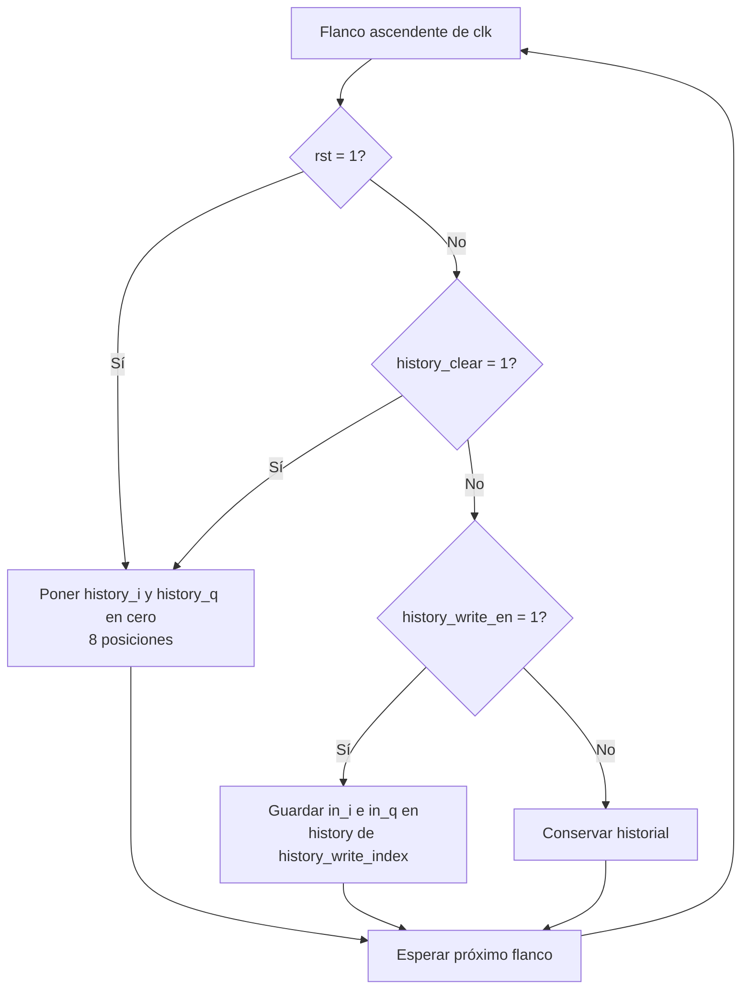
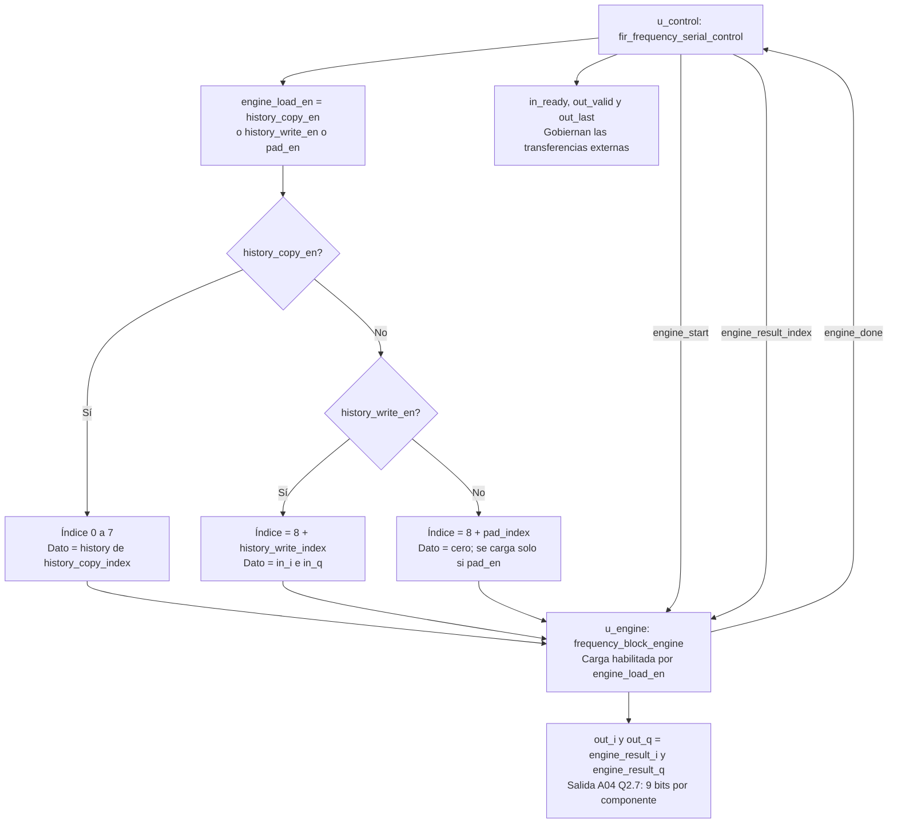
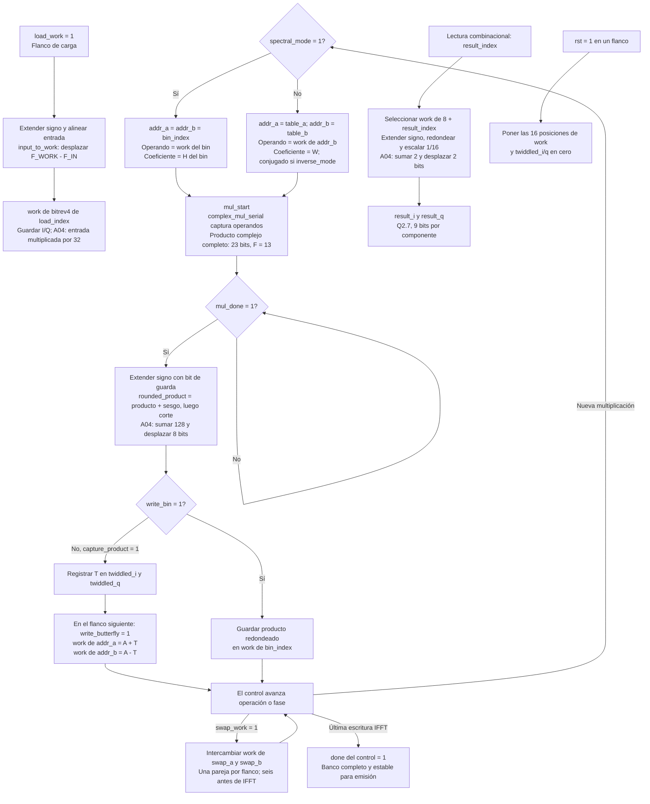
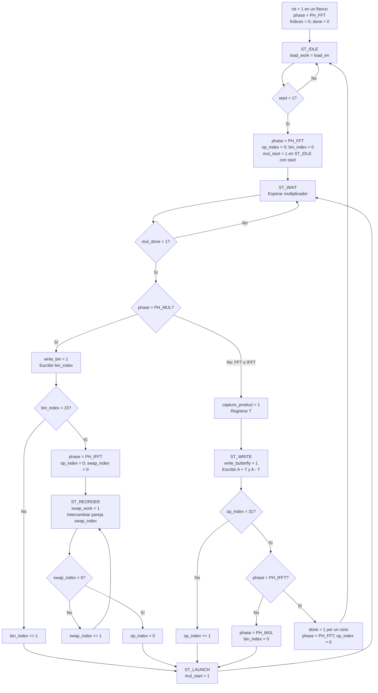
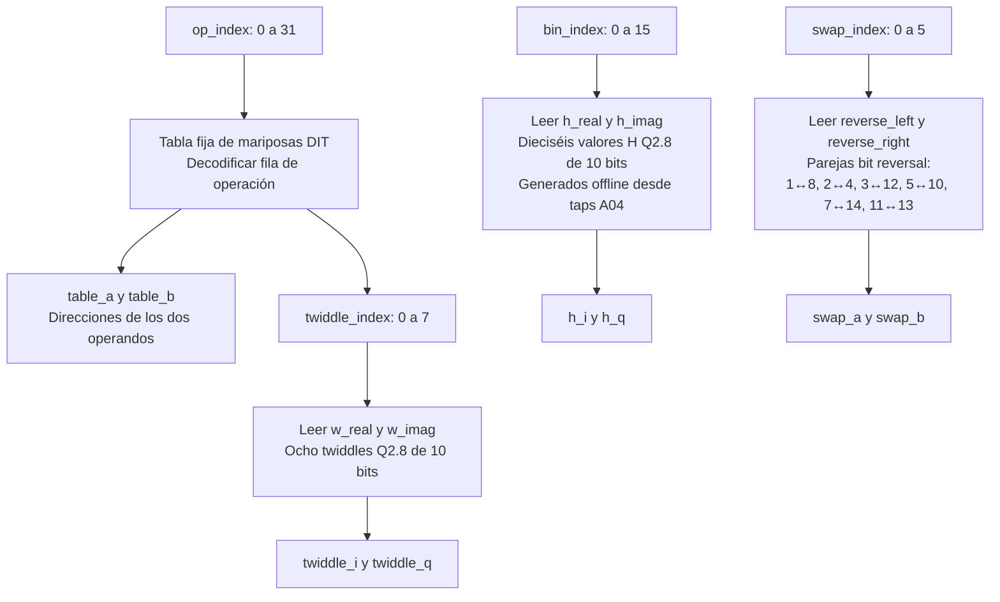
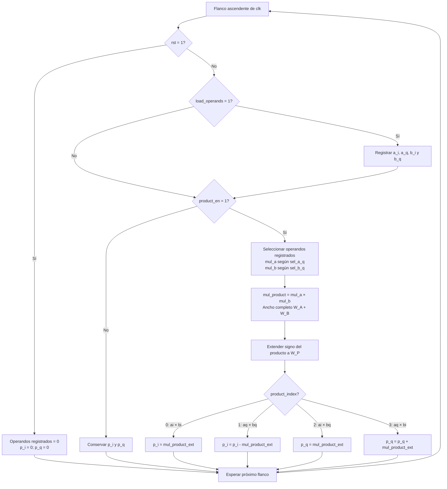
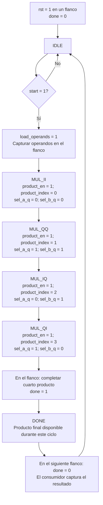

# Diagramas unitarios de los módulos RTL en frecuencia

Los siete módulos actuales de `rtl/frequency` usan los formatos A04 y el multiplicador acumulador. Los diagramas están escritos en Mermaid.

- [fir_frequency_serial](#fir_frequency_serial)
- [fir_frequency_serial_control](#fir_frequency_serial_control)
- [frequency_block_engine](#frequency_block_engine)
- [frequency_block_engine_control](#frequency_block_engine_control)
- [frequency_block_roms](#frequency_block_roms)
- [complex_mul_serial](#complex_mul_serial)
- [complex_mul_serial_control](#complex_mul_serial_control)

Las escrituras ocurren en el flanco ascendente y el reset es síncrono activo alto. Los rombos representan condiciones y no agregan ciclos. Las ROMs son combinacionales. Con entrada disponible y salida lista: 7 ciclos por mariposa, 6 por bin, 550 de motor y 575 por bloque completo.

[Diagrama general](general_diagram.md) · [Arquitectura serial](arquitectura-rtl-frecuencia-serial.md) · [Resultados y análisis PPA](../../reports/ppa/frequency.md)

## fir_frequency_serial

Fuente: [`fir_frequency_serial.sv`](../../rtl/frequency/fir_frequency_serial.sv). El núcleo conserva ocho muestras de historial y conecta su control con el motor. El primer diagrama muestra las escrituras de historial; el segundo, las conexiones combinacionales de carga y salida.

`history_clear` tiene prioridad sobre la escritura y se activa cuando se acepta la última salida de la trama. La copia usa el historial anterior; las entradas nuevas se escriben después, durante captura. En un bloque parcial, `pad_en` carga ceros en el motor sin agregarlos al historial. Con backpressure, el control conserva el índice de salida y el motor conserva `work`, por lo que I/Q permanecen estables.

## fir_frequency_serial_control

Fuente: [`fir_frequency_serial_control.sv`](../../rtl/frequency/fir_frequency_serial_control.sv). La FSM prepara una ventana de 16 posiciones y emite una salida por muestra real aceptada. `sample_count` es el índice de la siguiente muestra nueva; `block_count` es la cantidad de salidas válidas del bloque.

```mermaid
flowchart TD
    RST["rst = 1 en un flanco<br/>Limpiar índices, contadores y block_last"] --> COPY["COPY_HISTORY<br/>history_copy_en = 1<br/>Copiar posición copy_index"]
    COPY --> COPIED{"copy_index = 7?"}
    COPIED -->|No| COPY_INC["copy_index += 1"] --> COPY
    COPIED -->|Sí| INIT["copy_index = 0<br/>sample_count = 0"] --> CAPTURE["CAPTURE<br/>in_ready = 1"]
    CAPTURE --> ACCEPT{"in_valid e in_ready?"}
    ACCEPT -->|No| CAPTURE
    ACCEPT -->|Sí| SAVE["history_write_en = 1<br/>Cargar muestra y actualizar historial<br/>block_last = in_last"]
    SAVE --> LAST{"in_last = 1?"}
    LAST -->|Sí| PARTIAL["block_count = sample_count + 1<br/>emit_index = 0"]
    PARTIAL --> FULL_LAST{"sample_count = 7?"}
    FULL_LAST -->|Sí| START["START<br/>engine_start = 1"]
    FULL_LAST -->|No| PAD_INIT["fill_index = sample_count + 1"] --> PAD["PAD<br/>pad_en = 1<br/>Cargar cero en posición nueva fill_index"]
    LAST -->|No| FULL{"sample_count = 7?"}
    FULL -->|No| SAMPLE_INC["sample_count += 1"] --> CAPTURE
    FULL -->|Sí| FULL_COUNT["block_count = 8<br/>emit_index = 0"] --> START
    PAD --> PAD_END{"fill_index = 7?"}
    PAD_END -->|No| PAD_INC["fill_index += 1"] --> PAD
    PAD_END -->|Sí| PAD_CLEAR["fill_index = 0"] --> START
    START --> COMPUTE["COMPUTE<br/>Esperar al motor"]
    COMPUTE --> DONE{"engine_done = 1?"}
    DONE -->|No| COMPUTE
    DONE -->|Sí| EMIT_INIT["emit_index = 0"] --> EMIT["EMIT<br/>out_valid = 1; engine_result_index = emit_index<br/>out_last = block_last y último índice"]
    EMIT --> SENT{"out_valid y out_ready?"}
    SENT -->|No| EMIT
    SENT -->|Sí| END_BLOCK{"emit_index + 1 = block_count?"}
    END_BLOCK -->|No| EMIT_INC["emit_index += 1"] --> EMIT
    END_BLOCK -->|Sí| FRAME_END{"block_last = 1?"}
    FRAME_END -->|Sí| CLEAR["history_clear = 1<br/>Última salida de trama aceptada"]
    FRAME_END -->|No| KEEP["Conservar historial para próximo bloque"]
    CLEAR --> RESTART["emit_index = 0<br/>copy_index = 0"] --> COPY
    KEEP --> RESTART
```

Reset tiene prioridad desde cualquier estado y conduce a `COPY_HISTORY`; además, mientras `rst=1`, `in_ready`, `out_valid` y las habilitaciones externas quedan en cero. `out_last` se calcula combinacionalmente en `EMIT` cuando `block_last=1` y el índice corresponde a la última salida: puede permanecer alto mientras esa salida está detenida. El historial se limpia únicamente al aceptarla. Un estado inválido vuelve a `COPY_HISTORY`.

Las cajas de actualización y los rombos describen lo que ocurre en el flanco de transición; los únicos estados son `COPY_HISTORY`, `CAPTURE`, `PAD`, `START`, `COMPUTE` y `EMIT`. Una burbuja de entrada no avanza `sample_count`, y una pausa de salida no avanza `emit_index`.

## frequency_block_engine

Fuente: [`frequency_block_engine.sv`](../../rtl/frequency/frequency_block_engine.sv). El banco `work` contiene 16 muestras complejas Q7.5. Una sola instancia del multiplicador se comparte entre mariposas FFT/IFFT y productos espectrales.

La rama de carga se usa mientras el motor está libre. `load_work`, `capture_product`, `write_bin`, `write_butterfly` y `swap_work` habilitan escrituras en el flanco; sin habilitación se conservan los registros. El control las separa durante la operación normal. Las direcciones, coeficientes, sumas/restas y lectura de salida son combinacionales.

El redondeo se aplica después de completar cada producto complejo y al convertir la salida, sin saturación. Las comprobaciones de simulación detectan overflow; no forman parte del hardware sintetizado. El control decide cuándo el resultado leído es válido: durante el cálculo, las posiciones de `work` todavía pueden cambiar.

## frequency_block_engine_control

Fuente: [`frequency_block_engine_control.sv`](../../rtl/frequency/frequency_block_engine_control.sv). La FSM tiene cinco estados y tres fases: `PH_FFT`, `PH_MUL` y `PH_IFFT`. `op_index` recorre las 32 mariposas, `bin_index` los 16 productos espectrales y `swap_index` los seis intercambios.

`spectral_mode` indica `PH_MUL`; `inverse_mode` indica `PH_IFFT`. Ambos son combinacionales. Reset tiene prioridad desde cualquier estado. `done` se pone por defecto en cero en cada flanco y sube al escribir la última mariposa IFFT; un estado inválido vuelve a `ST_IDLE`.

La primera multiplicación arranca en el mismo flanco que acepta `start`, sin pasar por `ST_LAUNCH`. Después, cada mariposa captura T en `ST_WAIT` y escribe en `ST_WRITE`; cada bin se escribe directamente en `ST_WAIT`. Las cajas intermedias de actualización no son estados adicionales. El motor necesita 32 × 7 + 16 × 6 + 6 + 32 × 7 = 550 ciclos según el conteo del testbench.

## frequency_block_roms

Fuente: [`frequency_block_roms.sv`](../../rtl/frequency/frequency_block_roms.sv). Todas las lecturas son combinacionales: el módulo no tiene `clk`, reset, registros ni FSM. Las tres ramas del diagrama se evalúan en paralelo cuando cambian sus índices.

Las filas 0…7, 8…15, 16…23 y 24…31 representan las cuatro etapas de FFT16. FFT e IFFT reutilizan la misma tabla; el motor conjuga el twiddle para IFFT. Las ROMs entregan W sin cambiar su signo. H se consulta directamente por bin, sin reconstrucción por simetría.

Los `default` de las funciones W y H devuelven sus últimas entradas (7 y 15). Los `default` de las funciones de intercambio devuelven la pareja 11↔13, por lo que índices 6 y 7 también la seleccionarían; el control solo recorre 0…5. La tabla de operaciones inicializa sus salidas a `(table_a, table_b, twiddle_index) = (0, 1, 0)` antes del `case`.

## complex_mul_serial

Fuente: [`complex_mul_serial.sv`](../../rtl/frequency/complex_mul_serial.sv). El datapath captura operandos y reutiliza un único multiplicador real. Los cuatro productos se acumulan directamente en `p_i/p_q`, sin registros de productos separados ni ciclo de combinación.

El control separa la captura de los cuatro ciclos de producto. Los multiplexores, la multiplicación y la extensión de signo son combinacionales; solo se registran los operandos y las actualizaciones de `p_i/p_q` indicadas en el diagrama. `load_operands` y `product_en` son habilitaciones independientes en el datapath, aunque el control no las activa juntas.

`W_P` debe ser al menos `W_A + W_B + 1` para cubrir la suma/resta completa. El motor instancia la unidad con anchos 12 × 10 → 23 bits; el redondeo A04 se hace en el motor, después de `done`. Durante el cálculo las salidas pueden mostrar valores parciales; son finales con `done` y se mantienen hasta la siguiente acumulación o reset.

## complex_mul_serial_control

Fuente: [`complex_mul_serial_control.sv`](../../rtl/frequency/complex_mul_serial_control.sv). La FSM captura ambos operandos complejos, habilita cuatro productos reales y genera un pulso registrado de finalización.

Reset tiene prioridad desde cualquier estado y vuelve a `IDLE` con `done=0`; el datapath limpia operandos y resultados en ese mismo flanco. `start` se acepta únicamente en `IDLE`. Los estados de producto avanzan un estado por flanco y `DONE` vuelve a `IDLE` sin aceptar un nuevo `start` en ese flanco. Un estado inválido también vuelve a `IDLE`.

Contando el flanco que acepta `start` como 1: captura en 1, productos en 2…5, resultado completo y `done=1` después del flanco 5; el motor lo captura en el 6. `done` se pone por defecto en cero en cada flanco y solo sube en la transición `MUL_QI → DONE`. No existe el estado `COMBINE`.
