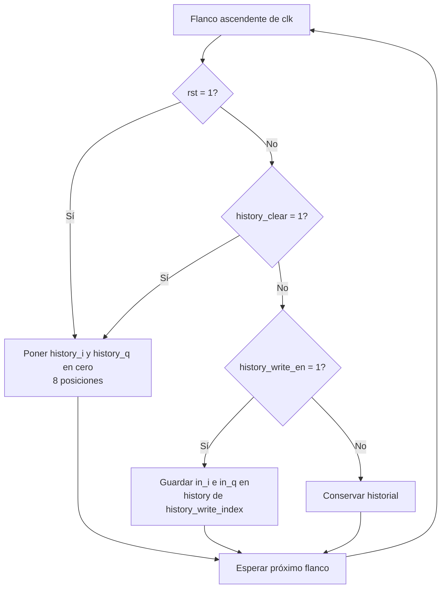
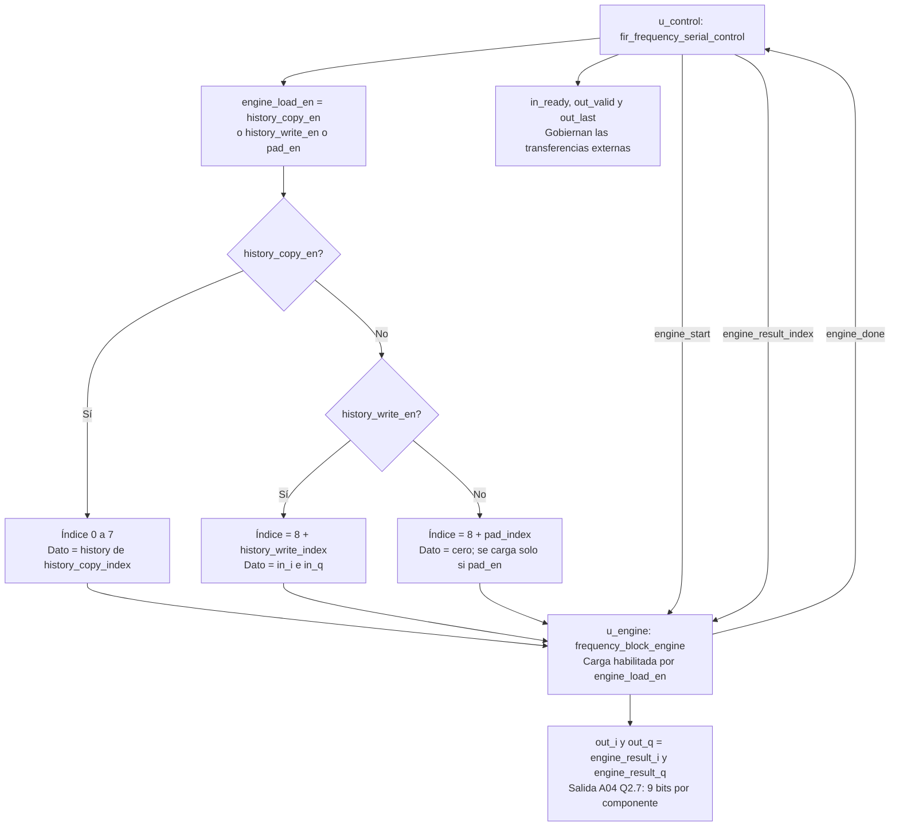

# Flujo de `fir_frequency_serial`

Fuente: [`fir_frequency_serial.sv`](../../rtl/frequency/fir_frequency_serial.sv). El núcleo conserva ocho muestras de historial y conecta su control con el motor. El primer diagrama muestra las escrituras de historial; el segundo, las conexiones combinacionales de carga y salida.

`history_clear` tiene prioridad sobre la escritura y se activa cuando se acepta la última salida de la trama. La copia usa el historial anterior; las entradas nuevas se escriben después, durante captura. En un bloque parcial, `pad_en` carga ceros en el motor sin agregarlos al historial. Con backpressure, el control conserva el índice de salida y el motor conserva `work`, por lo que I/Q permanecen estables.

[Índice de diagramas](README.md) · [Control del núcleo](fir_frequency_serial_control.md)
