# Flujo de `fir_frequency_serial_control`

Fuente: [`fir_frequency_serial_control.sv`](../../rtl/frequency/fir_frequency_serial_control.sv). La FSM prepara una ventana de 16 posiciones y emite una salida por muestra real aceptada. `sample_count` es el índice de la siguiente muestra nueva; `block_count` es la cantidad de salidas válidas del bloque.

```mermaid
flowchart TD
    RST["rst = 1 en un flanco<br/>Limpiar índices, contadores y block_last"] --> COPY["COPY_HISTORY<br/>history_copy_en = 1<br/>Copiar posición copy_index"]
    COPY --> COPIED{"copy_index = 7?"}
    COPIED -->|No| COPY_INC["copy_index += 1"] --> COPY
    COPIED -->|Sí| INIT["copy_index = 0<br/>sample_count = 0"] --> CAPTURE["CAPTURE<br/>in_ready = 1"]
    CAPTURE --> ACCEPT{"in_valid e in_ready?"}
    ACCEPT -->|No| CAPTURE
    ACCEPT -->|Sí| SAVE["history_write_en = 1<br/>Cargar muestra y actualizar historial<br/>block_last = in_last"]
    SAVE --> LAST{"in_last = 1?"}
    LAST -->|Sí| PARTIAL["block_count = sample_count + 1<br/>emit_index = 0"]
    PARTIAL --> FULL_LAST{"sample_count = 7?"}
    FULL_LAST -->|Sí| START["START<br/>engine_start = 1"]
    FULL_LAST -->|No| PAD_INIT["fill_index = sample_count + 1"] --> PAD["PAD<br/>pad_en = 1<br/>Cargar cero en posición nueva fill_index"]
    LAST -->|No| FULL{"sample_count = 7?"}
    FULL -->|No| SAMPLE_INC["sample_count += 1"] --> CAPTURE
    FULL -->|Sí| FULL_COUNT["block_count = 8<br/>emit_index = 0"] --> START
    PAD --> PAD_END{"fill_index = 7?"}
    PAD_END -->|No| PAD_INC["fill_index += 1"] --> PAD
    PAD_END -->|Sí| PAD_CLEAR["fill_index = 0"] --> START
    START --> COMPUTE["COMPUTE<br/>Esperar al motor"]
    COMPUTE --> DONE{"engine_done = 1?"}
    DONE -->|No| COMPUTE
    DONE -->|Sí| EMIT_INIT["emit_index = 0"] --> EMIT["EMIT<br/>out_valid = 1; engine_result_index = emit_index<br/>out_last = block_last y último índice"]
    EMIT --> SENT{"out_valid y out_ready?"}
    SENT -->|No| EMIT
    SENT -->|Sí| END_BLOCK{"emit_index + 1 = block_count?"}
    END_BLOCK -->|No| EMIT_INC["emit_index += 1"] --> EMIT
    END_BLOCK -->|Sí| FRAME_END{"block_last = 1?"}
    FRAME_END -->|Sí| CLEAR["history_clear = 1<br/>Última salida de trama aceptada"]
    FRAME_END -->|No| KEEP["Conservar historial para próximo bloque"]
    CLEAR --> RESTART["emit_index = 0<br/>copy_index = 0"] --> COPY
    KEEP --> RESTART
```

Reset tiene prioridad desde cualquier estado y conduce a `COPY_HISTORY`; además, mientras `rst=1`, `in_ready`, `out_valid` y las habilitaciones externas quedan en cero. `out_last` se calcula combinacionalmente en `EMIT` cuando `block_last=1` y el índice corresponde a la última salida: puede permanecer alto mientras esa salida está detenida. El historial se limpia únicamente al aceptarla. Un estado inválido vuelve a `COPY_HISTORY`.

Las cajas de actualización y los rombos describen lo que ocurre en el flanco de transición; los únicos estados son `COPY_HISTORY`, `CAPTURE`, `PAD`, `START`, `COMPUTE` y `EMIT`. Una burbuja de entrada no avanza `sample_count`, y una pausa de salida no avanza `emit_index`.

[Índice de diagramas](README.md) · [Datapath del núcleo](fir_frequency_serial.md)
