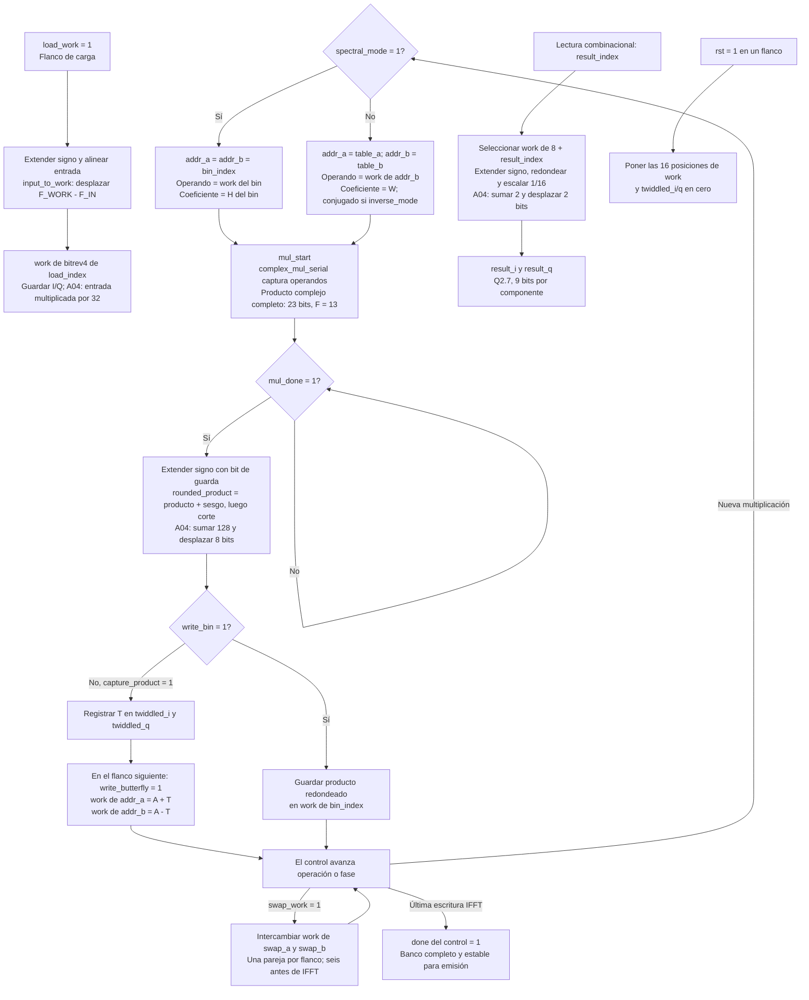

# Flujo de `frequency_block_engine`

Fuente: [`frequency_block_engine.sv`](../../rtl/frequency/frequency_block_engine.sv). El banco `work` contiene 16 muestras complejas Q7.5. Una sola instancia del multiplicador se comparte entre mariposas FFT/IFFT y productos espectrales.

La rama de carga se usa mientras el motor está libre. `load_work`, `capture_product`, `write_bin`, `write_butterfly` y `swap_work` habilitan escrituras en el flanco; sin habilitación se conservan los registros. El control las separa durante la operación normal. Las direcciones, coeficientes, sumas/restas y lectura de salida son combinacionales.

El redondeo se aplica después de completar cada producto complejo y al convertir la salida, sin saturación. Las comprobaciones de simulación detectan overflow; no forman parte del hardware sintetizado. El control decide cuándo el resultado leído es válido: durante el cálculo, las posiciones de `work` todavía pueden cambiar.

[Índice de diagramas](README.md) · [Control del motor](frequency_block_engine_control.md) · [ROMs](frequency_block_roms.md)
