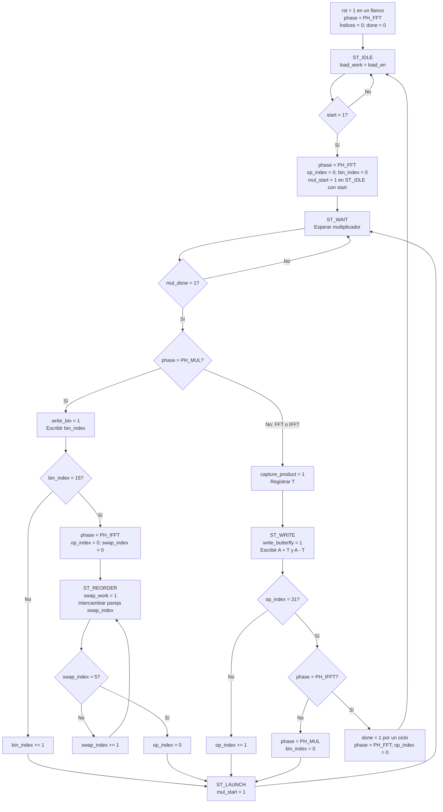

# Flujo de `frequency_block_engine_control`

Fuente: [`frequency_block_engine_control.sv`](../../rtl/frequency/frequency_block_engine_control.sv). La FSM tiene cinco estados y tres fases: `PH_FFT`, `PH_MUL` y `PH_IFFT`. `op_index` recorre las 32 mariposas, `bin_index` los 16 productos espectrales y `swap_index` los seis intercambios.

`spectral_mode` indica `PH_MUL`; `inverse_mode` indica `PH_IFFT`. Ambos son combinacionales. Reset tiene prioridad desde cualquier estado. `done` se pone por defecto en cero en cada flanco y sube al escribir la última mariposa IFFT; un estado inválido vuelve a `ST_IDLE`.

La primera multiplicación arranca en el mismo flanco que acepta `start`, sin pasar por `ST_LAUNCH`. Después, cada mariposa captura T en `ST_WAIT` y escribe en `ST_WRITE`; cada bin se escribe directamente en `ST_WAIT`. Las cajas intermedias de actualización no son estados adicionales. El motor necesita 32 × 7 + 16 × 6 + 6 + 32 × 7 = 550 ciclos según el conteo del testbench.

[Índice de diagramas](README.md) · [Datapath del motor](frequency_block_engine.md)
