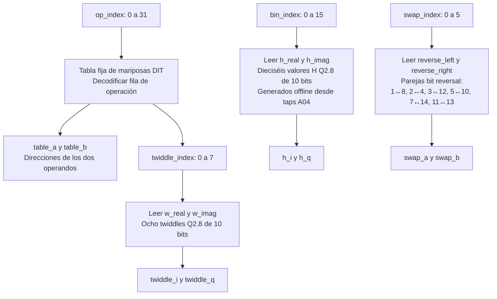

# Flujo de `frequency_block_roms`

Fuente: [`frequency_block_roms.sv`](../../rtl/frequency/frequency_block_roms.sv). Todas las lecturas son combinacionales: el módulo no tiene `clk`, reset, registros ni FSM. Las tres ramas del diagrama se evalúan en paralelo cuando cambian sus índices.

Las filas 0…7, 8…15, 16…23 y 24…31 representan las cuatro etapas de FFT16. FFT e IFFT reutilizan la misma tabla; el motor conjuga el twiddle para IFFT. Las ROMs entregan W sin cambiar su signo. H se consulta directamente por bin, sin reconstrucción por simetría.

Los `default` de las funciones W y H devuelven sus últimas entradas (7 y 15). Los `default` de las funciones de intercambio devuelven la pareja 11↔13, por lo que índices 6 y 7 también la seleccionarían; el control solo recorre 0…5. La tabla de operaciones inicializa sus salidas a `(table_a, table_b, twiddle_index) = (0, 1, 0)` antes del `case`.

[Índice de diagramas](README.md) · [Motor que consume las tablas](frequency_block_engine.md)
