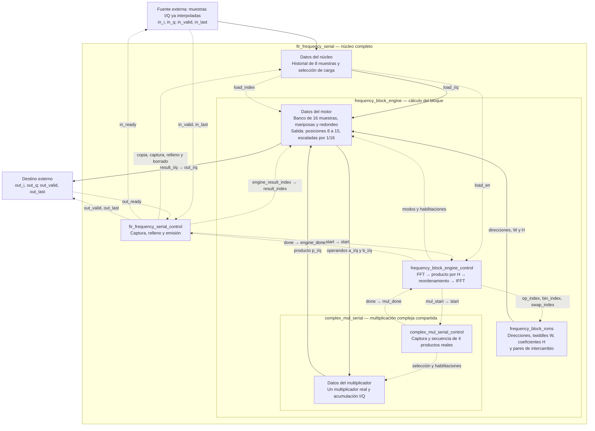

# Diagrama general del filtro en frecuencia

Los [diagramas por módulo RTL](diagrams-rtl-modules-unitirarios.md) detallan el núcleo serial, sus controles, el motor, las ROMs y el multiplicador acumulador actuales.

La [propuesta de E01](../contratos/frecuencia.md) implementa el FIR RRC8, beta 0,5, mediante FFT16 y 50 % de superposición según la [consigna vigente](../consigna-actualizada.md). Enzo confirmó el upsampler 2× el 7/10/2026 como decisión de diseño para ambas cadenas.

```mermaid
flowchart LR
    Q["Generador QPSK reutilizable<br/>símbolos I/Q = ±1"]
    UP["Upsampler 2× separado<br/>a0, 0, a1, 0, ..."]
    Q --> UP

    subgraph T0["Preparación de bloque en tiempo"]
        NEW["8 muestras nuevas<br/>equivalentes a 4 símbolos"]
        HIST["8 muestras de historial<br/>cero al inicio de trama"]
        WIN["Ventana de 16 muestras<br/>8 anteriores + 8 nuevas"]
        NEW --> WIN
        HIST --> WIN
        NEW -->|historial para el próximo bloque| HIST
    end
    UP --> NEW

    subgraph OFF["Preparación en Python, fuera del procesamiento RTL"]
        H["8 coeficientes RRC<br/>beta 0,5; tabla exacta en E02"]
        PAD["Agregar 8 ceros"]
        FH["Precalcular FFT16"]
        H --> PAD --> FH
    end

    subgraph CORE["Núcleo: un bloque a la vez en la versión inicial"]
        FX["FFT16"]
        ROM["Tabla H constante<br/>16 valores explícitos<br/>lectura directa de H k"]
        MUL["16 productos por bloque<br/>X[k] por H[k]"]
        INV["IFFT16<br/>escala total 1/16"]
        SELECT["Descartar posiciones 0 a 7<br/>conservar 8 a 15"]
        FX --> MUL --> INV --> SELECT
        ROM --> MUL
    end
    WIN --> FX
    FH -.->|tabla generada| ROM
    SELECT --> OUT["8 salidas por bloque completo<br/>p en el parcial; 2S por trama"]
```

El historial leído por una ventana pertenece al bloque anterior; se actualiza después de formar la ventana actual. La fuente espera cuando el núcleo no puede aceptar datos. El generador, el upsampler y el núcleo son módulos distintos; el diagrama expresa responsabilidades, no obliga a ejecutarlas en paralelo ni fija puertos RTL.

La tabla H se calcula fuera del hardware una vez que se fijan los coeficientes. Los 16 productos pueden reutilizar una unidad en la implementación inicial. La paralelización y el pipeline se estudian en C03/C04.

C01 usa un motor serial compartido para FFT e IFFT, guiado por una tabla fija de 32 operaciones con las direcciones de ambos operandos y el índice del twiddle. La misma tabla se recorre para cada transformada y cada bloque; los datos y resultados se calculan durante la ejecución. Las entradas y las reglas de avance se detallan en la [arquitectura serial, §2.4](arquitectura-rtl-frecuencia-serial.md#24-tabla-fija-de-operaciones-fft16ifft16).

Una trama de S símbolos produce 2S muestras, sin cola final. El último cero del upsampler pertenece a la trama. Un bloque parcial se rellena solo para calcular la transformada y emite únicamente sus p muestras válidas. Las pausas no son muestras cero. El historial se reinicia entre tramas independientes.

El FIR temporal se implementa por separado y recibe las mismas muestras del upsampler y los mismos ocho coeficientes RRC. Ambas ramas deben producir la misma secuencia causal de 2S salidas, sin cola final, al alinear sus índices de muestra. Se admiten diferencias de redondeo en flotante; A04 define la tolerancia entre dominios en punto fijo y cada RTL se compara con su modelo fijo.

## Conexión de los módulos RTL actuales

La implementación serial se integra desde `fir_frequency_serial`. El siguiente diagrama muestra su jerarquía real: el núcleo contiene su control y el motor; el motor contiene su control, las ROMs y el multiplicador; el multiplicador contiene su propio control. Los bloques «datos» representan lógica y registros dentro de esos módulos, no módulos adicionales. Las flechas continuas llevan datos y las punteadas indican control, índices o fin de operación.

`clk` y `rst` son comunes a los módulos secuenciales y se omiten para facilitar la lectura. `frequency_block_roms` es combinacional. El generador QPSK y el upsampler del diagrama algorítmico quedan fuera de esta jerarquía: la entrada del núcleo recibe las muestras ya interpoladas.

| Módulo RTL | Función principal y conexión |
|---|---|
| [`fir_frequency_serial`](../../rtl/frequency/fir_frequency_serial.sv) | Es el módulo superior. Guarda el historial, arma la carga de 16 muestras y conecta las interfaces de entrada/salida con el motor. |
| [`fir_frequency_serial_control`](../../rtl/frequency/fir_frequency_serial_control.sv) | Decide cuándo copiar el historial, aceptar muestras, rellenar con ceros, iniciar el motor y emitir resultados. Gestiona `valid/ready/last`, el bloque parcial y el borrado del historial al terminar la trama. |
| [`frequency_block_engine`](../../rtl/frequency/frequency_block_engine.sv) | Guarda y transforma el bloque en su banco de trabajo. Hace las sumas/restas de las mariposas, usa el multiplicador compartido y aplica redondeo y escala de salida. |
| [`frequency_block_engine_control`](../../rtl/frequency/frequency_block_engine_control.sv) | Recorre las 32 mariposas FFT, los 16 productos por H, los intercambios de reordenamiento y las 32 mariposas IFFT. Selecciona los índices de ROM y espera `mul_done` antes de avanzar. |
| [`frequency_block_roms`](../../rtl/frequency/frequency_block_roms.sv) | Entrega al motor las direcciones de cada operación, los twiddles W, los 16 coeficientes H y los pares de intercambio, según los índices del control. |
| [`complex_mul_serial`](../../rtl/frequency/complex_mul_serial.sv) | Recibe dos operandos complejos del motor y devuelve su producto I/Q. Reutiliza un multiplicador real para los cuatro productos necesarios, tanto en FFT/IFFT como en el producto por H. |
| [`complex_mul_serial_control`](../../rtl/frequency/complex_mul_serial_control.sv) | Captura los operandos al recibir `start`, selecciona los cuatro productos reales y señala `done` al completar el resultado complejo. |

## Ejemplo: recorrido de ejecución de un bloque

Seguimos el primer bloque de una trama, con 8 muestras nuevas `x[0]` a `x[7]` ya interpoladas y el destino listo para recibir. Cada punto describe una etapa de ejecución; una etapa puede ocupar varios ciclos de reloj. Las muestras y operaciones son complejas (I/Q).

1. **Preparar el historial — `fir_frequency_serial` y su control.** Después del reset, el historial contiene 8 ceros. En `COPY_HISTORY`, el control copia una muestra por ciclo al motor. Es la primera mitad lógica de la ventana: `[0, 0, 0, 0, 0, 0, 0, 0]`.
2. **Recibir las muestras nuevas — `fir_frequency_serial`.** En `CAPTURE`, el control activa `in_ready`. Cada vez que `in_valid && in_ready`, el núcleo carga una muestra al motor y la guarda en el historial para el próximo bloque. Tras aceptar `x[0]` a `x[7]`, la ventana lógica es `[0, 0, 0, 0, 0, 0, 0, 0, x[0], x[1], ..., x[7]]`. El motor almacena esta carga con direcciones de bits invertidos para preparar la FFT.
3. **Iniciar el cálculo — `fir_frequency_serial_control` → `frequency_block_engine_control`.** El control del núcleo pulsa `engine_start` y pasa a `COMPUTE`. El motor comienza la FFT; mientras calcula, el núcleo mantiene `in_ready` y `out_valid` desactivados.
4. **Buscar la primera operación FFT — `frequency_block_engine_control` → `frequency_block_roms`.** Con `op_index = 0`, las ROMs entregan las direcciones 0 y 1 del banco y el twiddle `W = 1 + j0`. El motor toma el dato de la dirección 1 y W como operandos del multiplicador complejo.
5. **Calcular el producto complejo — `complex_mul_serial` y su control.** Al recibir `mul_start`, el control captura los operandos A y B. En cuatro ciclos calcula `A_i·B_i`, `A_q·B_q`, `A_i·B_q` y `A_q·B_i`. El datapath forma `p_i = A_i·B_i − A_q·B_q` y `p_q = A_i·B_q + A_q·B_i`, y el control indica `mul_done` al motor.
6. **Completar la FFT — `frequency_block_engine`.** El motor redondea el producto y escribe la suma y la diferencia de la mariposa en el banco. Su control avanza `op_index` y repite los pasos de consulta, multiplicación y escritura hasta completar las 32 mariposas. El banco pasa a contener `X[0]` a `X[15]`.
7. **Filtrar en frecuencia — motor, ROMs y multiplicador.** El control activa el modo espectral y recorre `bin_index = 0` a `15`. Para cada k, las ROMs entregan `H[k]`; el mismo multiplicador calcula `X[k]·H[k]` y el motor escribe el resultado redondeado en la posición k del banco.
8. **Volver al tiempo — motor y su control.** El control recorre los 6 pares de intercambio de las ROMs para reordenar el banco. Luego ejecuta las 32 mariposas IFFT reutilizando las mismas tablas y el mismo multiplicador, con el signo imaginario del twiddle invertido. Al finalizar, pulsa `engine_done`.
9. **Emitir las salidas válidas — `fir_frequency_serial_control` y motor.** El control pasa a `EMIT`, activa `out_valid` y recorre `engine_result_index = 0` a `7`. El motor devuelve las posiciones 8 a 15 de la IFFT con escala total 1/16 y ajuste al formato de salida: `y[0]` a `y[7]`. Cada salida avanza solo con `out_valid && out_ready`; si el destino pausa, se conserva la muestra actual. Las posiciones 0 a 7 se descartan.
10. **Preparar el siguiente bloque — `fir_frequency_serial`.** Si la trama continúa, el historial ya contiene `x[0]` a `x[7]`. El control vuelve a `COPY_HISTORY` y la próxima ventana será `[x[0], ..., x[7], x[8], ..., x[15]]`. Si `x[7]` llevaba `in_last`, la salida `y[7]` lleva `out_last` y, al aceptarla, se borra el historial para la siguiente trama independiente.

Si el último bloque tiene solo p muestras nuevas, el paso 2 termina al aceptar `in_last` y el estado `PAD` completa las posiciones nuevas restantes con ceros. El motor realiza el mismo cálculo completo, pero el paso 9 emite únicamente las p salidas válidas y marca la última con `out_last`.

Por lo tanto, FFT, producto espectral e IFFT son fases del mismo motor RTL. El detalle interno de cada módulo está en los [diagramas por módulo](diagrams-rtl-modules-unitirarios.md).
