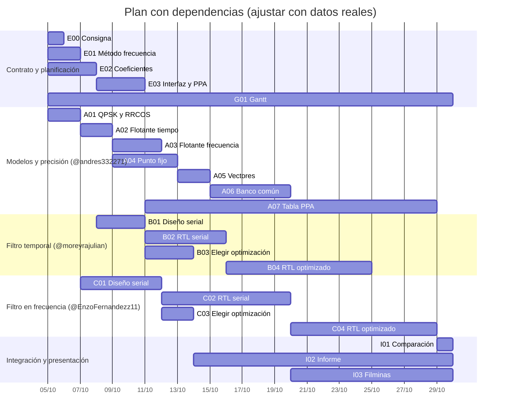

# Gantt del proyecto

**Versión inicial:** 2026-10-02. **Revisión con dependencias:** 2026-10-03. **Ajuste a la fecha límite:** 2026-10-05. **Avance real:** 2026-10-07 y 2026-10-12. **Responsables:** @andres332271 = modelos/precisión, @moreyrajulian = tiempo, @EnzoFernandezz11 = frecuencia. Las fechas son una estimación para organizar el trabajo en días corridos (incluye fines de semana); todo debe estar terminado antes del **30/10**, fecha límite de la presentación. Los IDs y dependencias corresponden al [backlog](backlog.md).

## Plan

Cada tarea arranca con `after` sobre sus dependencias **para empezar**, de modo que no puede comenzar antes que ellas; al cambiar una duración, las tareas siguientes se corren solas. Las dependencias **para cerrar** no se dibujan: la duración de cada barra se eligió para terminar después de ellas, y `tests/test_plan.py` falla si alguna regla se rompe. En Mermaid el fin es exclusivo: una barra que termina el 07/10 libera a la siguiente ese mismo día.

G01, I02 e I03 terminan el 29/10, el día anterior a la presentación. Para entrar en el plazo, B03 y C03 se hacen en paralelo con el serial, I03 arranca con los resultados seriales, I01 dura un día y C04 baja a 9 días. C04 queda en el camino crítico sin margen; B04 tiene 4 días de holgura.

**Corte de C04 (lunes 26/10):** si C04 no pasa el vector matching, se presenta C serial (C02) contra B optimizado (B04), C04 queda como trabajo futuro en el informe y se avisa al profesor.

## Avance real

Esta tabla registra lo que efectivamente pasó y quién lo hizo, que es lo exigido para explicar el reparto real. Las fechas planificadas están solo en el diagrama: anotar aquí inicio y fin reales cuando ocurran, sin tocar el plan salvo para replanificar.

**Al 12/10:** 11 de 23 tareas iniciadas (E00–E03, G01, A01–A05 y C01), 6 integradas (E00–E03, A01 y A02) y 0 verificadas. Según el plan deberían haber empezado 15: faltan B01, B02, B03, C02 y A07. A05 empezó un día antes de lo previsto. Las fechas son locales; GitHub muestra UTC, y un PR abierto de noche puede figurar con el día siguiente.

Riesgos al 12/10:

- **Rama temporal:** B01 no tiene evidencia en el repo y el plan lo ubicaba del 08/10 al 10/10. La cadena B01 → B02 → B04 tenía 4 días de holgura hasta I01 (29/10). Si B01 empieza el 13/10, lleva 5 días de atraso y B04 terminaría el 29/10, un día tarde: pasa a ser la cadena más comprometida.
- **Rama en frecuencia:** C01 sigue sin holgura. El plan lo cerraba el 11/10 y sigue en revisión; cada día hasta integrarlo corre C02, C04 y el corte del 26/10.
- **Modelos:** A03 lleva un día de atraso y bloquea el cierre de C01 y de A04. A07 (tabla PPA) no empezó; su plan arrancaba el 11/10.

| ID | Responsable real | Inicio real | Fin real | Estado/notas |
|---|---|---|---|---|
| [E00](https://github.com/EnzoFernandezz11/rrc-fir-rtl/issues/1) | @andres332271 | 05/10 | 07/10 | Consigna actualizada en #27 y segunda versión en #29 (06/10). |
| [E01](https://github.com/EnzoFernandezz11/rrc-fir-rtl/issues/2) | @EnzoFernandezz11 | 05/10 | 08/10 | #28 integrado. Plan: fin 06/10 (+2 días). |
| [E02](https://github.com/EnzoFernandezz11/rrc-fir-rtl/issues/3) | @andres332271 | 07/10 | 08/10 | #33 integrado; D02/D03 siguen propuestos hasta la revisión conjunta. Plan: fin 07/10 (+1). |
| [E03](https://github.com/EnzoFernandezz11/rrc-fir-rtl/issues/4) | @moreyrajulian | 09/10 | 09/10 | #38 integrado; D03, D05 y D06 siguen propuestos. Plan: fin 10/10 (−1). |
| [G01](https://github.com/EnzoFernandezz11/rrc-fir-rtl/issues/5) | @andres332271 | 03/10 | — | #24, #27, #34 y este registro. Actualizar semanalmente. |
| [A01](https://github.com/EnzoFernandezz11/rrc-fir-rtl/issues/6) | @andres332271 | 07/10 | 08/10 | #32 integrado. Plan: fin 06/10 (+2). |
| [A02](https://github.com/EnzoFernandezz11/rrc-fir-rtl/issues/7) | @andres332271 | 07/10 | 09/10 | #35 integrado. Plan: fin 08/10 (+1). |
| [A03](https://github.com/EnzoFernandezz11/rrc-fir-rtl/issues/8) | @andres332271 | 12/10 | — | #40 en revisión; error máx. entre modelos flotantes < 2e-14. Plan: fin 11/10. |
| [A04](https://github.com/EnzoFernandezz11/rrc-fir-rtl/issues/9) | @andres332271 | 12/10 | — | #41 en revisión: salida Q2.7 (9 bits), SQNR 44,2/43,0 dB. Cierra después de A03. Plan: fin 12/10. |
| [A05](https://github.com/EnzoFernandezz11/rrc-fir-rtl/issues/10) | @andres332271 | 12/10 | — | #42 en revisión, apilado sobre #41. Corte para cerrar B02/C02. Plan: inicio 13/10, fin 14/10. |
| [B01](https://github.com/EnzoFernandezz11/rrc-fir-rtl/issues/11) | @moreyrajulian | 12/10 | 13/10 | #44 integrado: `L = 9`, `II = 10`, 56 FF estimados. Plan: inicio 08/10, fin 10/10 (+3). |
| [B02](https://github.com/EnzoFernandezz11/rrc-fir-rtl/issues/12) | @moreyrajulian | 13/10 | — | RTL, testbench (vectores smoke, `L`/`II`, pausas) y registro en CI. Plan: inicio 11/10. |
| [C01](https://github.com/EnzoFernandezz11/rrc-fir-rtl/issues/13) | @EnzoFernandezz11 | 06/10 | — | #39 en revisión, con cambios pedidos el 12/10 (quitar R01); arquitectura verificada por simulación. Plan: fin 11/10. |
| [C02](https://github.com/EnzoFernandezz11/rrc-fir-rtl/issues/14) | — | — | — | Plan: inicio 12/10. |
| [A06](https://github.com/EnzoFernandezz11/rrc-fir-rtl/issues/15) | — | — | — | — |
| [B03](https://github.com/EnzoFernandezz11/rrc-fir-rtl/issues/16) | — | — | — | Plan: inicio 11/10. |
| [B04](https://github.com/EnzoFernandezz11/rrc-fir-rtl/issues/17) | — | — | — | — |
| [C03](https://github.com/EnzoFernandezz11/rrc-fir-rtl/issues/18) | — | — | — | — |
| [C04](https://github.com/EnzoFernandezz11/rrc-fir-rtl/issues/19) | — | — | — | Camino crítico hasta I01. |
| [A07](https://github.com/EnzoFernandezz11/rrc-fir-rtl/issues/20) | — | — | — | Empieza con variantes disponibles. Plan: inicio 11/10. |
| [I01](https://github.com/EnzoFernandezz11/rrc-fir-rtl/issues/21) | — | — | — | — |
| [I02](https://github.com/EnzoFernandezz11/rrc-fir-rtl/issues/22) | — | — | — | Borrador temprano; conclusiones tras I01. |
| [I03](https://github.com/EnzoFernandezz11/rrc-fir-rtl/issues/23) | — | — | — | Presentación 30/10. |

## Corte del viernes 16/10

Meta: 20 de 23 tareas con evidencia de inicio (87 %). Es el máximo que permite el plan sin violar dependencias; solo I01 y C04 (y por lo tanto el cierre de I03) dependen de resultados posteriores. El avance real se comunica separado en tres cifras: **iniciadas**, **integradas** y **verificadas**. La cantidad de tarjetas movidas no sustituye el vector matching. Si E01 o C02 se retrasan, registrar la causa y ajustar fechas y responsable; no empezar C04 sin C02 para mejorar el porcentaje.
