# Resultados PPA de frecuencia: C02 y C04

> **Regla obligatoria de mantenimiento:** mostrar únicamente la **última corrida exitosa de cada variante**. Una nueva corrida reemplaza íntegramente su sección, incluso si reproduce los mismos valores; no se agregan históricos ni resúmenes duplicados. Cada resultado debe enlazar configuración, biblioteca, hashes y logs. Las corridas anteriores permanecen en `build/ppa/`. Una corrida fallida no reemplaza resultados válidos. **Excepción explícita:** conservar la referencia histórica Vivado de C02 al final, identificada como FPGA.

Tecnología: **ASIC SKY130 HD, 130 nm**. Síntesis y potencia nominal usan
TT / 25 °C / 1,8 V; STA físico cubre los nueve corners declarados en cada corrida.
La simulación mide exactitud y ciclos; la síntesis mide celdas y área Liberty;
el análisis post-ruteo usa parasíticos SPEF. La potencia con actividad es una
estimación funcional sin retardos, no una medición de silicio.
Los objetivos de 10 MHz (C02) y 100 MHz (C04) se evalúan por escenario: setup/hold,
restricciones eléctricas y resultado global se presentan por separado. Una
corrida completa no implica que el circuito cumpla todas las restricciones.

[Procedimiento y comandos](../../docs/frecuencia/ppa.md).

<!-- serial-analysis:start -->
## Comparación de arquitecturas

C02 comparte un motor: FFT16 (224 ciclos), producto espectral (96),
reordenamiento (6), IFFT16 (224) y preparación/emisión (25), total **575 ciclos
por bloque de ocho**. C04 despliega FFT, producto e IFFT con pipeline y bancos
dobles, para un intervalo de **8 ciclos por bloque** sin pausas.

El throughput sostenido se compara como `8 × f_clk / II_bloque`. A igual reloj,
la ganancia arquitectónica es `575/8 = 71,875×`. Comparar los objetivos de
10 y 100 MHz agrega otro factor diez, condicionado al cierre temporal ASIC.
La latencia de 559 frente a 26 ciclos es una métrica distinta del intervalo.

El área SKY130 se compara únicamente entre mediciones hechas con la misma
biblioteca, corner y flujo. Las cifras LUT/DSP de Vivado describen una FPGA y no
se convierten en área ASIC. Los bancos sin macros SRAM se sintetizan a registros
y lógica. La potencia y la energía por muestra requieren una evaluación posterior.
<!-- serial-analysis:end -->

## Última corrida C02 — frecuencia serial

<!-- serial-runs:start -->

<!-- serial-measurement:bd8a1d47b6aa068ba312cbf120b3d386fa2339fc5df8fd87d7222fcdfd41f1d1 -->

### frequency_serial — corrida 20261024T190548892720Z-22dd3d09 (OpenLane 2 / SKY130)

**Medición física completa; simulación funcional de netlist final, STA post-SPEF y potencia con VCD.**

Potencia estimada TT/25 °C/1,8 V, sin retardos de simulación ni glitches temporales completos. No es signoff de fabricación.

| Escenario | Reloj | Setup/hold | Restricciones eléctricas | Timing global | Potencia total | Energía total/muestra |
|---|---:|---|---|---|---:|---:|
| target | 10 MHz | PASS | FAIL | FAIL | 0.000658033549 W | 4.72961614e-09 J |
| common | 10 MHz | PASS | FAIL | FAIL | 0.000658033549 W | 4.72961614e-09 J |

#### Área y benchmark

| Medición | Resultado |
|---|---:|
| Área final de celdas | 57365.000 µm² |
| Área del core | 144863.936 µm² |
| Área del die | 157743.082 µm² |
| Latencia | 559 ciclos |
| Ciclos por bloque | 575 ciclos |
| Ciclos activos | 147200 ciclos |
| Throughput efectivo (condicionado; timing global FAIL) | 139130.435 muestras/s |
| Throughput sostenido (condicionado; timing global FAIL) | 139130.435 muestras/s |

El throughput al reloj objetivo queda condicionado a PASS global de timing. Fmax es estimación registro a registro, sin barrido.

#### Potencia y energía

| Escenario | Interna (W) | Switching (W) | Dinámica (W) | Leakage (W) | Total (W) | Energía dinámica/muestra (J) | Energía total/muestra (J) |
|---|---:|---:|---:|---:|---:|---:|---:|
| target | 0.000456245057 | 0.000201749663 | 0.000657994719 | 3.88314966e-08 | 0.000658033549 | 4.72933705e-09 | 4.72961614e-09 |
| common | 0.000456245057 | 0.000201749663 | 0.000657994719 | 3.88314966e-08 | 0.000658033549 | 4.72933705e-09 | 4.72961614e-09 |

#### Timing por corner

| Escenario | Corner | Setup WS (ns) | Hold WS (ns) | Setup/hold violaciones | Slew / cap / fanout violaciones | Fmax estimada (MHz) |
|---|---|---:|---:|---:|---:|---:|
| target | nom_tt_025C_1v80 | 57.8216 | 0.3106 | 0 / 0 | 0 / 1 / 22 | No medida |
| target | nom_ss_100C_1v60 | 56.2369 | 0.8684 | 0 / 0 | 60 / 1 / 22 | No medida |
| target | nom_ff_n40C_1v95 | 58.4558 | 0.1104 | 0 / 0 | 0 / 1 / 22 | No medida |
| target | min_tt_025C_1v80 | 57.8779 | 0.3079 | 0 / 0 | 0 / 0 / 22 | No medida |
| target | min_ss_100C_1v60 | 56.3378 | 0.8634 | 0 / 0 | 39 / 0 / 22 | No medida |
| target | min_ff_n40C_1v95 | 58.4930 | 0.1088 | 0 / 0 | 0 / 0 / 22 | No medida |
| target | max_tt_025C_1v80 | 57.7644 | 0.3140 | 0 / 0 | 0 / 1 / 22 | No medida |
| target | max_ss_100C_1v60 | 56.1350 | 0.8752 | 0 / 0 | 86 / 1 / 22 | No medida |
| target | max_ff_n40C_1v95 | 58.4175 | 0.1118 | 0 / 0 | 0 / 1 / 22 | No medida |
| common | nom_tt_025C_1v80 | 57.8216 | 0.3106 | 0 / 0 | 0 / 1 / 22 | No medida |
| common | nom_ss_100C_1v60 | 56.2369 | 0.8684 | 0 / 0 | 60 / 1 / 22 | No medida |
| common | nom_ff_n40C_1v95 | 58.4558 | 0.1104 | 0 / 0 | 0 / 1 / 22 | No medida |
| common | min_tt_025C_1v80 | 57.8779 | 0.3079 | 0 / 0 | 0 / 0 / 22 | No medida |
| common | min_ss_100C_1v60 | 56.3378 | 0.8634 | 0 / 0 | 39 / 0 / 22 | No medida |
| common | min_ff_n40C_1v95 | 58.4930 | 0.1088 | 0 / 0 | 0 / 0 / 22 | No medida |
| common | max_tt_025C_1v80 | 57.7644 | 0.3140 | 0 / 0 | 0 / 1 / 22 | No medida |
| common | max_ss_100C_1v60 | 56.1350 | 0.8752 | 0 / 0 | 86 / 1 / 22 | No medida |
| common | max_ff_n40C_1v95 | 58.4175 | 0.1118 | 0 / 0 | 0 / 1 / 22 | No medida |
- [manifest.json](../../build/ppa/frequency_serial/20261024T190548892720Z-22dd3d09/manifest.json).
- [physical_metrics.json](../../build/ppa/frequency_serial/20261024T190548892720Z-22dd3d09/physical_metrics.json).
- [local_metrics.json](../../build/ppa/frequency_serial/20261024T190548892720Z-22dd3d09/local_metrics.json).
- [gate_metrics.json](../../build/ppa/frequency_serial/20261024T190548892720Z-22dd3d09/gate_metrics.json).
- [resources.json](../../build/ppa/frequency_serial/20261024T190548892720Z-22dd3d09/resources.json).
- [openlane-target.json](../../build/ppa/frequency_serial/20261024T190548892720Z-22dd3d09/openlane-target.json).
- [STA, netlist final, SPEF, SDF y restricciones resueltas](../../build/ppa/frequency_serial/20261024T190548892720Z-22dd3d09/runs/).
El escenario common comparte la corrida target al mismo reloj; no se creó un directorio adicional.
- [Actividad y potencia target](../../build/ppa/frequency_serial/20261024T190548892720Z-22dd3d09/target/) y [Actividad y potencia common](../../build/ppa/frequency_serial/20261024T190548892720Z-22dd3d09/target/).
- Los directorios de escenario existentes conservan `power.sdc` y el log combinado `power.log`.

<!-- serial-runs:end -->

## Última corrida C04 — frecuencia optimizada

<!-- optimized-runs:start -->

<!-- optimized-measurement:38f8227330f7388a67f3cbc21502e06beec3af264af310a20a4f7ad050b65973 -->
### frequency_optimized — corrida 20261026T174127Z-22dd3d09-c04resume (OpenLane 2 / SKY130)

**Medición física completa; simulación funcional de netlist final, STA post-SPEF y potencia con VCD.**

Layout físico reutilizado de [20261024T232507221614Z-22dd3d09](../../build/ppa/frequency_optimized/20261024T232507221614Z-22dd3d09/manifest.json); esta corrida no hizo placement ni routing nuevos. Se volvió a ejecutar la simulación funcional de la netlist y el análisis de potencia.

Potencia estimada TT/25 °C/1,8 V, sin retardos de simulación ni glitches temporales completos. No es signoff de fabricación.

| Escenario | Reloj | Setup/hold | Restricciones eléctricas | Timing global | Potencia total | Energía total/muestra |
|---|---:|---|---|---|---:|---:|
| target | 100 MHz | FAIL | FAIL | FAIL | 0.0634741572 W | 6.42799815e-10 J |
| common | 10 MHz | PASS | FAIL | FAIL | 0.00634781743 W | 6.42840495e-10 J |

#### Área y benchmark

| Medición | Resultado |
|---|---:|
| Área final de celdas | 541302.000 µm² |
| Área del core | 1432473.856 µm² |
| Área del die | 1472699.144 µm² |
| Latencia | 26 ciclos |
| Ciclos por bloque | 8 ciclos |
| Ciclos activos | 2074 ciclos |
| Throughput efectivo (condicionado; timing global FAIL) | 98746383.799 muestras/s |
| Throughput sostenido (condicionado; timing global FAIL) | 100000000.000 muestras/s |

El throughput al reloj objetivo queda condicionado a PASS global de timing. Fmax es estimación registro a registro, sin barrido.

#### Potencia y energía

| Escenario | Interna (W) | Switching (W) | Dinámica (W) | Leakage (W) | Total (W) | Energía dinámica/muestra (J) | Energía total/muestra (J) |
|---|---:|---:|---:|---:|---:|---:|---:|
| target | 0.0449800378 | 0.0184937747 | 0.0634738125 | 3.45756401e-07 | 0.0634741572 | 6.42796324e-10 | 6.42799815e-10 |
| common | 0.00449809387 | 0.00184937778 | 0.00634747165 | 3.45756401e-07 | 0.00634781743 | 6.42805479e-10 | 6.42840495e-10 |

#### Timing por corner

| Escenario | Corner | Setup WS (ns) | Hold WS (ns) | Setup/hold violaciones | Slew / cap / fanout violaciones | Fmax estimada (MHz) |
|---|---|---:|---:|---:|---:|---:|
| target | nom_tt_025C_1v80 | 2.3303 | 0.3033 | 0 / 0 | 6 / 1 / 183 | 144.90 |
| target | nom_ss_100C_1v60 | -3.1626 | -0.3319 | 448 / 7 | 418 / 1 / 183 | 75.97 |
| target | nom_ff_n40C_1v95 | 3.4852 | 0.1000 | 0 / 0 | 0 / 1 / 183 | 224.59 |
| target | min_tt_025C_1v80 | 2.4742 | 0.3005 | 0 / 0 | 0 / 0 / 183 | 145.93 |
| target | min_ss_100C_1v60 | -3.0373 | -0.1998 | 397 / 7 | 236 / 0 / 183 | 76.70 |
| target | min_ff_n40C_1v95 | 3.5825 | 0.1000 | 0 / 0 | 0 / 0 / 183 | 226.60 |
| target | max_tt_025C_1v80 | 2.1969 | 0.3057 | 0 / 0 | 8 / 3 / 183 | 143.37 |
| target | max_ss_100C_1v60 | -3.2810 | -0.4994 | 488 / 13 | 544 / 3 / 183 | 75.30 |
| target | max_ff_n40C_1v95 | 3.3915 | 0.1018 | 0 / 0 | 0 / 3 / 183 | 221.80 |
| common | nom_tt_025C_1v80 | 56.3303 | 0.3033 | 0 / 0 | 6 / 1 / 183 | 144.90 |
| common | nom_ss_100C_1v60 | 53.5298 | 0.8271 | 0 / 0 | 418 / 1 / 183 | 75.97 |
| common | nom_ff_n40C_1v95 | 57.4852 | 0.1000 | 0 / 0 | 0 / 1 / 183 | 224.59 |
| common | min_tt_025C_1v80 | 56.4742 | 0.3005 | 0 / 0 | 0 / 0 / 183 | 145.93 |
| common | min_ss_100C_1v60 | 53.7805 | 0.8244 | 0 / 0 | 236 / 0 / 183 | 76.70 |
| common | min_ff_n40C_1v95 | 57.5826 | 0.1000 | 0 / 0 | 0 / 0 / 183 | 226.60 |
| common | max_tt_025C_1v80 | 56.1969 | 0.3057 | 0 / 0 | 8 / 3 / 183 | 143.37 |
| common | max_ss_100C_1v60 | 53.3134 | 0.8316 | 0 / 0 | 544 / 3 / 183 | 75.30 |
| common | max_ff_n40C_1v95 | 57.3915 | 0.1018 | 0 / 0 | 0 / 3 / 183 | 221.80 |
- [manifest.json](../../build/ppa/frequency_optimized/20261026T174127Z-22dd3d09-c04resume/manifest.json).
- [physical_metrics.json](../../build/ppa/frequency_optimized/20261026T174127Z-22dd3d09-c04resume/physical_metrics.json).
- [local_metrics.json](../../build/ppa/frequency_optimized/20261026T174127Z-22dd3d09-c04resume/local_metrics.json).
- [gate_metrics.json](../../build/ppa/frequency_optimized/20261026T174127Z-22dd3d09-c04resume/gate_metrics.json).
- [resources.json](../../build/ppa/frequency_optimized/20261026T174127Z-22dd3d09-c04resume/resources.json).
- [openlane-target.json](../../build/ppa/frequency_optimized/20261026T174127Z-22dd3d09-c04resume/openlane-target.json).
- [openlane-common.json](../../build/ppa/frequency_optimized/20261026T174127Z-22dd3d09-c04resume/openlane-common.json).
- [STA, netlist final, SPEF, SDF y restricciones resueltas](../../build/ppa/frequency_optimized/20261026T174127Z-22dd3d09-c04resume/runs/).
- [Actividad y potencia objetivo](../../build/ppa/frequency_optimized/20261026T174127Z-22dd3d09-c04resume/target/) y [a 10 MHz](../../build/ppa/frequency_optimized/20261026T174127Z-22dd3d09-c04resume/common/).
- Cada escenario conserva `power.sdc` y el log combinado `power.log`.

#### Procedencia de la medición

Se reutilizó el layout post-PnR C04 original; no se ejecutó un P&R nuevo. La temporización se releyó de los reportes post-SPEF conservados. La actividad target/common se simuló de nuevo sobre las netlists finales.

En common, STA físico lee `base.sdc` con reloj 100 ns y delays E/S 20 ns; la potencia usa el SDC resuelto del target con solo el período de reloj reescrito a 100 ns, por lo que conserva delays E/S 2 ns. La diferencia de slack nominal de 54 ns se explica por +90 ns de período y −18 ns por cada margen E/S. Ver [diagnóstico de caminos y constraints](../../build/ppa/environment/c04-path-diagnostic.md).

El log target reanalizado coincide byte a byte con el anterior (SHA-256 `d2f8b4b31780df999925d9d75eb0c39a194f0c7bb60ac9963017441f14a82e19`). El resumen de recursos cubre solo esta reanudación; no infiere consumo histórico de P&R.

<!-- c04-diagnostics:start -->
#### Consumo de simulación y potencia — medido el 26/10/2026

| Escenario | Etapa | Tiempo acumulado (s) | RSS máximo de un proceso (MiB) |
|---|---|---:|---:|
| target | Simulación netlist | 40.98 | 284.06 |
| target | Segmentación VCD | 37.64 | 178.14 |
| target | OpenSTA potencia (64 procesos) | 1061.51 | 511.64 |
| common | Simulación netlist | 40.44 | 284.01 |
| common | Segmentación VCD | 35.04 | 178.16 |
| common | OpenSTA potencia (64 procesos) | 1056.33 | 511.70 |

Se midieron **132 procesos**, con **0 abortos**. El RSS no se suma entre procesos secuenciales. El mínimo de memoria disponible del host muestreado cada cinco segundos fue **4.50 GiB**. Las variaciones de swap del host también están registradas; no se atribuyen exclusivamente al filtro.

Los VCD originales target/common ocuparon **174.11 / 173.79 MiB**. Al coexistir un VCD y sus 64 segmentos, ocuparon hasta **1.53 GiB por escenario**; esta reanudación conserva ambos conjuntos para auditoría. El flujo físico habitual elimina los temporales conforme los procesa. Los resultados y `TMPDIR` quedan en `/mnt/datos`; se evita usar el tmpfs `/tmp` para temporales EDA.

La adquisición completó sin cortes por RAM o espacio. El fallo histórico sólo registraba un rechazo del reporte de potencia; no hay medición histórica de `vvp` que permita atribuirlo a OOM o falta de disco. El nuevo `target/power.log` es idéntico byte a byte al del 24/10. El perfil no incluye una nueva síntesis, P&R ni el coste del postprocesado y verificación de hashes.

[Consumo por proceso y muestras del host](../../build/ppa/frequency_optimized/20261026T174127Z-22dd3d09-c04resume/resource_summary.json) · [Validación de artefactos](../../build/ppa/frequency_optimized/20261026T174127Z-22dd3d09-c04resume/validation.json) · [Procedencia y hashes del layout](../../build/ppa/frequency_optimized/20261026T174127Z-22dd3d09-c04resume/source_run/rehash.json) · [Comandos registrados](../../build/ppa/frequency_optimized/20261026T174127Z-22dd3d09-c04resume/reproduce.txt).

Para ejecutar una nueva corrida desde RTL con las versiones fijadas y el perfil documentado:

```sh
sh scripts/ppa/openlane/run.sh --target frequency_optimized
```

El archivo de comandos enlazado documenta las rutas específicas de adquisición y postprocesado de esta reanudación del 26/10.

#### Interpretación de timing y restricciones

A 100 MHz, el corner nominal `nom_tt_025C_1v80` pasa setup/hold: **+2.330294 / +0.303278 ns**. El peor corner analizado, `max_ss_100C_1v60`, tiene **-3.280996 ns de setup** y **-0.499415 ns de hold**. El cierre global de C04 a 100 MHz sigue pendiente; además permanecen violaciones eléctricas.

| Chequeo SS | Camino crítico confirmado | Interpretación |
|---|---|---|
| Setup | `_78863_` → `_81410_` | El destino corresponde a `u_spectral.spectral_bins[15].u_product.aligned[1][19]`. El origen no conserva un alias RTL que permita atribuirle una función más específica. |
| Hold | `rst` → `_79914_` | El destino corresponde a `u_control.fft_token[0][5]`; requiere revisar la ruta de reset y sus restricciones de entrada. |

[Diagnóstico con referencias a reportes y netlist](../../build/ppa/environment/c04-path-diagnostic.md).

| Análisis C04 | Período | Retardos de E/S |
|---|---:|---:|
| STA target, `base.sdc` | 10 ns | 2 ns |
| STA common, `base.sdc` | 100 ns | 20 ns |
| Potencia target, SDC resuelto | 10 ns | 2 ns |
| Potencia common, SDC resuelto con reloj ajustado | 100 ns | 2 ns |

Los retardos E/S del STA son el 20 % del período. El aumento de slack nominal de 2,330 a 56,330 ns se explica por **+90 ns de período −18 ns de entrada −18 ns de salida = +54 ns**. El resultado common no demuestra que reducir la frecuencia, por sí solo, corrija el hold del target. Potencia conserva el SDC resuelto del layout y ajusta el reloj; su actividad funcional sin retardos no valida el timing de E/S ni reproduce todos los glitches. Los SDC usados y sus hashes se conservan en la corrida.

La Fmax de las tablas es una estimación registro a registro: usa la métrica precisa cuando existe y el reporte de reloj redondeado como alternativa. No es un barrido de frecuencia ni una garantía de timing de E/S.

#### Comparación y próximos pasos para C04

A 10 MHz, esta estimación da **6.347817 mW** y **0.642840 nJ/muestra** para C04, frente a **0.658034 mW** y **4.729616 nJ/muestra** para C02. C04 tiene aproximadamente **9.65×** más potencia media y **7.36×** menos energía por muestra en este benchmark. Son estimaciones con actividad y las condiciones declaradas; ambos layouts conservan violaciones eléctricas. Las gráficas físicas comunes siguen condicionadas al PASS global de ambas variantes.

La implementación del flujo pasó **25 pruebas PPA** y `make smoke`: **72 pruebas Python** y tres variantes RTL compiladas y simuladas. [Resumen de validación del código](../../build/ppa/environment/c04-code-validation.json) · [Log Python de smoke](../../build/ci-logs/python-tests.log). La nueva simulación de netlist verificó 2048/2048 muestras en ambos escenarios.

Para cerrar C04 falta resolver el timing global objetivo y las restricciones eléctricas, y comprobar su dependencia formal de A06. El siguiente trabajo técnico es revisar restricciones legítimas de reset/E/S, fanout y optimización física; después evaluar síntesis orientada a retardo frente a `AREA 0`. El análisis de caminos determinará si hace falta retiming o nuevos cortes RTL. Esta entrega no modifica el RTL.

La metodología sigue M8 (síntesis, implementación y SPEF), M9 (corners, setup/hold y retiming) y M10 (potencia con actividad). Los nueve corners, 2048 muestras y 64 segmentos son decisiones del proyecto. Los mínimos de 10/100 MHz están registrados en el [contrato técnico](../../docs/contrato-tecnico.md); el procedimiento completo está en la [guía PPA](../../docs/frecuencia/ppa.md).
<!-- c04-diagnostics:end -->

<!-- optimized-runs:end -->

<!-- comparison:start -->

## Comparación C02 / C04

Corridas: [C02](../../build/ppa/frequency_serial/20261024T190548892720Z-22dd3d09/manifest.json) / [C04](../../build/ppa/frequency_optimized/20261026T174127Z-22dd3d09-c04resume/manifest.json). Benchmark: QPSK 2×, semilla 1, 2048 muestras exactas.

Las diferencias porcentuales son (C04/C02 − 1) × 100; un signo positivo no siempre significa mejora.

Medición física; revisar PASS/FAIL por corner antes de interpretar las tasas.

| Métrica | Unidad | C02 | C04 | Cambio C04/C02 | Condición / procedencia |
|---|---|---:|---:|---:|---|
| Muestras aceptadas | muestras | 2048 | 2048 | 0 % | local_metrics.json / resources.json |
| Muestras exactas | muestras | 2048 | 2048 | 0 % | local_metrics.json / resources.json |
| Reloj configurado | MHz | 10 | 100 | 900 % | Objetivos propios, 10/100 MHz; hipotético si timing FAIL |
| Latencia | ciclos | 559 | 26 | -95.348837 % | local_metrics.json / resources.json |
| Intervalo por bloque | ciclos | 575 | 8 | -98.608696 % | local_metrics.json / resources.json |
| Ciclos activos del benchmark | ciclos | 147200 | 2074 | -98.591033 % | local_metrics.json / resources.json |
| Latencia temporal | ns | 55900 | 260 | -99.534884 % | Objetivos propios, 10/100 MHz; hipotético si timing FAIL |
| Throughput sostenido | muestras/s | 139130.434783 | 1e+08 | 71775 % | Objetivos propios, 10/100 MHz; hipotético si timing FAIL |
| Throughput efectivo | muestras/s | 139130.434783 | 9.87464e+07 | 70873.963356 % | Objetivos propios, 10/100 MHz; hipotético si timing FAIL |
| Celdas de síntesis | celdas | 4474 | 48295 | 979.459097 % | local_metrics.json / resources.json |
| Flip-flops de síntesis | FF | 610 | 6562 | 975.737705 % | local_metrics.json / resources.json |
| Celdas combinacionales de síntesis | celdas | 3864 | 41733 | 980.046584 % | local_metrics.json / resources.json |
| Área de celdas de síntesis | µm² | 38448.1248 | 382962.2912 | 896.049335 % | local_metrics.json / resources.json |
| Área final de celdas | µm² | 57365 | 541302 | 843.610215 % | physical_metrics.json |
| Área del núcleo | µm² | 144863.936 | 1432473.856 | 888.840905 % | physical_metrics.json |
| Área del die | µm² | 157743.082425 | 1472699.144 | 833.606166 % | physical_metrics.json |
| Potencia interna | W | 0.000456245 | 0.04498 | 9758.745248 % | Netlist final / SPEF / VCD, TT; objetivos propios |
| Potencia de conmutación | W | 0.00020175 | 0.018494 | 9066.694233 % | Netlist final / SPEF / VCD, TT; objetivos propios |
| Potencia dinámica | W | 0.000657995 | 0.063474 | 9546.553486 % | Netlist final / SPEF / VCD, TT; objetivos propios |
| Leakage del núcleo | W | 3.88315e-08 | 3.45756e-07 | 790.401946 % | Netlist final / SPEF / VCD, TT; objetivos propios |
| Potencia total | W | 0.000658034 | 0.063474 | 9546.036627 % | Netlist final / SPEF / VCD, TT; objetivos propios |
| Energía dinámica por muestra | J/muestra | 4.72934e-09 | 6.42796e-10 | -86.408321 % | Netlist final / SPEF / VCD, TT; objetivos propios |
| Energía total por muestra | J/muestra | 4.72962e-09 | 6.428e-10 | -86.409049 % | Netlist final / SPEF / VCD, TT; objetivos propios |
| Pines con actividad VCD/reloj/constante | % | 100 | 100 | 0 % | physical_metrics.json |

### Radares normalizados

100 es el mejor valor **de esta pareja** en cada eje. Más afuera es mejor. Beneficios: 100 × valor/máximo; costos: 100 × mínimo/valor. Empate en cero: ambos 100; costo cero frente a costo positivo: 100 frente a 0. La superficie no es una puntuación global. Valores originales en la tabla.

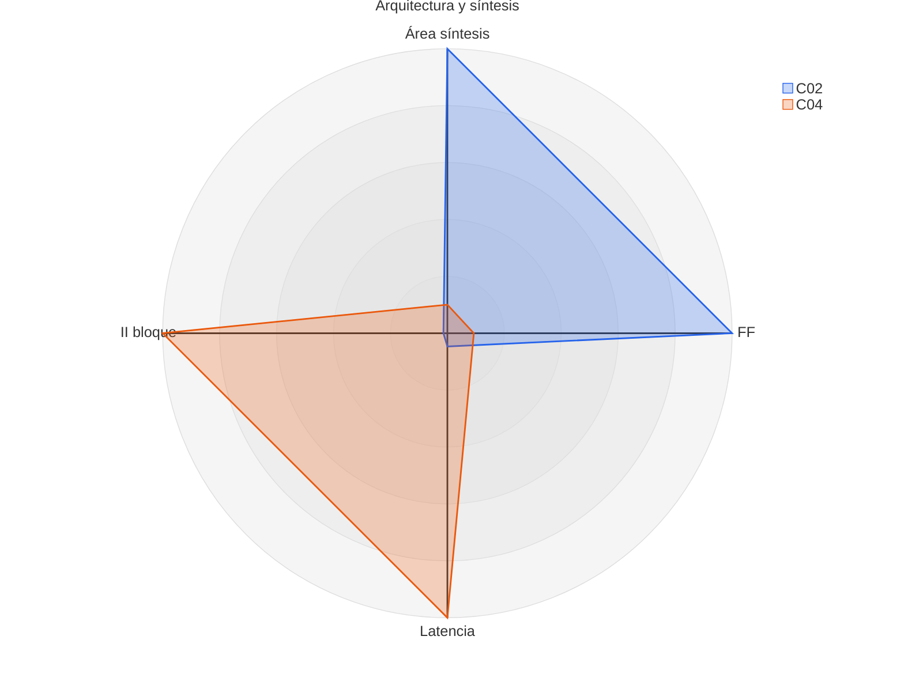

[Fuente Mermaid](../../build/ppa/comparisons/e9a58ba6857b698a/radar-arquitectura.mmd)

### Barras: objetivos propios

Cada gráfico usa una unidad; menor costo favorece la variante más pequeña.

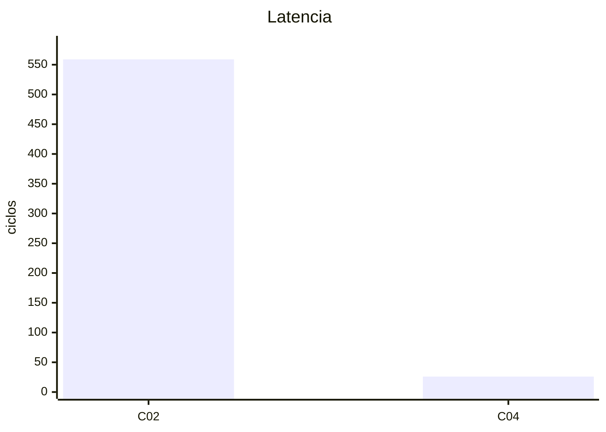

[Fuente Mermaid](../../build/ppa/comparisons/e9a58ba6857b698a/latency_cycles.mmd)

| ciclos | C02 | C04 |
|---|---:|---:|
| Latencia | 559 | 26 |

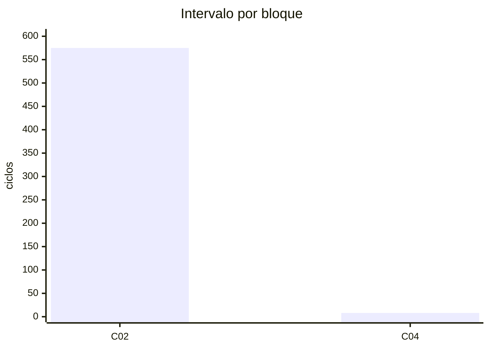

[Fuente Mermaid](../../build/ppa/comparisons/e9a58ba6857b698a/block_cycles.mmd)

| ciclos | C02 | C04 |
|---|---:|---:|
| Intervalo por bloque | 575 | 8 |

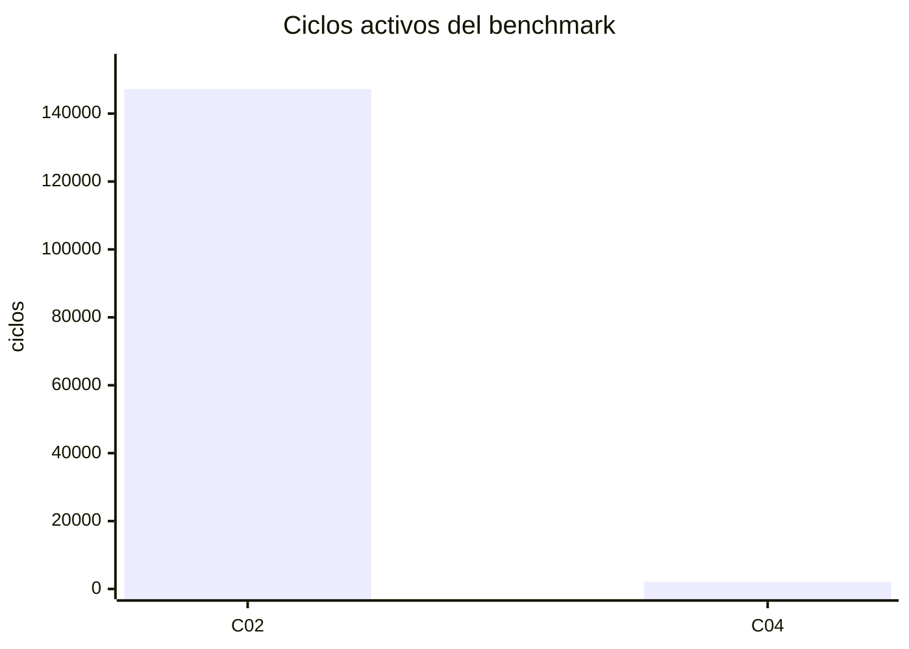

[Fuente Mermaid](../../build/ppa/comparisons/e9a58ba6857b698a/active_cycles.mmd)

| ciclos | C02 | C04 |
|---|---:|---:|
| Ciclos activos del benchmark | 147200 | 2074 |

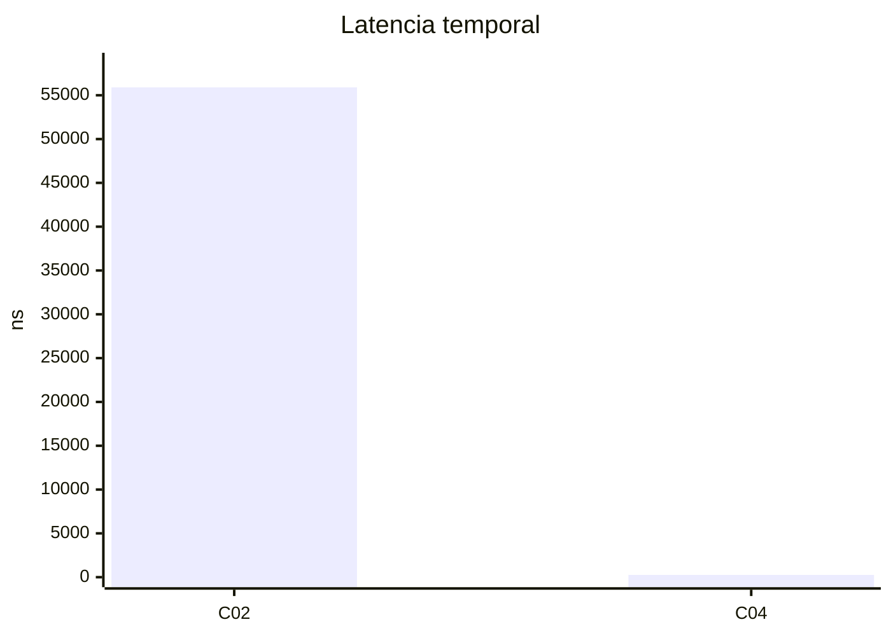

[Fuente Mermaid](../../build/ppa/comparisons/e9a58ba6857b698a/latency_ns.mmd)

| ns | C02 | C04 |
|---|---:|---:|
| Latencia temporal | 55900 | 260 |

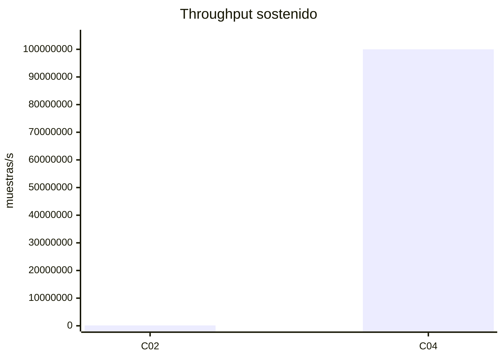

[Fuente Mermaid](../../build/ppa/comparisons/e9a58ba6857b698a/sustained_sps.mmd)

| muestras/s | C02 | C04 |
|---|---:|---:|
| Throughput sostenido | 139130.434783 | 1e+08 |

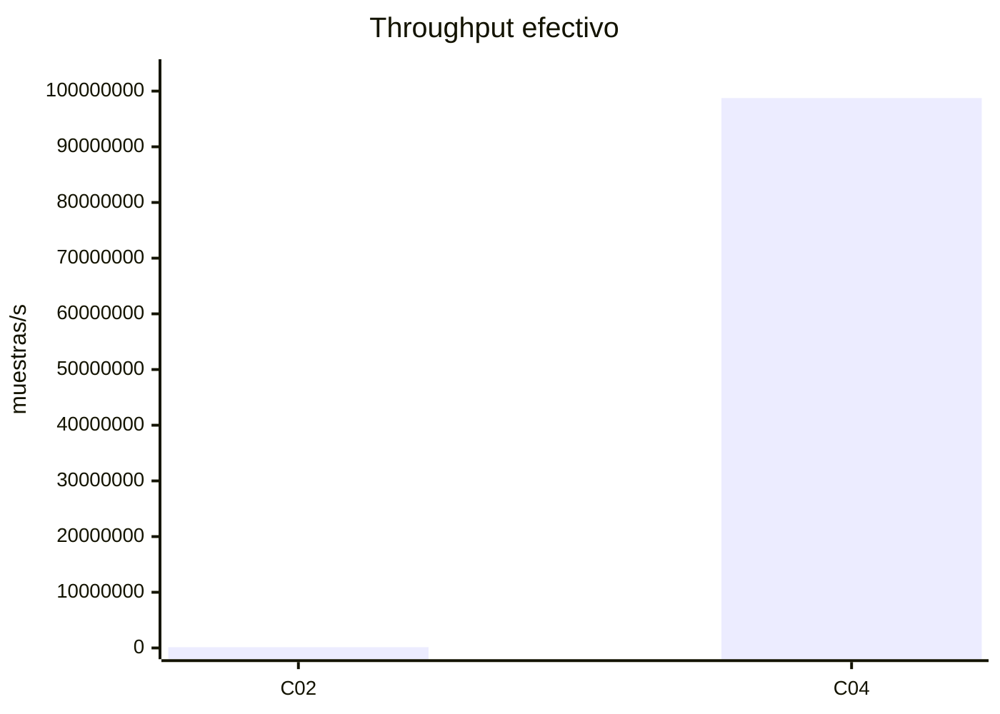

[Fuente Mermaid](../../build/ppa/comparisons/e9a58ba6857b698a/effective_sps.mmd)

| muestras/s | C02 | C04 |
|---|---:|---:|
| Throughput efectivo | 139130.434783 | 9.87464e+07 |


[Fuente Mermaid](../../build/ppa/comparisons/e9a58ba6857b698a/cells.mmd)

| celdas | C02 | C04 |
|---|---:|---:|
| Celdas de síntesis | 4474 | 48295 |

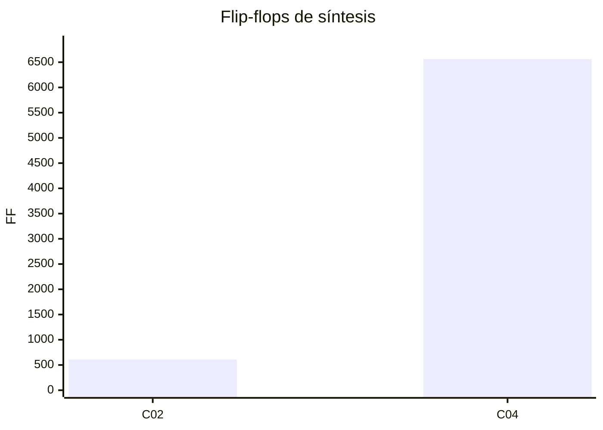

[Fuente Mermaid](../../build/ppa/comparisons/e9a58ba6857b698a/flip_flops.mmd)

| FF | C02 | C04 |
|---|---:|---:|
| Flip-flops de síntesis | 610 | 6562 |


[Fuente Mermaid](../../build/ppa/comparisons/e9a58ba6857b698a/combinational_cells.mmd)

| celdas | C02 | C04 |
|---|---:|---:|
| Celdas combinacionales de síntesis | 3864 | 41733 |

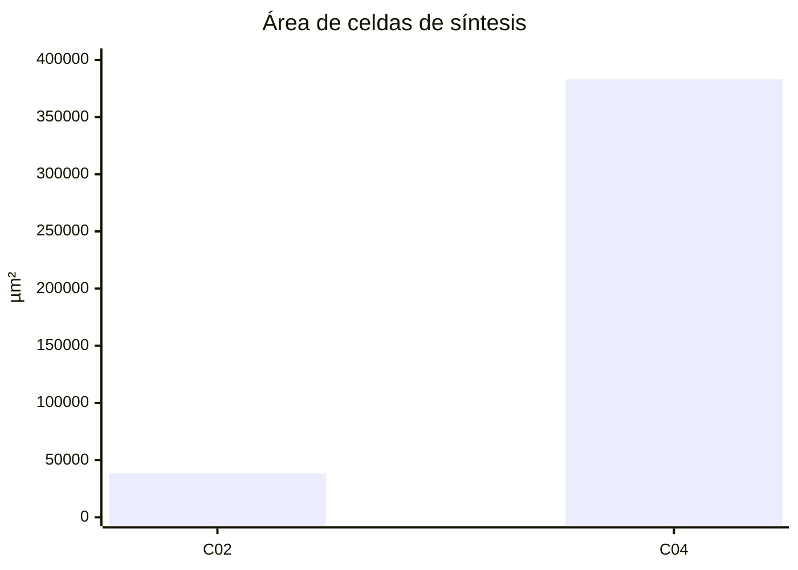

[Fuente Mermaid](../../build/ppa/comparisons/e9a58ba6857b698a/cell_area_um2.mmd)

| µm² | C02 | C04 |
|---|---:|---:|
| Área de celdas de síntesis | 38448.1248 | 382962.2912 |

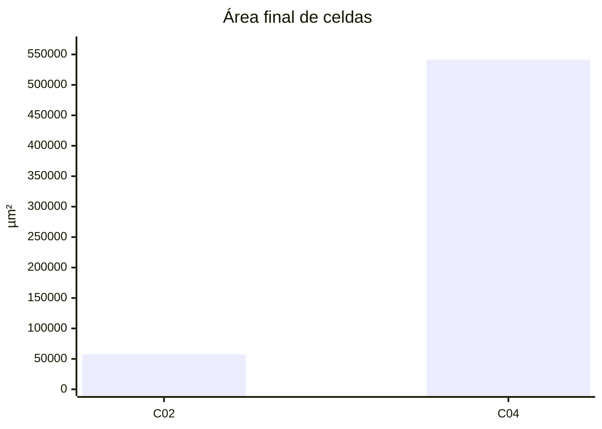

[Fuente Mermaid](../../build/ppa/comparisons/e9a58ba6857b698a/final_cell_area_um2.mmd)

| µm² | C02 | C04 |
|---|---:|---:|
| Área final de celdas | 57365 | 541302 |


[Fuente Mermaid](../../build/ppa/comparisons/e9a58ba6857b698a/core_area_um2.mmd)

| µm² | C02 | C04 |
|---|---:|---:|
| Área del núcleo | 144863.936 | 1432473.856 |

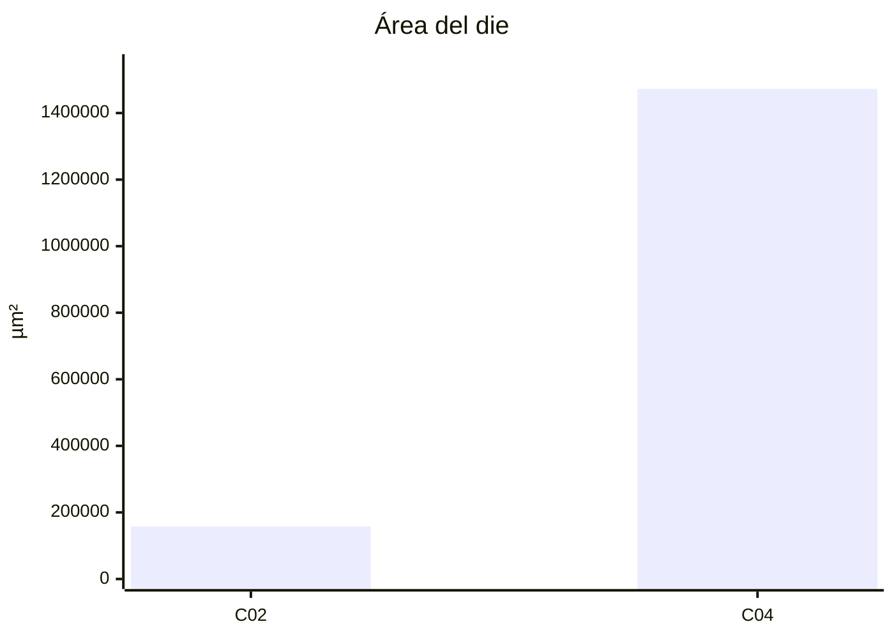

[Fuente Mermaid](../../build/ppa/comparisons/e9a58ba6857b698a/die_area_um2.mmd)

| µm² | C02 | C04 |
|---|---:|---:|
| Área del die | 157743.082425 | 1472699.144 |

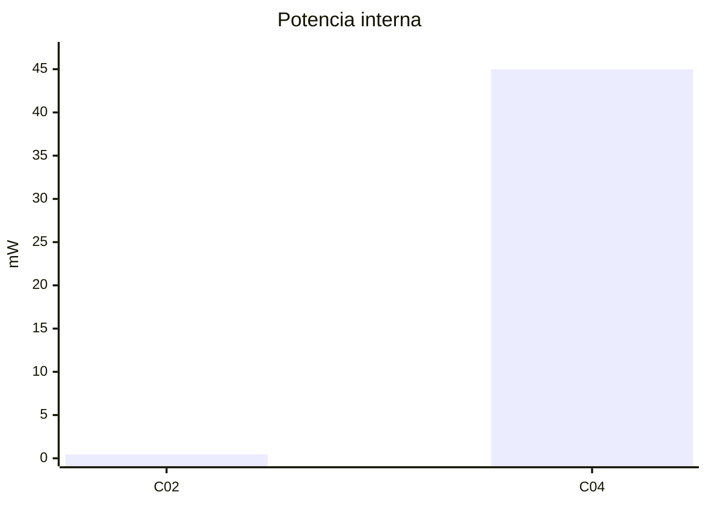

[Fuente Mermaid](../../build/ppa/comparisons/e9a58ba6857b698a/internal_w.mmd)

| W | C02 | C04 |
|---|---:|---:|
| Potencia interna | 0.000456245 | 0.04498 |

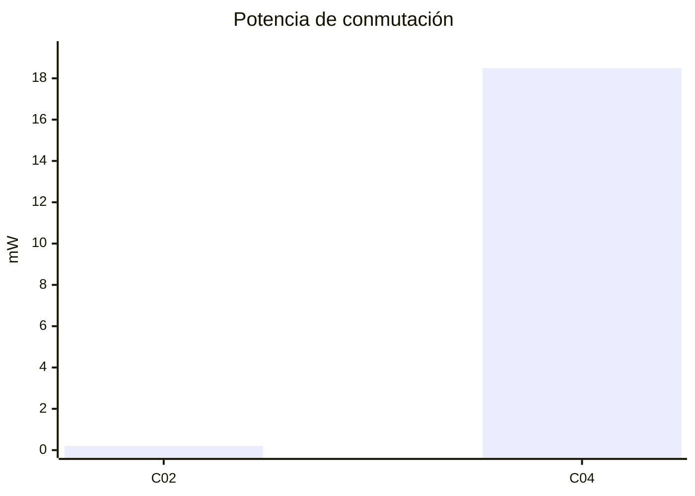

[Fuente Mermaid](../../build/ppa/comparisons/e9a58ba6857b698a/switching_w.mmd)

| W | C02 | C04 |
|---|---:|---:|
| Potencia de conmutación | 0.00020175 | 0.018494 |

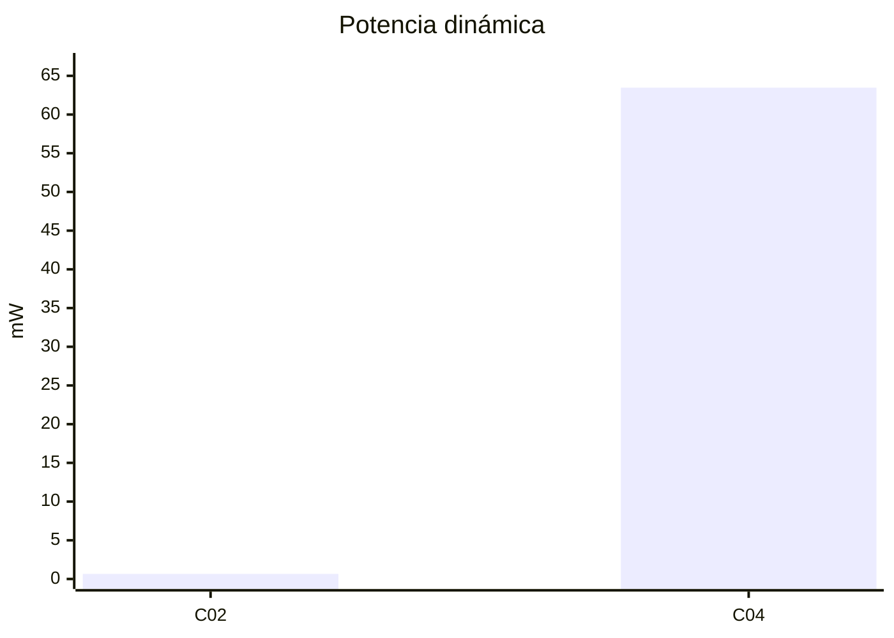

[Fuente Mermaid](../../build/ppa/comparisons/e9a58ba6857b698a/dynamic_w.mmd)

| W | C02 | C04 |
|---|---:|---:|
| Potencia dinámica | 0.000657995 | 0.063474 |

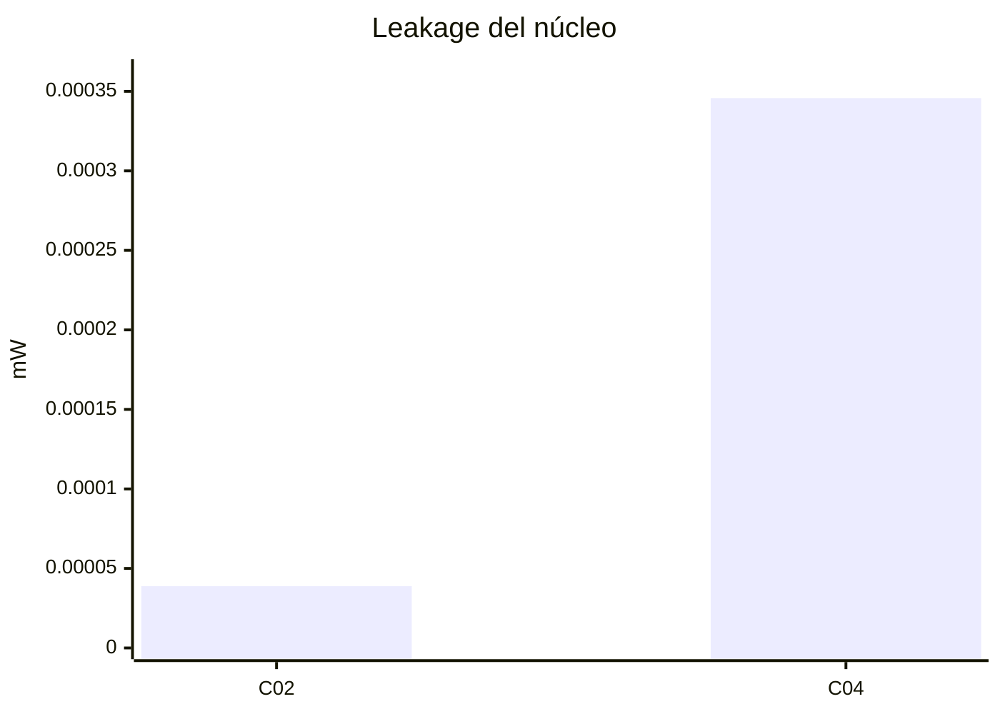

[Fuente Mermaid](../../build/ppa/comparisons/e9a58ba6857b698a/leakage_w.mmd)

| W | C02 | C04 |
|---|---:|---:|
| Leakage del núcleo | 3.88315e-08 | 3.45756e-07 |

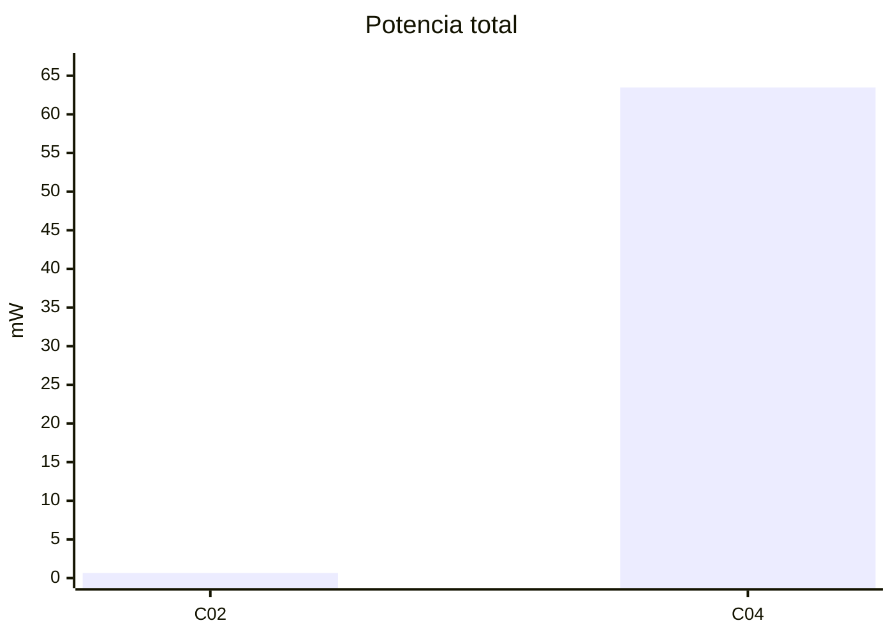

[Fuente Mermaid](../../build/ppa/comparisons/e9a58ba6857b698a/total_w.mmd)

| W | C02 | C04 |
|---|---:|---:|
| Potencia total | 0.000658034 | 0.063474 |

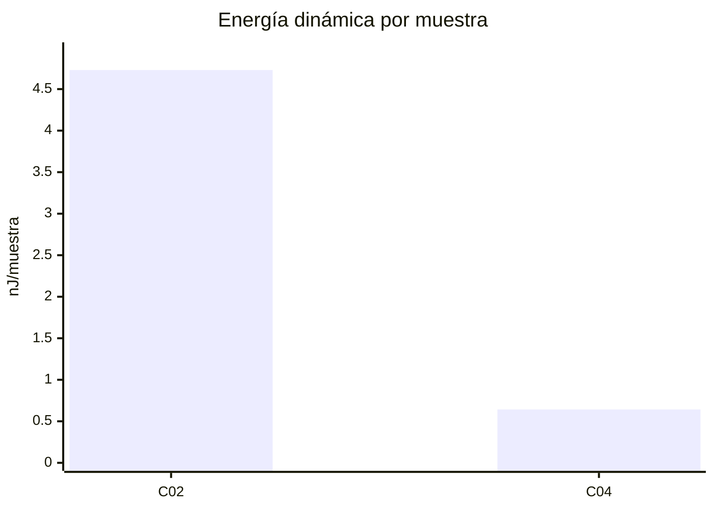

[Fuente Mermaid](../../build/ppa/comparisons/e9a58ba6857b698a/dynamic_energy_j.mmd)

| J/muestra | C02 | C04 |
|---|---:|---:|
| Energía dinámica por muestra | 4.72934e-09 | 6.42796e-10 |

```mermaid
xychart-beta
    title "Energía total por muestra"
    x-axis ["C02", "C04"]
    y-axis "nJ/muestra" 0.000000000000 --> 4.966096942908
    bar [4.729616136103, 0.642799814523]
```

[Fuente Mermaid](../../build/ppa/comparisons/e9a58ba6857b698a/total_energy_j.mmd)

| J/muestra | C02 | C04 |
|---|---:|---:|
| Energía total por muestra | 4.72962e-09 | 6.428e-10 |

```mermaid
xychart-beta
    title "Pines con actividad VCD/reloj/constante"
    x-axis ["C02", "C04"]
    y-axis "%" 0.000000000000 --> 105.000000000000
    bar [100.000000000000, 100.000000000000]
```

[Fuente Mermaid](../../build/ppa/comparisons/e9a58ba6857b698a/activity_coverage_pct.mmd)

| % | C02 | C04 |
|---|---:|---:|
| Pines con actividad VCD/reloj/constante | 100 | 100 |

### Reloj común: 10 MHz

Potencia común medida por variante (TT/25 °C/1,8 V), aunque el estado global no habilite gráficas:

| Métrica | Unidad | C02 | C04 |
|---|---|---:|---:|
| internal_w | W | 0.000456245 | 0.004498 |
| switching_w | W | 0.00020175 | 0.001849 |
| dynamic_w | W | 0.000657995 | 0.006347 |
| leakage_w | W | 3.88315e-08 | 3.45756e-07 |
| total_w | W | 0.000658034 | 0.006348 |
| dynamic_energy_j | J/muestra | 4.72934e-09 | 6.42805e-10 |
| total_energy_j | J/muestra | 4.72962e-09 | 6.4284e-10 |
Pendiente: ambas implementaciones deben demostrar timing a 10 MHz. No se grafican datos físicos supuestos.

### Timing por corner


Escenario target: C02 setup/hold **PASS**, eléctrico/restricciones **FAIL**, global **FAIL**; C04 setup/hold **FAIL**, eléctrico/restricciones **FAIL**, global **FAIL**.

| Estado | C02 | C04 |
|---|---|---|
| Setup/hold | PASS | FAIL |
| Eléctrico/restricciones | FAIL | FAIL |
| Global | FAIL | FAIL |

| Corner | Métrica | C02 | C04 |
|---|---|---:|---:|
| nom_tt_025C_1v80 | setup_ws_ns | 57.821582 | 2.330294 |
| nom_tt_025C_1v80 | hold_ws_ns | 0.310596 | 0.303278 |
| nom_tt_025C_1v80 | setup_wns_ns | 0 | 0 |
| nom_tt_025C_1v80 | hold_wns_ns | 0 | 0 |
| nom_tt_025C_1v80 | setup_tns_ns | 0 | 0 |
| nom_tt_025C_1v80 | hold_tns_ns | 0 | 0 |
| nom_tt_025C_1v80 | setup_violations | 0 | 0 |
| nom_tt_025C_1v80 | hold_violations | 0 | 0 |
| nom_tt_025C_1v80 | max_slew_violations | 0 | 6 |
| nom_tt_025C_1v80 | max_cap_violations | 1 | 1 |
| nom_tt_025C_1v80 | max_fanout_violations | 22 | 183 |
| nom_tt_025C_1v80 | unannotated_routed_nets | 0 | 0 |
| nom_tt_025C_1v80 | fmax_estimate_mhz | No medida | 144.903827 |
| nom_tt_025C_1v80 | constraint_warnings | 0 | 0 |
| nom_tt_025C_1v80 | unconstrained_endpoints | 0 | 0 |
| nom_ss_100C_1v60 | setup_ws_ns | 56.236922 | -3.162587 |
| nom_ss_100C_1v60 | hold_ws_ns | 0.86842 | -0.331913 |
| nom_ss_100C_1v60 | setup_wns_ns | 0 | -3.162587 |
| nom_ss_100C_1v60 | hold_wns_ns | 0 | -0.331913 |
| nom_ss_100C_1v60 | setup_tns_ns | 0 | -406.348261 |
| nom_ss_100C_1v60 | hold_tns_ns | 0 | -1.803331 |
| nom_ss_100C_1v60 | setup_violations | 0 | 448 |
| nom_ss_100C_1v60 | hold_violations | 0 | 7 |
| nom_ss_100C_1v60 | max_slew_violations | 60 | 418 |
| nom_ss_100C_1v60 | max_cap_violations | 1 | 1 |
| nom_ss_100C_1v60 | max_fanout_violations | 22 | 183 |
| nom_ss_100C_1v60 | unannotated_routed_nets | 0 | 0 |
| nom_ss_100C_1v60 | fmax_estimate_mhz | No medida | 75.972907 |
| nom_ss_100C_1v60 | constraint_warnings | 0 | 0 |
| nom_ss_100C_1v60 | unconstrained_endpoints | 0 | 0 |
| nom_ff_n40C_1v95 | setup_ws_ns | 58.455791 | 3.485214 |
| nom_ff_n40C_1v95 | hold_ws_ns | 0.110389 | 0.10003 |
| nom_ff_n40C_1v95 | setup_wns_ns | 0 | 0 |
| nom_ff_n40C_1v95 | hold_wns_ns | 0 | 0 |
| nom_ff_n40C_1v95 | setup_tns_ns | 0 | 0 |
| nom_ff_n40C_1v95 | hold_tns_ns | 0 | 0 |
| nom_ff_n40C_1v95 | setup_violations | 0 | 0 |
| nom_ff_n40C_1v95 | hold_violations | 0 | 0 |
| nom_ff_n40C_1v95 | max_slew_violations | 0 | 0 |
| nom_ff_n40C_1v95 | max_cap_violations | 1 | 1 |
| nom_ff_n40C_1v95 | max_fanout_violations | 22 | 183 |
| nom_ff_n40C_1v95 | unannotated_routed_nets | 0 | 0 |
| nom_ff_n40C_1v95 | fmax_estimate_mhz | No medida | 224.593783 |
| nom_ff_n40C_1v95 | constraint_warnings | 0 | 0 |
| nom_ff_n40C_1v95 | unconstrained_endpoints | 0 | 0 |
| min_tt_025C_1v80 | setup_ws_ns | 57.877949 | 2.474242 |
| min_tt_025C_1v80 | hold_ws_ns | 0.307922 | 0.300486 |
| min_tt_025C_1v80 | setup_wns_ns | 0 | 0 |
| min_tt_025C_1v80 | hold_wns_ns | 0 | 0 |
| min_tt_025C_1v80 | setup_tns_ns | 0 | 0 |
| min_tt_025C_1v80 | hold_tns_ns | 0 | 0 |
| min_tt_025C_1v80 | setup_violations | 0 | 0 |
| min_tt_025C_1v80 | hold_violations | 0 | 0 |
| min_tt_025C_1v80 | max_slew_violations | 0 | 0 |
| min_tt_025C_1v80 | max_cap_violations | 0 | 0 |
| min_tt_025C_1v80 | max_fanout_violations | 22 | 183 |
| min_tt_025C_1v80 | unannotated_routed_nets | 0 | 0 |
| min_tt_025C_1v80 | fmax_estimate_mhz | No medida | 145.92505 |
| min_tt_025C_1v80 | constraint_warnings | 0 | 0 |
| min_tt_025C_1v80 | unconstrained_endpoints | 0 | 0 |
| min_ss_100C_1v60 | setup_ws_ns | 56.337763 | -3.037316 |
| min_ss_100C_1v60 | hold_ws_ns | 0.863378 | -0.199806 |
| min_ss_100C_1v60 | setup_wns_ns | 0 | -3.037316 |
| min_ss_100C_1v60 | hold_wns_ns | 0 | -0.199806 |
| min_ss_100C_1v60 | setup_tns_ns | 0 | -357.997588 |
| min_ss_100C_1v60 | hold_tns_ns | 0 | -0.927088 |
| min_ss_100C_1v60 | setup_violations | 0 | 397 |
| min_ss_100C_1v60 | hold_violations | 0 | 7 |
| min_ss_100C_1v60 | max_slew_violations | 39 | 236 |
| min_ss_100C_1v60 | max_cap_violations | 0 | 0 |
| min_ss_100C_1v60 | max_fanout_violations | 22 | 183 |
| min_ss_100C_1v60 | unannotated_routed_nets | 0 | 0 |
| min_ss_100C_1v60 | fmax_estimate_mhz | No medida | 76.702904 |
| min_ss_100C_1v60 | constraint_warnings | 0 | 0 |
| min_ss_100C_1v60 | unconstrained_endpoints | 0 | 0 |
| min_ff_n40C_1v95 | setup_ws_ns | 58.493031 | 3.582549 |
| min_ff_n40C_1v95 | hold_ws_ns | 0.108772 | 0.099976 |
| min_ff_n40C_1v95 | setup_wns_ns | 0 | 0 |
| min_ff_n40C_1v95 | hold_wns_ns | 0 | 0 |
| min_ff_n40C_1v95 | setup_tns_ns | 0 | 0 |
| min_ff_n40C_1v95 | hold_tns_ns | 0 | 0 |
| min_ff_n40C_1v95 | setup_violations | 0 | 0 |
| min_ff_n40C_1v95 | hold_violations | 0 | 0 |
| min_ff_n40C_1v95 | max_slew_violations | 0 | 0 |
| min_ff_n40C_1v95 | max_cap_violations | 0 | 0 |
| min_ff_n40C_1v95 | max_fanout_violations | 22 | 183 |
| min_ff_n40C_1v95 | unannotated_routed_nets | 0 | 0 |
| min_ff_n40C_1v95 | fmax_estimate_mhz | No medida | 226.599726 |
| min_ff_n40C_1v95 | constraint_warnings | 0 | 0 |
| min_ff_n40C_1v95 | unconstrained_endpoints | 0 | 0 |
| max_tt_025C_1v80 | setup_ws_ns | 57.764419 | 2.196895 |
| max_tt_025C_1v80 | hold_ws_ns | 0.313966 | 0.305665 |
| max_tt_025C_1v80 | setup_wns_ns | 0 | 0 |
| max_tt_025C_1v80 | hold_wns_ns | 0 | 0 |
| max_tt_025C_1v80 | setup_tns_ns | 0 | 0 |
| max_tt_025C_1v80 | hold_tns_ns | 0 | 0 |
| max_tt_025C_1v80 | setup_violations | 0 | 0 |
| max_tt_025C_1v80 | hold_violations | 0 | 0 |
| max_tt_025C_1v80 | max_slew_violations | 0 | 8 |
| max_tt_025C_1v80 | max_cap_violations | 1 | 3 |
| max_tt_025C_1v80 | max_fanout_violations | 22 | 183 |
| max_tt_025C_1v80 | unannotated_routed_nets | 0 | 0 |
| max_tt_025C_1v80 | fmax_estimate_mhz | No medida | 143.370656 |
| max_tt_025C_1v80 | constraint_warnings | 0 | 0 |
| max_tt_025C_1v80 | unconstrained_endpoints | 0 | 0 |
| max_ss_100C_1v60 | setup_ws_ns | 56.134981 | -3.280996 |
| max_ss_100C_1v60 | hold_ws_ns | 0.875171 | -0.499415 |
| max_ss_100C_1v60 | setup_wns_ns | 0 | -3.280996 |
| max_ss_100C_1v60 | hold_wns_ns | 0 | -0.499415 |
| max_ss_100C_1v60 | setup_tns_ns | 0 | -464.008237 |
| max_ss_100C_1v60 | hold_tns_ns | 0 | -3.389989 |
| max_ss_100C_1v60 | setup_violations | 0 | 488 |
| max_ss_100C_1v60 | hold_violations | 0 | 13 |
| max_ss_100C_1v60 | max_slew_violations | 86 | 544 |
| max_ss_100C_1v60 | max_cap_violations | 1 | 3 |
| max_ss_100C_1v60 | max_fanout_violations | 22 | 183 |
| max_ss_100C_1v60 | unannotated_routed_nets | 0 | 0 |
| max_ss_100C_1v60 | fmax_estimate_mhz | No medida | 75.295558 |
| max_ss_100C_1v60 | constraint_warnings | 0 | 0 |
| max_ss_100C_1v60 | unconstrained_endpoints | 0 | 0 |
| max_ff_n40C_1v95 | setup_ws_ns | 58.417457 | 3.391547 |
| max_ff_n40C_1v95 | hold_ws_ns | 0.111838 | 0.101807 |
| max_ff_n40C_1v95 | setup_wns_ns | 0 | 0 |
| max_ff_n40C_1v95 | hold_wns_ns | 0 | 0 |
| max_ff_n40C_1v95 | setup_tns_ns | 0 | 0 |
| max_ff_n40C_1v95 | hold_tns_ns | 0 | 0 |
| max_ff_n40C_1v95 | setup_violations | 0 | 0 |
| max_ff_n40C_1v95 | hold_violations | 0 | 0 |
| max_ff_n40C_1v95 | max_slew_violations | 0 | 0 |
| max_ff_n40C_1v95 | max_cap_violations | 1 | 3 |
| max_ff_n40C_1v95 | max_fanout_violations | 22 | 183 |
| max_ff_n40C_1v95 | unannotated_routed_nets | 0 | 0 |
| max_ff_n40C_1v95 | fmax_estimate_mhz | No medida | 221.800653 |
| max_ff_n40C_1v95 | constraint_warnings | 0 | 0 |
| max_ff_n40C_1v95 | unconstrained_endpoints | 0 | 0 |

Escenarios discretos de proceso/interconexión: **C02 azul**, **C04 naranja**. Las líneas no interpolan corners físicos nuevos.

```mermaid
---
config:
  themeVariables:
    xyChart:
      plotColorPalette: '#2563eb, #ea580c'
---
xychart-beta
    title "setup_ws_ns: target"
    x-axis ["nom-TT", "nom-SS", "nom-FF", "min-TT", "min-SS", "min-FF", "max-TT", "max-SS", "max-FF"]
    y-axis "ns" -3.280996012190 --> 61.417682278364
    line [57.821582047871, 56.236922488334, 58.455791195465, 57.877949404693, 56.337762716245, 58.493030741299, 57.764418883162, 56.134980919151, 58.417457413786]
    line [2.330293801658, -3.162586726462, 3.485214437918, 2.474241770388, -3.037316262248, 3.582549469596, 2.196894728317, -3.280996012190, 3.391546695038]
```

[Fuente Mermaid](../../build/ppa/comparisons/e9a58ba6857b698a/target-setup_ws_ns.mmd)

```mermaid
---
config:
  themeVariables:
    xyChart:
      plotColorPalette: '#2563eb, #ea580c'
---
xychart-beta
    title "hold_ws_ns: target"
    x-axis ["nom-TT", "nom-SS", "nom-FF", "min-TT", "min-SS", "min-FF", "max-TT", "max-SS", "max-FF"]
    y-axis "ns" -0.499414967961 --> 0.918929741643
    line [0.310595891131, 0.868420249181, 0.110388756816, 0.307922140945, 0.863377616060, 0.108772438579, 0.313965751173, 0.875171182517, 0.111838041993]
    line [0.303278077902, -0.331912728918, 0.100030320192, 0.300486311005, -0.199806177259, 0.099975808240, 0.305664835428, -0.499414967961, 0.101807343215]
```

[Fuente Mermaid](../../build/ppa/comparisons/e9a58ba6857b698a/target-hold_ws_ns.mmd)

```mermaid
---
config:
  themeVariables:
    xyChart:
      plotColorPalette: '#2563eb, #ea580c'
---
xychart-beta
    title "setup_tns_ns: target"
    x-axis ["nom-TT", "nom-SS", "nom-FF", "min-TT", "min-SS", "min-FF", "max-TT", "max-SS", "max-FF"]
    y-axis "ns" -464.008236966897 --> 0.000000000000
    line [0.000000000000, 0.000000000000, 0.000000000000, 0.000000000000, 0.000000000000, 0.000000000000, 0.000000000000, 0.000000000000, 0.000000000000]
    line [0.000000000000, -406.348260763418, 0.000000000000, 0.000000000000, -357.997588373478, 0.000000000000, 0.000000000000, -464.008236966897, 0.000000000000]
```

[Fuente Mermaid](../../build/ppa/comparisons/e9a58ba6857b698a/target-setup_tns_ns.mmd)

```mermaid
---
config:
  themeVariables:
    xyChart:
      plotColorPalette: '#2563eb, #ea580c'
---
xychart-beta
    title "hold_tns_ns: target"
    x-axis ["nom-TT", "nom-SS", "nom-FF", "min-TT", "min-SS", "min-FF", "max-TT", "max-SS", "max-FF"]
    y-axis "ns" -3.389988608001 --> 0.000000000000
    line [0.000000000000, 0.000000000000, 0.000000000000, 0.000000000000, 0.000000000000, 0.000000000000, 0.000000000000, 0.000000000000, 0.000000000000]
    line [0.000000000000, -1.803330646964, 0.000000000000, 0.000000000000, -0.927087766130, 0.000000000000, 0.000000000000, -3.389988608001, 0.000000000000]
```

[Fuente Mermaid](../../build/ppa/comparisons/e9a58ba6857b698a/target-hold_tns_ns.mmd)

Escenario common: C02 setup/hold **PASS**, eléctrico/restricciones **FAIL**, global **FAIL**; C04 setup/hold **PASS**, eléctrico/restricciones **FAIL**, global **FAIL**.

| Estado | C02 | C04 |
|---|---|---|
| Setup/hold | PASS | PASS |
| Eléctrico/restricciones | FAIL | FAIL |
| Global | FAIL | FAIL |

| Corner | Métrica | C02 | C04 |
|---|---|---:|---:|
| nom_tt_025C_1v80 | setup_ws_ns | 57.821582 | 56.330291 |
| nom_tt_025C_1v80 | hold_ws_ns | 0.310596 | 0.303278 |
| nom_tt_025C_1v80 | setup_wns_ns | 0 | 0 |
| nom_tt_025C_1v80 | hold_wns_ns | 0 | 0 |
| nom_tt_025C_1v80 | setup_tns_ns | 0 | 0 |
| nom_tt_025C_1v80 | hold_tns_ns | 0 | 0 |
| nom_tt_025C_1v80 | setup_violations | 0 | 0 |
| nom_tt_025C_1v80 | hold_violations | 0 | 0 |
| nom_tt_025C_1v80 | max_slew_violations | 0 | 6 |
| nom_tt_025C_1v80 | max_cap_violations | 1 | 1 |
| nom_tt_025C_1v80 | max_fanout_violations | 22 | 183 |
| nom_tt_025C_1v80 | unannotated_routed_nets | 0 | 0 |
| nom_tt_025C_1v80 | fmax_estimate_mhz | No medida | 144.9 |
| nom_tt_025C_1v80 | constraint_warnings | 0 | 0 |
| nom_tt_025C_1v80 | unconstrained_endpoints | 0 | 0 |
| nom_ss_100C_1v60 | setup_ws_ns | 56.236922 | 53.529762 |
| nom_ss_100C_1v60 | hold_ws_ns | 0.86842 | 0.827144 |
| nom_ss_100C_1v60 | setup_wns_ns | 0 | 0 |
| nom_ss_100C_1v60 | hold_wns_ns | 0 | 0 |
| nom_ss_100C_1v60 | setup_tns_ns | 0 | 0 |
| nom_ss_100C_1v60 | hold_tns_ns | 0 | 0 |
| nom_ss_100C_1v60 | setup_violations | 0 | 0 |
| nom_ss_100C_1v60 | hold_violations | 0 | 0 |
| nom_ss_100C_1v60 | max_slew_violations | 60 | 418 |
| nom_ss_100C_1v60 | max_cap_violations | 1 | 1 |
| nom_ss_100C_1v60 | max_fanout_violations | 22 | 183 |
| nom_ss_100C_1v60 | unannotated_routed_nets | 0 | 0 |
| nom_ss_100C_1v60 | fmax_estimate_mhz | No medida | 75.97 |
| nom_ss_100C_1v60 | constraint_warnings | 0 | 0 |
| nom_ss_100C_1v60 | unconstrained_endpoints | 0 | 0 |
| nom_ff_n40C_1v95 | setup_ws_ns | 58.455791 | 57.485211 |
| nom_ff_n40C_1v95 | hold_ws_ns | 0.110389 | 0.10003 |
| nom_ff_n40C_1v95 | setup_wns_ns | 0 | 0 |
| nom_ff_n40C_1v95 | hold_wns_ns | 0 | 0 |
| nom_ff_n40C_1v95 | setup_tns_ns | 0 | 0 |
| nom_ff_n40C_1v95 | hold_tns_ns | 0 | 0 |
| nom_ff_n40C_1v95 | setup_violations | 0 | 0 |
| nom_ff_n40C_1v95 | hold_violations | 0 | 0 |
| nom_ff_n40C_1v95 | max_slew_violations | 0 | 0 |
| nom_ff_n40C_1v95 | max_cap_violations | 1 | 1 |
| nom_ff_n40C_1v95 | max_fanout_violations | 22 | 183 |
| nom_ff_n40C_1v95 | unannotated_routed_nets | 0 | 0 |
| nom_ff_n40C_1v95 | fmax_estimate_mhz | No medida | 224.59 |
| nom_ff_n40C_1v95 | constraint_warnings | 0 | 0 |
| nom_ff_n40C_1v95 | unconstrained_endpoints | 0 | 0 |
| min_tt_025C_1v80 | setup_ws_ns | 57.877949 | 56.474237 |
| min_tt_025C_1v80 | hold_ws_ns | 0.307922 | 0.300486 |
| min_tt_025C_1v80 | setup_wns_ns | 0 | 0 |
| min_tt_025C_1v80 | hold_wns_ns | 0 | 0 |
| min_tt_025C_1v80 | setup_tns_ns | 0 | 0 |
| min_tt_025C_1v80 | hold_tns_ns | 0 | 0 |
| min_tt_025C_1v80 | setup_violations | 0 | 0 |
| min_tt_025C_1v80 | hold_violations | 0 | 0 |
| min_tt_025C_1v80 | max_slew_violations | 0 | 0 |
| min_tt_025C_1v80 | max_cap_violations | 0 | 0 |
| min_tt_025C_1v80 | max_fanout_violations | 22 | 183 |
| min_tt_025C_1v80 | unannotated_routed_nets | 0 | 0 |
| min_tt_025C_1v80 | fmax_estimate_mhz | No medida | 145.93 |
| min_tt_025C_1v80 | constraint_warnings | 0 | 0 |
| min_tt_025C_1v80 | unconstrained_endpoints | 0 | 0 |
| min_ss_100C_1v60 | setup_ws_ns | 56.337763 | 53.780484 |
| min_ss_100C_1v60 | hold_ws_ns | 0.863378 | 0.824435 |
| min_ss_100C_1v60 | setup_wns_ns | 0 | 0 |
| min_ss_100C_1v60 | hold_wns_ns | 0 | 0 |
| min_ss_100C_1v60 | setup_tns_ns | 0 | 0 |
| min_ss_100C_1v60 | hold_tns_ns | 0 | 0 |
| min_ss_100C_1v60 | setup_violations | 0 | 0 |
| min_ss_100C_1v60 | hold_violations | 0 | 0 |
| min_ss_100C_1v60 | max_slew_violations | 39 | 236 |
| min_ss_100C_1v60 | max_cap_violations | 0 | 0 |
| min_ss_100C_1v60 | max_fanout_violations | 22 | 183 |
| min_ss_100C_1v60 | unannotated_routed_nets | 0 | 0 |
| min_ss_100C_1v60 | fmax_estimate_mhz | No medida | 76.7 |
| min_ss_100C_1v60 | constraint_warnings | 0 | 0 |
| min_ss_100C_1v60 | unconstrained_endpoints | 0 | 0 |
| min_ff_n40C_1v95 | setup_ws_ns | 58.493031 | 57.582552 |
| min_ff_n40C_1v95 | hold_ws_ns | 0.108772 | 0.099976 |
| min_ff_n40C_1v95 | setup_wns_ns | 0 | 0 |
| min_ff_n40C_1v95 | hold_wns_ns | 0 | 0 |
| min_ff_n40C_1v95 | setup_tns_ns | 0 | 0 |
| min_ff_n40C_1v95 | hold_tns_ns | 0 | 0 |
| min_ff_n40C_1v95 | setup_violations | 0 | 0 |
| min_ff_n40C_1v95 | hold_violations | 0 | 0 |
| min_ff_n40C_1v95 | max_slew_violations | 0 | 0 |
| min_ff_n40C_1v95 | max_cap_violations | 0 | 0 |
| min_ff_n40C_1v95 | max_fanout_violations | 22 | 183 |
| min_ff_n40C_1v95 | unannotated_routed_nets | 0 | 0 |
| min_ff_n40C_1v95 | fmax_estimate_mhz | No medida | 226.6 |
| min_ff_n40C_1v95 | constraint_warnings | 0 | 0 |
| min_ff_n40C_1v95 | unconstrained_endpoints | 0 | 0 |
| max_tt_025C_1v80 | setup_ws_ns | 57.764419 | 56.196898 |
| max_tt_025C_1v80 | hold_ws_ns | 0.313966 | 0.305665 |
| max_tt_025C_1v80 | setup_wns_ns | 0 | 0 |
| max_tt_025C_1v80 | hold_wns_ns | 0 | 0 |
| max_tt_025C_1v80 | setup_tns_ns | 0 | 0 |
| max_tt_025C_1v80 | hold_tns_ns | 0 | 0 |
| max_tt_025C_1v80 | setup_violations | 0 | 0 |
| max_tt_025C_1v80 | hold_violations | 0 | 0 |
| max_tt_025C_1v80 | max_slew_violations | 0 | 8 |
| max_tt_025C_1v80 | max_cap_violations | 1 | 3 |
| max_tt_025C_1v80 | max_fanout_violations | 22 | 183 |
| max_tt_025C_1v80 | unannotated_routed_nets | 0 | 0 |
| max_tt_025C_1v80 | fmax_estimate_mhz | No medida | 143.37 |
| max_tt_025C_1v80 | constraint_warnings | 0 | 0 |
| max_tt_025C_1v80 | unconstrained_endpoints | 0 | 0 |
| max_ss_100C_1v60 | setup_ws_ns | 56.134981 | 53.313409 |
| max_ss_100C_1v60 | hold_ws_ns | 0.875171 | 0.831592 |
| max_ss_100C_1v60 | setup_wns_ns | 0 | 0 |
| max_ss_100C_1v60 | hold_wns_ns | 0 | 0 |
| max_ss_100C_1v60 | setup_tns_ns | 0 | 0 |
| max_ss_100C_1v60 | hold_tns_ns | 0 | 0 |
| max_ss_100C_1v60 | setup_violations | 0 | 0 |
| max_ss_100C_1v60 | hold_violations | 0 | 0 |
| max_ss_100C_1v60 | max_slew_violations | 86 | 544 |
| max_ss_100C_1v60 | max_cap_violations | 1 | 3 |
| max_ss_100C_1v60 | max_fanout_violations | 22 | 183 |
| max_ss_100C_1v60 | unannotated_routed_nets | 0 | 0 |
| max_ss_100C_1v60 | fmax_estimate_mhz | No medida | 75.3 |
| max_ss_100C_1v60 | constraint_warnings | 0 | 0 |
| max_ss_100C_1v60 | unconstrained_endpoints | 0 | 0 |
| max_ff_n40C_1v95 | setup_ws_ns | 58.417457 | 57.391547 |
| max_ff_n40C_1v95 | hold_ws_ns | 0.111838 | 0.101807 |
| max_ff_n40C_1v95 | setup_wns_ns | 0 | 0 |
| max_ff_n40C_1v95 | hold_wns_ns | 0 | 0 |
| max_ff_n40C_1v95 | setup_tns_ns | 0 | 0 |
| max_ff_n40C_1v95 | hold_tns_ns | 0 | 0 |
| max_ff_n40C_1v95 | setup_violations | 0 | 0 |
| max_ff_n40C_1v95 | hold_violations | 0 | 0 |
| max_ff_n40C_1v95 | max_slew_violations | 0 | 0 |
| max_ff_n40C_1v95 | max_cap_violations | 1 | 3 |
| max_ff_n40C_1v95 | max_fanout_violations | 22 | 183 |
| max_ff_n40C_1v95 | unannotated_routed_nets | 0 | 0 |
| max_ff_n40C_1v95 | fmax_estimate_mhz | No medida | 221.8 |
| max_ff_n40C_1v95 | constraint_warnings | 0 | 0 |
| max_ff_n40C_1v95 | unconstrained_endpoints | 0 | 0 |

Escenarios discretos de proceso/interconexión: **C02 azul**, **C04 naranja**. Las líneas no interpolan corners físicos nuevos.

```mermaid
---
config:
  themeVariables:
    xyChart:
      plotColorPalette: '#2563eb, #ea580c'
---
xychart-beta
    title "setup_ws_ns: common"
    x-axis ["nom-TT", "nom-SS", "nom-FF", "min-TT", "min-SS", "min-FF", "max-TT", "max-SS", "max-FF"]
    y-axis "ns" 0.000000000000 --> 61.417682278364
    line [57.821582047871, 56.236922488334, 58.455791195465, 57.877949404693, 56.337762716245, 58.493030741299, 57.764418883162, 56.134980919151, 58.417457413786]
    line [56.330291359167, 53.529761693952, 57.485211107249, 56.474236663362, 53.780483810783, 57.582551912087, 56.196897614897, 53.313408530221, 57.391547361172]
```

[Fuente Mermaid](../../build/ppa/comparisons/e9a58ba6857b698a/common-setup_ws_ns.mmd)

```mermaid
---
config:
  themeVariables:
    xyChart:
      plotColorPalette: '#2563eb, #ea580c'
---
xychart-beta
    title "hold_ws_ns: common"
    x-axis ["nom-TT", "nom-SS", "nom-FF", "min-TT", "min-SS", "min-FF", "max-TT", "max-SS", "max-FF"]
    y-axis "ns" 0.000000000000 --> 0.918929741643
    line [0.310595891131, 0.868420249181, 0.110388756816, 0.307922140945, 0.863377616060, 0.108772438579, 0.313965751173, 0.875171182517, 0.111838041993]
    line [0.303278077902, 0.827144154359, 0.100030320192, 0.300486311005, 0.824434543969, 0.099975808240, 0.305664835428, 0.831591707922, 0.101807343215]
```

[Fuente Mermaid](../../build/ppa/comparisons/e9a58ba6857b698a/common-hold_ws_ns.mmd)

```mermaid
---
config:
  themeVariables:
    xyChart:
      plotColorPalette: '#2563eb, #ea580c'
---
xychart-beta
    title "setup_tns_ns: common"
    x-axis ["nom-TT", "nom-SS", "nom-FF", "min-TT", "min-SS", "min-FF", "max-TT", "max-SS", "max-FF"]
    y-axis "ns" 0.000000000000 --> 1.000000000000
    line [0.000000000000, 0.000000000000, 0.000000000000, 0.000000000000, 0.000000000000, 0.000000000000, 0.000000000000, 0.000000000000, 0.000000000000]
    line [0.000000000000, 0.000000000000, 0.000000000000, 0.000000000000, 0.000000000000, 0.000000000000, 0.000000000000, 0.000000000000, 0.000000000000]
```

[Fuente Mermaid](../../build/ppa/comparisons/e9a58ba6857b698a/common-setup_tns_ns.mmd)

```mermaid
---
config:
  themeVariables:
    xyChart:
      plotColorPalette: '#2563eb, #ea580c'
---
xychart-beta
    title "hold_tns_ns: common"
    x-axis ["nom-TT", "nom-SS", "nom-FF", "min-TT", "min-SS", "min-FF", "max-TT", "max-SS", "max-FF"]
    y-axis "ns" 0.000000000000 --> 1.000000000000
    line [0.000000000000, 0.000000000000, 0.000000000000, 0.000000000000, 0.000000000000, 0.000000000000, 0.000000000000, 0.000000000000, 0.000000000000]
    line [0.000000000000, 0.000000000000, 0.000000000000, 0.000000000000, 0.000000000000, 0.000000000000, 0.000000000000, 0.000000000000, 0.000000000000]
```

[Fuente Mermaid](../../build/ppa/comparisons/e9a58ba6857b698a/common-hold_tns_ns.mmd)

<!-- comparison:end -->

## Referencia histórica preservada — C02 en Vivado 2024.2

Esta sección corresponde a **FPGA Artix-7**, no a SKY130. Se conserva por pedido
de Enzo como antecedente; el actualizador de corridas locales no la modifica.
No constituye medición ASIC ni puede completar su cierre de timing/potencia.


Resultados informados por el compañero en Windows el **13/10/2026**, sobre
Artix-7 `xc7a35tcpg236-1`, out-of-context, con reloj de 100 ns y el benchmark
A04 de 2048 muestras. Se recibió únicamente su resumen Markdown: **no están
los reportes originales, logs, netlist, SDF ni checkpoint para auditarlos**.
El commit, los hashes y el identificador exacto del paquete ejecutado no fueron
informados; esta evidencia se vincula a la base serial por su configuración
reportada, sin afirmar identidad de fuentes comprobada.

| Métrica | Resultado informado | Procedencia |
|---|---:|---|
| Verificación funcional de 2048 muestras | PASS | Simulación comportamental en Vivado, sin SDF |
| Latencia / ciclos por bloque | 559 / 575 | Simulación comportamental; coincide con la medida local |
| Ciclos activos / throughput a 10 MHz | 147200 / 139130,435 muestras/s | Simulación comportamental |
| Timing interno a 10 MHz | Cumple setup y hold | Implementación routed |
| WNS setup | +82,675 ns | Implementación routed |
| WHS hold | +0,189 ns | Implementación routed |
| Fmax aproximada | 57,72 MHz | Derivada de `1000/(100 − 82,675)`; sin barrido |
| LUT como lógica | 1875 (9,01 %) | Utilización implementada; no se informó LUT total |
| FF / Slice Registers | 569 (1,37 %) | Utilización implementada |
| DSP48E1 | 3 (3,33 %) | Utilización implementada |
| Block RAM | 0 | Utilización implementada |
| CARRY4 / F7+F8 Muxes | 20 / 238 | Utilización implementada |
| Potencia total on-chip | 0,070 W | Estimación vectorless sobre `implemented.dcp` |
| Potencia dinámica | 0,002 W | Estimación vectorless |
| Potencia estática del dispositivo | 0,068 W | Estimación vectorless |
| Energía dinámica por muestra | ≈ 14,4 nJ/muestra | Derivada de potencia vectorless y throughput RTL |
| Confianza de potencia | Media | Según el resumen recibido; actividad interna especificada <25 % |
| Temperatura de juntura / máxima ambiente | 25,4 °C / 84,6 °C | Condiciones por defecto informadas |
| Simulación temporal con SDF | No completó; watchdog a 160000 ciclos | Bloqueo informado en Windows + Vivado 2024.2 |
| Potencia con SAIF | Pendiente | No se obtuvo una simulación temporal completa |
| Caminos sin constraints / detalle del camino crítico | Pendiente de revisión | No se recibieron esos reportes |

La energía vectorless es una referencia provisional. **No se debe usar como
potencia comparable con actividad del benchmark** ni como medida SAIF. Las
cifras de potencia están redondeadas en el resumen recibido. La estática
corresponde al FPGA completo, no solo al filtro.

### Interpretación de la referencia histórica

- **El serial cumple el mínimo de 10 MHz de una variante lenta**, según los
  slacks informados. La Fmax aproximada de 57,72 MHz expresa margen físico y
  no constituye un incumplimiento del serial. Si la candidata se clasifica
  como rápida, deberá verificar el mínimo de 100 MHz en su propia implementación.
  Esa condición no se impone únicamente por llamarla optimizada.
- **FFT e IFFT siguen siendo la primera zona para reducir ciclos**: consumen
  el 77,9 % del bloque. Reducir esos ciclos puede mejorar el throughput incluso
  conservando el reloj de 10 MHz. Si se decide aumentar el reloj, el detalle
  del camino crítico permitirá evaluar dónde simplificar lógica o agregar
  registros; esa decisión depende del objetivo elegido para C03.
- **La base física usa tres DSP, no el único DSP del mapeo Yosys.** Los conteos
  proceden de herramientas distintas; no hay evidencia para atribuir la
  diferencia únicamente a una versión de Vivado. C03 debe partir del costo
  físico informado y medir cómo cambia al paralelizar.
- **La potencia todavía no permite elegir la optimización.** El resumen
  vectorless atribuye aproximadamente toda la dinámica a `u_engine` y un
  97 % del total a la estática del dispositivo. Esa distribución debe
  confirmarse con SAIF y los reportes originales antes de concluir ahorros
  de energía por muestra.

### Incidencias informadas del flujo FPGA

1. Los wrappers `xelab.bat` y `xsim.bat` separaron los argumentos con `=`,
   rompiendo la anotación `-sdfmax` y los `-testplusarg`. El compañero aplicó
   en su copia llamadas directas a los ejecutables de
   `bin/unwrapped/win64.o/`. Ese cambio no está aplicado en los scripts de
   este repositorio.
2. Tras corregir los argumentos, la simulación temporal arrancó pero terminó
   por timeout. El compañero planteó propagación de X por inicialización de
   FF/GSR/`glbl` como causa posible. **La causa no está confirmada** sin los
   logs, la netlist y el SDF; tampoco se ha demostrado que sea un defecto de
   Vivado 2024.2. El PASS comportamental confirma esa prueba funcional, pero
   no sustituye la simulación temporal.
3. La implementación produjo área y timing; el compañero obtuvo potencia
   vectorless por separado desde el checkpoint. El flujo completo con SAIF
   permanece incompleto. No hubo una ejecución temporal previa de Vivado
   validada en esta PC: las comprobaciones previas fueron locales con
   Icarus/Yosys y pruebas Tcl.


### Evidencia histórica

- [Resumen original recibido](../../build/ppa/frequency_serial/20261013-vivado2024.2-recibido/resultados_ppa_frequency_serial.md).
- SHA256 del resumen: `54e01cc87e53d321c744948fbca040b80d9b892c91641bf94fffc647eebfcfcb`.
- [Manifiesto de la base local serial](../../build/ppa/frequency_serial/20261013T220620013563Z-b9bd2183/manifest.json); no se confirmó identidad con las fuentes ejecutadas en Windows.
