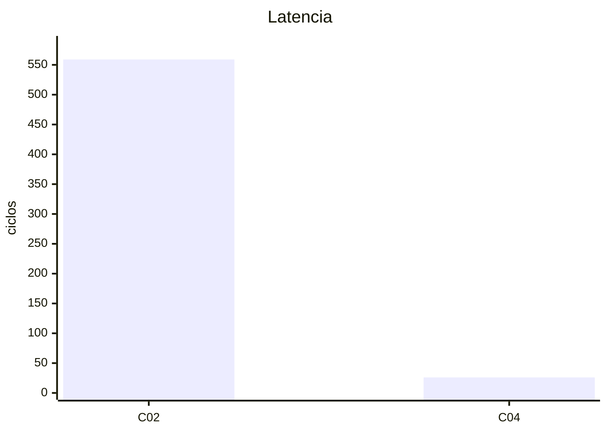
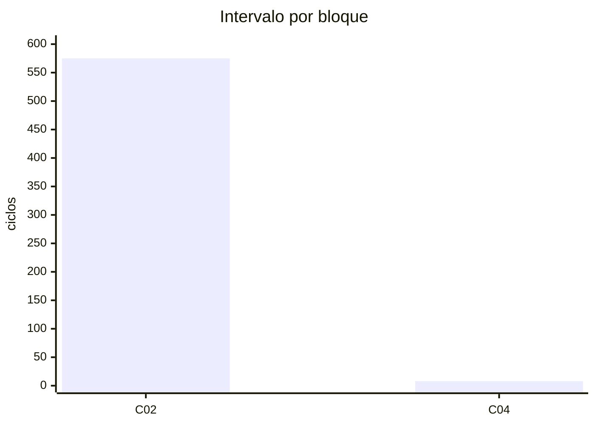
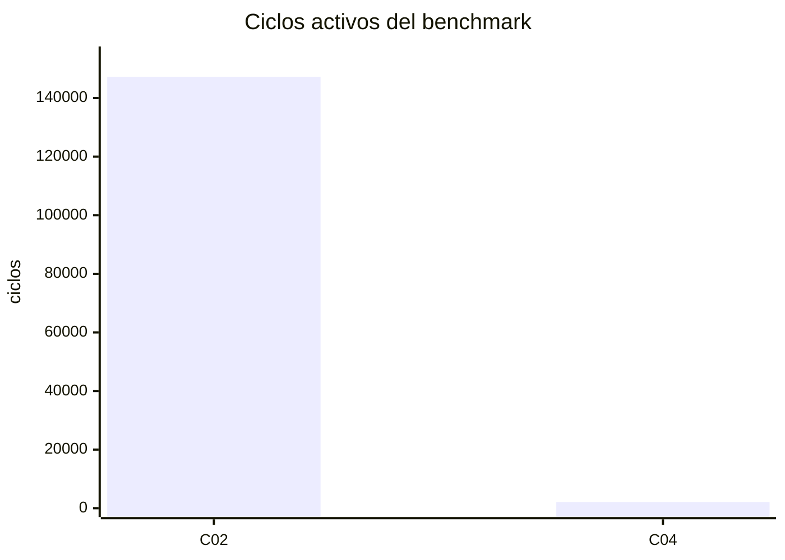
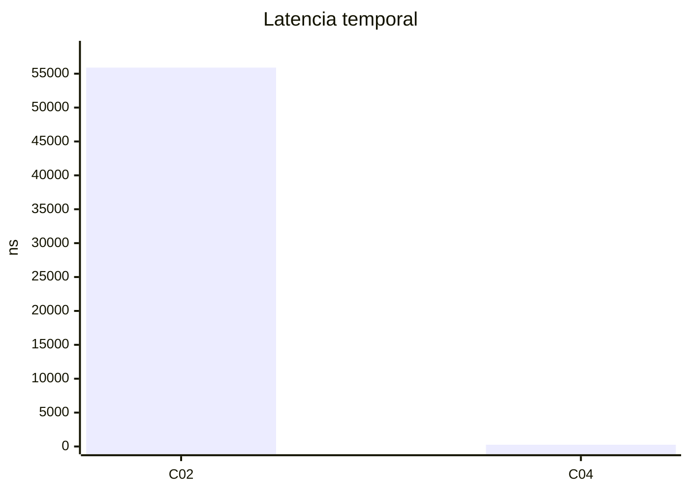
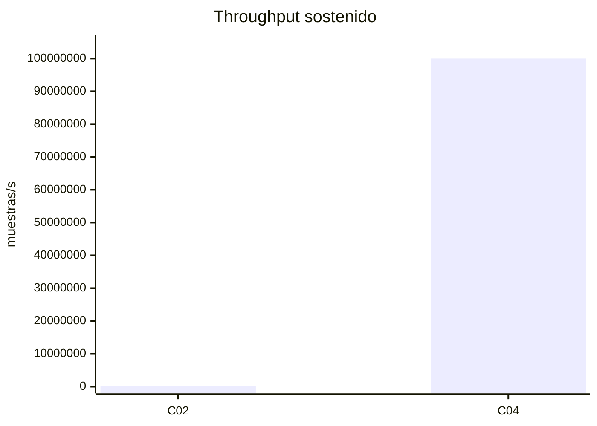
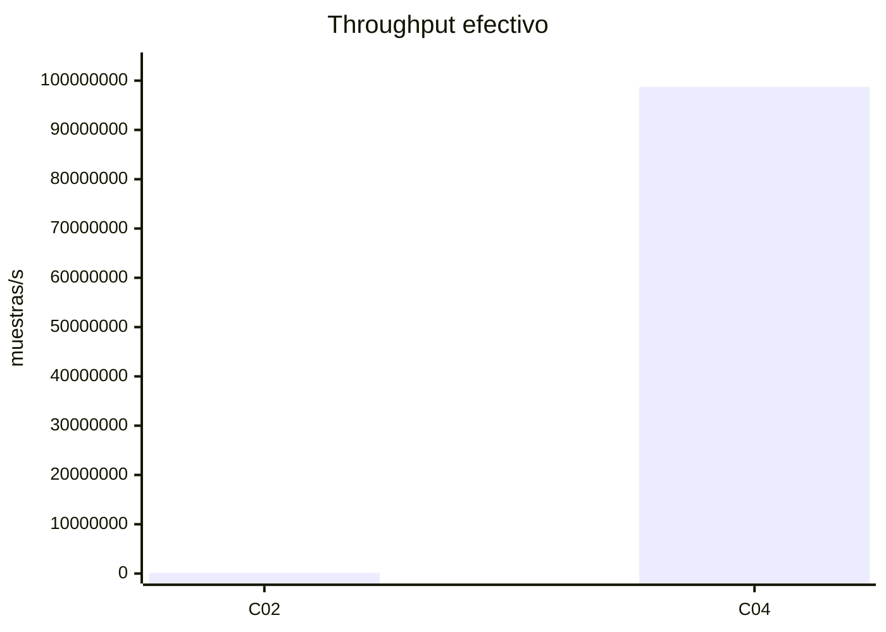
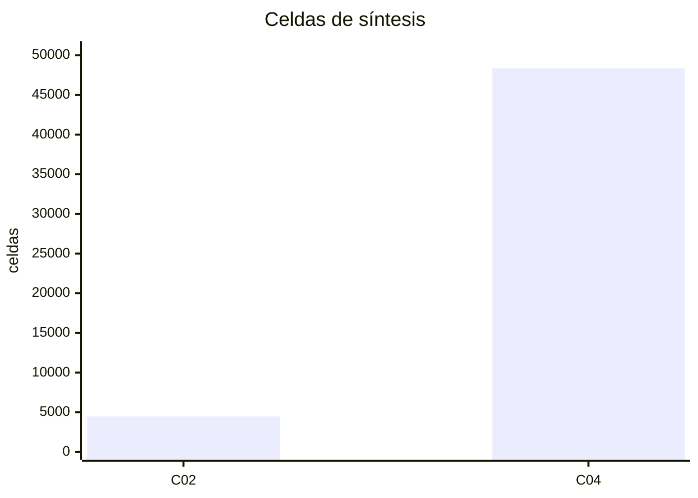
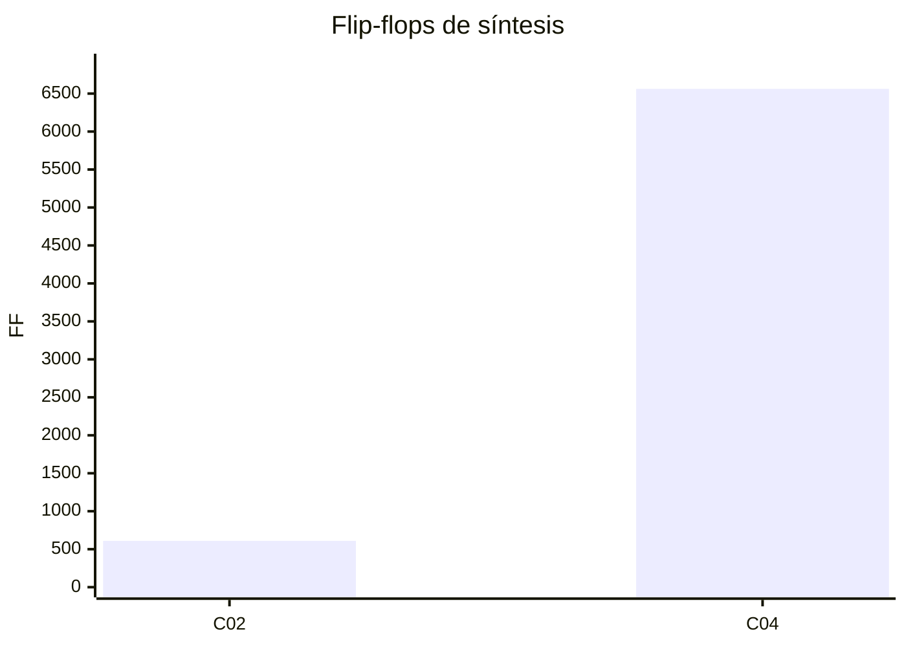
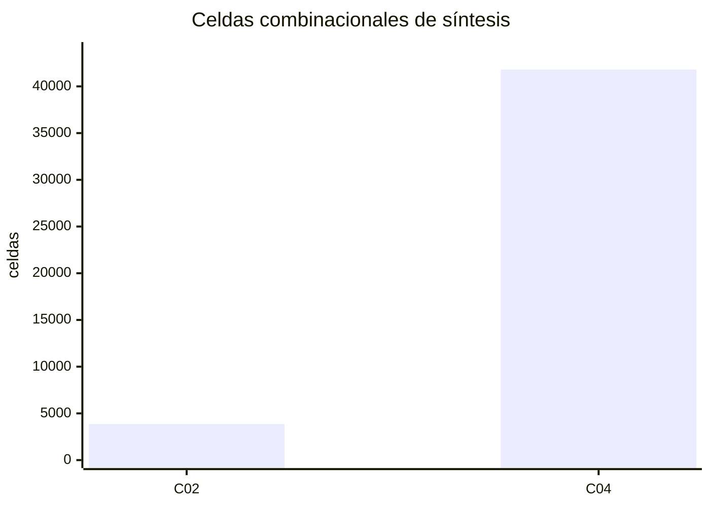

# Resultados PPA de frecuencia: C02 y C04

> **Regla obligatoria de mantenimiento:** mostrar únicamente la **última corrida exitosa de cada variante**. Una nueva corrida reemplaza íntegramente su sección, incluso si reproduce los mismos valores; no se agregan históricos ni resúmenes duplicados. Cada resultado debe enlazar configuración, biblioteca, hashes y logs. Las corridas anteriores permanecen en `build/ppa/`. Una corrida fallida no reemplaza resultados válidos. **Excepción explícita:** conservar la referencia histórica Vivado de C02 al final, identificada como FPGA.

Medición vigente: **ASIC SKY130 HD, 130 nm, TT / 25 °C / 1,8 V**, mediante Yosys.
La simulación RTL y la síntesis miden aspectos distintos: ciclos y exactitud por
un lado; celdas y área Liberty por el otro. Timing físico y potencia ASIC no están
medidos. Los objetivos de 10 MHz (C02) y 100 MHz (C04) no son frecuencias alcanzadas.

[Procedimiento y comandos](../../docs/frecuencia/ppa.md).

<!-- serial-analysis:start -->
## Comparación de arquitecturas

C02 comparte un motor: FFT16 (224 ciclos), producto espectral (96),
reordenamiento (6), IFFT16 (224) y preparación/emisión (25), total **575 ciclos
por bloque de ocho**. C04 despliega FFT, producto e IFFT con pipeline y bancos
dobles, para un intervalo de **8 ciclos por bloque** sin pausas.

El throughput sostenido se compara como `8 × f_clk / II_bloque`. A igual reloj,
la ganancia arquitectónica es `575/8 = 71,875×`. Comparar los objetivos de
10 y 100 MHz agrega otro factor diez, condicionado al cierre temporal ASIC.
La latencia de 559 frente a 26 ciclos es una métrica distinta del intervalo.

El área SKY130 se compara únicamente entre mediciones hechas con la misma
biblioteca, corner y flujo. Las cifras LUT/DSP de Vivado describen una FPGA y no
se convierten en área ASIC. Los bancos sin macros SRAM se sintetizan a registros
y lógica. La potencia y la energía por muestra requieren una evaluación posterior.
<!-- serial-analysis:end -->

## Última corrida C02 — frecuencia serial

<!-- serial-runs:start -->

<!-- serial-measurement:179d3c94f3fa36caff5acd295626c5179a0b6a644bb4dfde81e2b0430d1fca5d -->
### Frecuencia serial — corrida `20261022T111500117337Z-ee4a4eb1` (SKY130)

**PASS RTL, síntesis ASIC y simulación funcional de netlist SKY130. Timing físico y potencia no medidos.**

| Configuración | Valor |
|---|---|
| Commit base | `ee4a4eb1596519f412b13d8871df0a5ae64ed28b` |
| Cambios locales al iniciar | Sí; fuentes identificadas por hashes |
| Top | `fir_frequency_serial` |
| Tecnología / biblioteca | SKY130, 130 nm / `sky130_fd_sc_hd` |
| Corner | TT, 25 °C, 1,8 V |
| Liberty SHA256 | `8e78e14442062dba34d414fca6490b2f6b96038d4510d1438ca44fee31487135` |
| Flujo | Yosys aplanado + dfflibmap + ABC; sin placement ni routing |
| Reloj de simulación / objetivo | 10 MHz / 100 ns; sin cierre temporal demostrado |
| Formatos I/Q | Entrada 2/F0; trabajo 12/F5; constantes 10/F8; salida 9/F7 |
| Benchmark | QPSK 2×, semilla 1, 1024 símbolos, 2048 muestras; sin pausas |
| Yosys | `Yosys 0.52 (git sha1 fee39a3284c90249e1d9684cf6944ffbbcbb8f90)` |
| Icarus | `Icarus Verilog version 12.0 (stable) ()` |

#### Resultados actuales

| Medición | Resultado |
|---|---:|
| Muestras aceptadas / exactas | 2048 / 2048 |
| Latencia | 559 ciclos |
| Intervalo por bloque de ocho muestras | 575 ciclos |
| Ciclos activos del benchmark | 147200 |
| Throughput sostenido al reloj supuesto | 139130.435 muestras/s |
| Throughput efectivo al reloj supuesto | 139130.435 muestras/s |
| Celdas estándar totales | 4474 |
| Flip-flops | 610 |
| Celdas combinacionales | 3864 |
| Área de celdas | 38448.124800 µm² |

La regresión común `smoke` pasó antes del benchmark. La netlist mapeada también
verificó las 2048 salidas y reprodujo exactamente las métricas RTL usando los
modelos funcionales SKY130, sin retardos ni SDF. Esta prueba no verifica timing.
El área es la suma de áreas
Liberty de las instancias mapeadas, no el área final de un chip. Los bancos se
mapean a lógica y registros; no se incluyen macros SRAM. La síntesis no impone
un objetivo de retardo a ABC: no demuestra 10/100 MHz ni produce WNS/Fmax.
Las tasas en muestras/s suponen el reloj indicado; los ciclos se miden en RTL.

Pendientes ASIC: STA con restricciones de reloj/E/S, setup/hold, implementación
física con parasíticos y potencia con actividad representativa. Una corrida
Vivado posterior mide FPGA y se informa como referencia separada.

#### Evidencia reproducible

- [Manifiesto, versiones y hashes](../../build/ppa/frequency_serial/20261022T111500117337Z-ee4a4eb1/manifest.json).
- [Métricas RTL](../../build/ppa/frequency_serial/20261022T111500117337Z-ee4a4eb1/local_metrics.json) y [celdas/área por tipo](../../build/ppa/frequency_serial/20261022T111500117337Z-ee4a4eb1/resources.json).
- [Métricas de netlist](../../build/ppa/frequency_serial/20261022T111500117337Z-ee4a4eb1/gate_metrics.json) y [log del benchmark de netlist](../../build/ppa/frequency_serial/20261022T111500117337Z-ee4a4eb1/logs/gate_benchmark.log).
- [Estadística Yosys original](../../build/ppa/frequency_serial/20261022T111500117337Z-ee4a4eb1/cells.json) y [netlist SKY130](../../build/ppa/frequency_serial/20261022T111500117337Z-ee4a4eb1/mapped.v).
- [Script de la corrida](../../build/ppa/frequency_serial/20261022T111500117337Z-ee4a4eb1/synthesis.ys) y [biblioteca utilizada](../../build/ppa/frequency_serial/20261022T111500117337Z-ee4a4eb1/sky130_fd_sc_hd__tt_025C_1v80.lib).
- [Log de síntesis](../../build/ppa/frequency_serial/20261022T111500117337Z-ee4a4eb1/logs/yosys.log) y [benchmark](../../build/ppa/frequency_serial/20261022T111500117337Z-ee4a4eb1/logs/benchmark.log).
- [Regresión Python](../../build/ppa/frequency_serial/20261022T111500117337Z-ee4a4eb1/logs/regression/python-tests.log) y [regresión C02/C04](../../build/ppa/frequency_serial/20261022T111500117337Z-ee4a4eb1/logs/regression/).
- [Onda de los primeros cuatro bloques](../../build/ppa/frequency_serial/20261022T111500117337Z-ee4a4eb1/first_blocks.vcd).
- [Procedimiento](../../docs/frecuencia/ppa.md).

Sólo esta última corrida exitosa ocupa la sección; las anteriores permanecen en `build/ppa/`.

<!-- serial-runs:end -->

## Última corrida C04 — frecuencia optimizada

<!-- optimized-runs:start -->

<!-- optimized-measurement:f4e845ec0e39190c0d239507506605a7d1474595a335ef734cb0fc8a9df24989 -->
### Frecuencia optimizada — corrida `20261022T111804284811Z-ee4a4eb1` (SKY130)

**PASS RTL, síntesis ASIC y simulación funcional de netlist SKY130. Timing físico y potencia no medidos.**

| Configuración | Valor |
|---|---|
| Commit base | `ee4a4eb1596519f412b13d8871df0a5ae64ed28b` |
| Cambios locales al iniciar | Sí; fuentes identificadas por hashes |
| Top | `fir_frequency_optimized` |
| Tecnología / biblioteca | SKY130, 130 nm / `sky130_fd_sc_hd` |
| Corner | TT, 25 °C, 1,8 V |
| Liberty SHA256 | `8e78e14442062dba34d414fca6490b2f6b96038d4510d1438ca44fee31487135` |
| Flujo | Yosys aplanado + dfflibmap + ABC; sin placement ni routing |
| Reloj de simulación / objetivo | 100 MHz / 10 ns; sin cierre temporal demostrado |
| Formatos I/Q | Entrada 2/F0; trabajo 12/F5; constantes 10/F8; salida 9/F7 |
| Benchmark | QPSK 2×, semilla 1, 1024 símbolos, 2048 muestras; sin pausas |
| Yosys | `Yosys 0.52 (git sha1 fee39a3284c90249e1d9684cf6944ffbbcbb8f90)` |
| Icarus | `Icarus Verilog version 12.0 (stable) ()` |

#### Resultados actuales

| Medición | Resultado |
|---|---:|
| Muestras aceptadas / exactas | 2048 / 2048 |
| Latencia | 26 ciclos |
| Intervalo por bloque de ocho muestras | 8 ciclos |
| Ciclos activos del benchmark | 2074 |
| Throughput sostenido al reloj supuesto | 100000000.000 muestras/s |
| Throughput efectivo al reloj supuesto | 98746383.799 muestras/s |
| Celdas estándar totales | 48353 |
| Flip-flops | 6562 |
| Celdas combinacionales | 41791 |
| Área de celdas | 383355.168000 µm² |

La regresión común `smoke` pasó antes del benchmark. La netlist mapeada también
verificó las 2048 salidas y reprodujo exactamente las métricas RTL usando los
modelos funcionales SKY130, sin retardos ni SDF. Esta prueba no verifica timing.
El área es la suma de áreas
Liberty de las instancias mapeadas, no el área final de un chip. Los bancos se
mapean a lógica y registros; no se incluyen macros SRAM. La síntesis no impone
un objetivo de retardo a ABC: no demuestra 10/100 MHz ni produce WNS/Fmax.
Las tasas en muestras/s suponen el reloj indicado; los ciclos se miden en RTL.

Pendientes ASIC: STA con restricciones de reloj/E/S, setup/hold, implementación
física con parasíticos y potencia con actividad representativa. Una corrida
Vivado posterior mide FPGA y se informa como referencia separada.

#### Evidencia reproducible

- [Manifiesto, versiones y hashes](../../build/ppa/frequency_optimized/20261022T111804284811Z-ee4a4eb1/manifest.json).
- [Métricas RTL](../../build/ppa/frequency_optimized/20261022T111804284811Z-ee4a4eb1/local_metrics.json) y [celdas/área por tipo](../../build/ppa/frequency_optimized/20261022T111804284811Z-ee4a4eb1/resources.json).
- [Métricas de netlist](../../build/ppa/frequency_optimized/20261022T111804284811Z-ee4a4eb1/gate_metrics.json) y [log del benchmark de netlist](../../build/ppa/frequency_optimized/20261022T111804284811Z-ee4a4eb1/logs/gate_benchmark.log).
- [Estadística Yosys original](../../build/ppa/frequency_optimized/20261022T111804284811Z-ee4a4eb1/cells.json) y [netlist SKY130](../../build/ppa/frequency_optimized/20261022T111804284811Z-ee4a4eb1/mapped.v).
- [Script de la corrida](../../build/ppa/frequency_optimized/20261022T111804284811Z-ee4a4eb1/synthesis.ys) y [biblioteca utilizada](../../build/ppa/frequency_optimized/20261022T111804284811Z-ee4a4eb1/sky130_fd_sc_hd__tt_025C_1v80.lib).
- [Log de síntesis](../../build/ppa/frequency_optimized/20261022T111804284811Z-ee4a4eb1/logs/yosys.log) y [benchmark](../../build/ppa/frequency_optimized/20261022T111804284811Z-ee4a4eb1/logs/benchmark.log).
- [Regresión Python](../../build/ppa/frequency_optimized/20261022T111804284811Z-ee4a4eb1/logs/regression/python-tests.log) y [regresión C02/C04](../../build/ppa/frequency_optimized/20261022T111804284811Z-ee4a4eb1/logs/regression/).
- [Onda de los primeros cuatro bloques](../../build/ppa/frequency_optimized/20261022T111804284811Z-ee4a4eb1/first_blocks.vcd).
- [Procedimiento](../../docs/frecuencia/ppa.md).

Sólo esta última corrida exitosa ocupa la sección; las anteriores permanecen en `build/ppa/`.

<!-- optimized-runs:end -->

<!-- comparison:start -->

## Comparación C02 / C04

Corridas: [C02](../../build/ppa/frequency_serial/20261022T111500117337Z-ee4a4eb1/manifest.json) / [C04](../../build/ppa/frequency_optimized/20261022T111804284811Z-ee4a4eb1/manifest.json). Benchmark: QPSK 2×, semilla 1, 2048 muestras exactas.

Las diferencias porcentuales son (C04/C02 − 1) × 100; un signo positivo no siempre significa mejora.

Síntesis lógica y ciclos RTL. Los relojes de 10/100 MHz son supuestos, **sin timing físico demostrado**. Potencia y energía no medidas.

| Métrica | Unidad | C02 | C04 | Cambio C04/C02 | Condición / procedencia |
|---|---|---:|---:|---:|---|
| Muestras aceptadas | muestras | 2048 | 2048 | 0 % | local_metrics.json / resources.json |
| Muestras exactas | muestras | 2048 | 2048 | 0 % | local_metrics.json / resources.json |
| Reloj configurado | MHz | 10 | 100 | 900 % | Objetivos propios, 10/100 MHz; hipotético si timing FAIL |
| Latencia | ciclos | 559 | 26 | -95.348837 % | local_metrics.json / resources.json |
| Intervalo por bloque | ciclos | 575 | 8 | -98.608696 % | local_metrics.json / resources.json |
| Ciclos activos del benchmark | ciclos | 147200 | 2074 | -98.591033 % | local_metrics.json / resources.json |
| Latencia temporal | ns | 55900 | 260 | -99.534884 % | Objetivos propios, 10/100 MHz; hipotético si timing FAIL |
| Throughput sostenido | muestras/s | 139130.434783 | 1e+08 | 71775 % | Objetivos propios, 10/100 MHz; hipotético si timing FAIL |
| Throughput efectivo | muestras/s | 139130.434783 | 9.87464e+07 | 70873.963356 % | Objetivos propios, 10/100 MHz; hipotético si timing FAIL |
| Celdas de síntesis | celdas | 4474 | 48353 | 980.755476 % | local_metrics.json / resources.json |
| Flip-flops de síntesis | FF | 610 | 6562 | 975.737705 % | local_metrics.json / resources.json |
| Celdas combinacionales de síntesis | celdas | 3864 | 41791 | 981.547619 % | local_metrics.json / resources.json |
| Área de celdas de síntesis | µm² | 38448.1248 | 383355.168 | 897.071171 % | local_metrics.json / resources.json |
| Área final de celdas | µm² | No medida | No medida | — | physical_metrics.json |
| Área del núcleo | µm² | No medida | No medida | — | physical_metrics.json |
| Área del die | µm² | No medida | No medida | — | physical_metrics.json |
| Potencia interna | W | No medida | No medida | — | Netlist final / SPEF / VCD, TT; objetivos propios |
| Potencia de conmutación | W | No medida | No medida | — | Netlist final / SPEF / VCD, TT; objetivos propios |
| Potencia dinámica | W | No medida | No medida | — | Netlist final / SPEF / VCD, TT; objetivos propios |
| Leakage del núcleo | W | No medida | No medida | — | Netlist final / SPEF / VCD, TT; objetivos propios |
| Potencia total | W | No medida | No medida | — | Netlist final / SPEF / VCD, TT; objetivos propios |
| Energía dinámica por muestra | J/muestra | No medida | No medida | — | Netlist final / SPEF / VCD, TT; objetivos propios |
| Energía total por muestra | J/muestra | No medida | No medida | — | Netlist final / SPEF / VCD, TT; objetivos propios |
| Pines con actividad VCD/reloj/constante | % | No medida | No medida | — | physical_metrics.json |

### Radares normalizados

100 es el mejor valor **de esta pareja** en cada eje. Más afuera es mejor. Beneficios: 100 × valor/máximo; costos: 100 × mínimo/valor. Empate en cero: ambos 100; costo cero frente a costo positivo: 100 frente a 0. La superficie no es una puntuación global. Valores originales en la tabla.

```mermaid
---
config:
  theme: base
  themeVariables:
    cScale0: '#2563eb'
    cScale1: '#ea580c'
    fontSize: 18px
    radar:
      curveOpacity: 0.25
      axisLabelFontSize: 16px
      legendFontSize: 16px
  radar:
    width: 900
    height: 700
    axisScaleFactor: 1
    marginTop: 60
    marginBottom: 60
    marginLeft: 100
    marginRight: 100
    curveTension: 0
---
radar-beta
    title Arquitectura y síntesis
    axis a0["Área síntesis"], a1["FF"], a2["Latencia"], a3["II bloque"]
    curve c02["C02"]{100.00000, 100.00000, 4.65116, 1.39130}
    curve c04["C04"]{10.02937, 9.29595, 100.00000, 100.00000}
    min 0
    max 100
    ticks 5
    showLegend true
```

[Fuente Mermaid](../../build/ppa/comparisons/8f3fdf81fdb9a9d8/radar-arquitectura.mmd) · [SVG compatible](../../build/ppa/comparisons/8f3fdf81fdb9a9d8/radar-arquitectura.svg)

### Barras: objetivos propios

Cada gráfico usa una unidad; menor costo favorece la variante más pequeña.

[Fuente Mermaid](../../build/ppa/comparisons/8f3fdf81fdb9a9d8/latency_cycles.mmd) · [SVG compatible](../../build/ppa/comparisons/8f3fdf81fdb9a9d8/latency_cycles.svg)

| ciclos | C02 | C04 |
|---|---:|---:|
| Latencia | 559 | 26 |

[Fuente Mermaid](../../build/ppa/comparisons/8f3fdf81fdb9a9d8/block_cycles.mmd) · [SVG compatible](../../build/ppa/comparisons/8f3fdf81fdb9a9d8/block_cycles.svg)

| ciclos | C02 | C04 |
|---|---:|---:|
| Intervalo por bloque | 575 | 8 |

[Fuente Mermaid](../../build/ppa/comparisons/8f3fdf81fdb9a9d8/active_cycles.mmd) · [SVG compatible](../../build/ppa/comparisons/8f3fdf81fdb9a9d8/active_cycles.svg)

| ciclos | C02 | C04 |
|---|---:|---:|
| Ciclos activos del benchmark | 147200 | 2074 |

[Fuente Mermaid](../../build/ppa/comparisons/8f3fdf81fdb9a9d8/latency_ns.mmd) · [SVG compatible](../../build/ppa/comparisons/8f3fdf81fdb9a9d8/latency_ns.svg)

| ns | C02 | C04 |
|---|---:|---:|
| Latencia temporal | 55900 | 260 |

[Fuente Mermaid](../../build/ppa/comparisons/8f3fdf81fdb9a9d8/sustained_sps.mmd) · [SVG compatible](../../build/ppa/comparisons/8f3fdf81fdb9a9d8/sustained_sps.svg)

| muestras/s | C02 | C04 |
|---|---:|---:|
| Throughput sostenido | 139130.434783 | 1e+08 |

[Fuente Mermaid](../../build/ppa/comparisons/8f3fdf81fdb9a9d8/effective_sps.mmd) · [SVG compatible](../../build/ppa/comparisons/8f3fdf81fdb9a9d8/effective_sps.svg)

| muestras/s | C02 | C04 |
|---|---:|---:|
| Throughput efectivo | 139130.434783 | 9.87464e+07 |

[Fuente Mermaid](../../build/ppa/comparisons/8f3fdf81fdb9a9d8/cells.mmd) · [SVG compatible](../../build/ppa/comparisons/8f3fdf81fdb9a9d8/cells.svg)

| celdas | C02 | C04 |
|---|---:|---:|
| Celdas de síntesis | 4474 | 48353 |

[Fuente Mermaid](../../build/ppa/comparisons/8f3fdf81fdb9a9d8/flip_flops.mmd) · [SVG compatible](../../build/ppa/comparisons/8f3fdf81fdb9a9d8/flip_flops.svg)

| FF | C02 | C04 |
|---|---:|---:|
| Flip-flops de síntesis | 610 | 6562 |

[Fuente Mermaid](../../build/ppa/comparisons/8f3fdf81fdb9a9d8/combinational_cells.mmd) · [SVG compatible](../../build/ppa/comparisons/8f3fdf81fdb9a9d8/combinational_cells.svg)

| celdas | C02 | C04 |
|---|---:|---:|
| Celdas combinacionales de síntesis | 3864 | 41791 |

[Fuente Mermaid](../../build/ppa/comparisons/8f3fdf81fdb9a9d8/cell_area_um2.mmd) · [SVG compatible](../../build/ppa/comparisons/8f3fdf81fdb9a9d8/cell_area_um2.svg)

| µm² | C02 | C04 |
|---|---:|---:|
| Área de celdas de síntesis | 38448.1248 | 383355.168 |

### Reloj común: 10 MHz

Pendiente: ambas implementaciones deben demostrar timing a 10 MHz. No se grafican datos físicos supuestos.

<!-- comparison:end -->

## Referencia histórica preservada — C02 en Vivado 2024.2

Esta sección corresponde a **FPGA Artix-7**, no a SKY130. Se conserva por pedido
de Enzo como antecedente; el actualizador de corridas locales no la modifica.
No constituye medición ASIC ni puede completar su cierre de timing/potencia.

Resultados informados por el compañero en Windows el **13/10/2026**, sobre
Artix-7 `xc7a35tcpg236-1`, out-of-context, con reloj de 100 ns y el benchmark
A04 de 2048 muestras. Se recibió únicamente su resumen Markdown: **no están
los reportes originales, logs, netlist, SDF ni checkpoint para auditarlos**.
El commit, los hashes y el identificador exacto del paquete ejecutado no fueron
informados; esta evidencia se vincula a la base serial por su configuración
reportada, sin afirmar identidad de fuentes comprobada.

| Métrica | Resultado informado | Procedencia |
|---|---:|---|
| Verificación funcional de 2048 muestras | PASS | Simulación comportamental en Vivado, sin SDF |
| Latencia / ciclos por bloque | 559 / 575 | Simulación comportamental; coincide con la medida local |
| Ciclos activos / throughput a 10 MHz | 147200 / 139130,435 muestras/s | Simulación comportamental |
| Timing interno a 10 MHz | Cumple setup y hold | Implementación routed |
| WNS setup | +82,675 ns | Implementación routed |
| WHS hold | +0,189 ns | Implementación routed |
| Fmax aproximada | 57,72 MHz | Derivada de `1000/(100 − 82,675)`; sin barrido |
| LUT como lógica | 1875 (9,01 %) | Utilización implementada; no se informó LUT total |
| FF / Slice Registers | 569 (1,37 %) | Utilización implementada |
| DSP48E1 | 3 (3,33 %) | Utilización implementada |
| Block RAM | 0 | Utilización implementada |
| CARRY4 / F7+F8 Muxes | 20 / 238 | Utilización implementada |
| Potencia total on-chip | 0,070 W | Estimación vectorless sobre `implemented.dcp` |
| Potencia dinámica | 0,002 W | Estimación vectorless |
| Potencia estática del dispositivo | 0,068 W | Estimación vectorless |
| Energía dinámica por muestra | ≈ 14,4 nJ/muestra | Derivada de potencia vectorless y throughput RTL |
| Confianza de potencia | Media | Según el resumen recibido; actividad interna especificada <25 % |
| Temperatura de juntura / máxima ambiente | 25,4 °C / 84,6 °C | Condiciones por defecto informadas |
| Simulación temporal con SDF | No completó; watchdog a 160000 ciclos | Bloqueo informado en Windows + Vivado 2024.2 |
| Potencia con SAIF | Pendiente | No se obtuvo una simulación temporal completa |
| Caminos sin constraints / detalle del camino crítico | Pendiente de revisión | No se recibieron esos reportes |

La energía vectorless es una referencia provisional. **No se debe usar como
potencia comparable con actividad del benchmark** ni como medida SAIF. Las
cifras de potencia están redondeadas en el resumen recibido. La estática
corresponde al FPGA completo, no solo al filtro.

### Interpretación de la referencia histórica

- **El serial cumple el mínimo de 10 MHz de una variante lenta**, según los
  slacks informados. La Fmax aproximada de 57,72 MHz expresa margen físico y
  no constituye un incumplimiento del serial. Si la candidata se clasifica
  como rápida, deberá verificar el mínimo de 100 MHz en su propia implementación.
  Esa condición no se impone únicamente por llamarla optimizada.
- **FFT e IFFT siguen siendo la primera zona para reducir ciclos**: consumen
  el 77,9 % del bloque. Reducir esos ciclos puede mejorar el throughput incluso
  conservando el reloj de 10 MHz. Si se decide aumentar el reloj, el detalle
  del camino crítico permitirá evaluar dónde simplificar lógica o agregar
  registros; esa decisión depende del objetivo elegido para C03.
- **La base física usa tres DSP, no el único DSP del mapeo Yosys.** Los conteos
  proceden de herramientas distintas; no hay evidencia para atribuir la
  diferencia únicamente a una versión de Vivado. C03 debe partir del costo
  físico informado y medir cómo cambia al paralelizar.
- **La potencia todavía no permite elegir la optimización.** El resumen
  vectorless atribuye aproximadamente toda la dinámica a `u_engine` y un
  97 % del total a la estática del dispositivo. Esa distribución debe
  confirmarse con SAIF y los reportes originales antes de concluir ahorros
  de energía por muestra.

### Incidencias informadas del flujo FPGA

1. Los wrappers `xelab.bat` y `xsim.bat` separaron los argumentos con `=`,
   rompiendo la anotación `-sdfmax` y los `-testplusarg`. El compañero aplicó
   en su copia llamadas directas a los ejecutables de
   `bin/unwrapped/win64.o/`. Ese cambio no está aplicado en los scripts de
   este repositorio.
2. Tras corregir los argumentos, la simulación temporal arrancó pero terminó
   por timeout. El compañero planteó propagación de X por inicialización de
   FF/GSR/`glbl` como causa posible. **La causa no está confirmada** sin los
   logs, la netlist y el SDF; tampoco se ha demostrado que sea un defecto de
   Vivado 2024.2. El PASS comportamental confirma esa prueba funcional, pero
   no sustituye la simulación temporal.
3. La implementación produjo área y timing; el compañero obtuvo potencia
   vectorless por separado desde el checkpoint. El flujo completo con SAIF
   permanece incompleto. No hubo una ejecución temporal previa de Vivado
   validada en esta PC: las comprobaciones previas fueron locales con
   Icarus/Yosys y pruebas Tcl.

### Evidencia histórica

- [Resumen original recibido](../../build/ppa/frequency_serial/20261013-vivado2024.2-recibido/resultados_ppa_frequency_serial.md).
- SHA256 del resumen: `54e01cc87e53d321c744948fbca040b80d9b892c91641bf94fffc647eebfcfcb`.
- [Manifiesto de la base local serial](../../build/ppa/frequency_serial/20261013T220620013563Z-b9bd2183/manifest.json); no se confirmó identidad con las fuentes ejecutadas en Windows.
